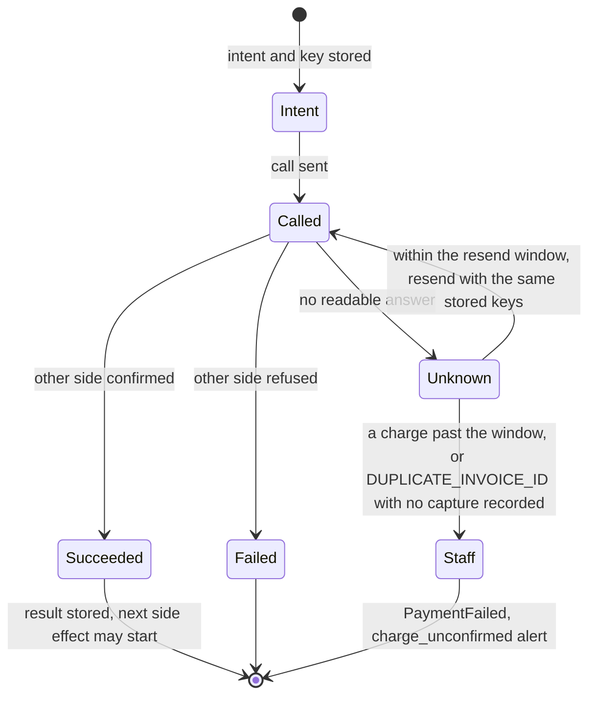

# external-side-effects — calls that change something outside BarPay

Every call that changes something outside BarPay is written so that a timeout, a repeat, or a second request arriving at the same moment never charges, deletes, or notifies differently from a single clean run.
**Not a procedure.** It gives the criteria for judging whether such code is safe, and why each one matters in BarPay.
What BarPay guarantees (single payment, unlock only on payment, store notified) is stated in the PRD and the OpenAPI spec; this skill points to them by name and does not restate them, so that changing the PRD never leaves a second, stale copy here. If writing the code shows that a rule is missing from the PRD, add it to the PRD (both languages) and the spec in the issue that needs it; do not settle it in this skill or in code alone.
How to write tests in general is in `testing`; how to cut the session aggregate and its transitions is in `domain-modeling`.

---

## Three outcomes, not two

A call to PayPal or to the store app has three outcomes — succeeded, failed, unknown — and "unknown" is a state the code stores and acts on, not an error to log and move past.
A timeout, a dropped connection, or a crash between sending and reading the reply all mean the other side may have done the work. Code that maps them to "failed" retries a charge that already went through; code that maps them to "succeeded" unlocks the gate for money that never moved.

- **Model "unknown" in the type the call returns.** A function that returns only `error` or `nil` forces the caller to pick one of the two wrong readings. Broken in BarPay: a timed-out capture read as a failure moves the session to PaymentFailed, staff retry it, and the customer is charged twice.
- **An absent error is not success.** Success is what the other side said: PayPal's status `COMPLETED` with a capture ID, a notification acknowledged by the store app. A response with no error but no capture ID, an unexpected status, or a body that does not parse is "unknown" or "failed", decided from what was actually returned. Broken in BarPay: the gate unlocks and the receipt shows a capture ID that does not exist, so the visit was never paid.
- **The gate waits for the outcome.** While a charge is unknown, the session stays in checking out and the gate stays locked; nothing downstream runs until a resend with the same keys settles it or BarPay hands the session to staff, as the PRD's Use cases, Customer checks out at the exit gate says. Broken in BarPay: a customer walks out on a charge that later turns out declined, and the store has no way to collect.

Read: every path out of "unknown" is a resend with the same stored `PayPal-Request-Id` (and, for a charge, `invoice_id`) or a hand-off to staff; there is no status lookup and no edge from "unknown" to a call with a new key. The window and the hand-off are the PRD's Fixed constraints, Idempotency.

---

## Store first, then call PayPal

For every PayPal call, store the intent and its idempotency keys (and when the attempt was first sent) before sending it, and resolve an unknown outcome by resending with those stored keys.
A key that exists only in memory is gone after a crash or restart, and the code can then not repeat the call safely. Broken in BarPay: after a restart in the middle of a capture, BarPay sends a second capture with a fresh key and the member pays twice.

- **Which retries reuse a key and which start a new one is the PRD's Fixed constraints, Idempotency.** It decides what the key is derived from and which kind of retry is a new attempt. Write the derivation in one function and use it everywhere; do not invent a key per call site. Broken in BarPay: a network retry with a new key charges twice; a staff retry that reuses the old key counts its resend window from the earlier attempt's first send, which may already be over.
- **Resend, do not look up, every time the outcome is unknown.** Send the same request with the same stored `PayPal-Request-Id` and `invoice_id`, only within the resend window, and stop and hand the session to staff when the PRD's Fixed constraints, Idempotency says to; a lost or refused charge leaves no order ID to look up. Broken in BarPay: a resend with a new `PayPal-Request-Id` or `invoice_id` charges a capture that PayPal completed late a second time, or a resend past the window gets `DUPLICATE_INVOICE_ID` and the session is marked paid with no capture ID on the receipt.
- **Saving and deleting a saved PayPal follow the same rule as charging.** A save whose answer was lost can leave a vault entry the member does not know about; a delete whose answer was lost can leave a saved PayPal BarPay thinks is gone. Broken in BarPay: a member who deleted their saved PayPal is still chargeable, or a member is told linking failed while PayPal holds a saved PayPal for them.

---

## Notifications are safe to send again

For a call that only tells you whether it arrived — a signed notification to the store app — design it to be sent more than once and let the receiver discard duplicates.
There is no status to query: an unacknowledged notification may still have been processed. Exactly-once delivery is impossible here, so the guarantee is at-least-once with something the receiver can deduplicate on. Broken in BarPay: the store app gets the same `session.closed` twice with nothing to tell them apart and prints two receipts, or BarPay stops resending to avoid duplicates and the store app never learns a charge failed.

- **The event ID and sequence number are fixed when the event is stored, not when it is sent.** A resend carries the same ID, sequence and body, so the receiver can drop it. Broken in BarPay: each retry looks like a new event and the store app records the same payment several times.
- **The store app's acknowledgement is the only success.** A send that returned no error but got no acknowledgement is retried on the schedule in the PRD's Responsibilities, Notifications. Broken in BarPay: a notification lost in transit is marked delivered and never resent.

---

## Store the result before the next side effect

When one side effect leads to another, store the first one's result before starting the second: store the capture ID, then notify and unlock.
If the process stops between the two, what was stored is the only record of what happened. Broken in BarPay: the gate unlocks and the notification goes out, BarPay restarts before saving the capture ID, and the session is checked out again at the next scan — a second charge with no receipt for the first.

- **Each later effect reads its input from what was stored, not from a variable in memory.** Then a restart resumes from the stored state and runs each remaining effect once. Broken in BarPay: after a restart the unlock or the notification is skipped because the value it needed was only in memory, and staff see a paid session with a locked gate.
- **A failed later effect does not undo an earlier one.** A charge that succeeded stands even when unlocking fails; what follows is the PRD's Use cases, Customer checks out at the exit gate. Broken in BarPay: an unlock failure rolls the session back to active and the next scan charges again.

---

## One place decides every state change of a session

A session receives operations from several entry points at once — the exit gate, the store server's admin operations (close, retry, settle outside BarPay, mark unpaid, record a register payment), the maximum stay, the register request, and late orders — so every state change is decided in one place, and "only once" is held by a unique constraint or a conditional state transition in the store, not by a mutex.
A mutex lives in one process and disappears on restart; a check in each handler lets two handlers both see "active" and both act. Broken in BarPay: a scan at the gate and a staff close arrive together, both see the session active, and both charge.

- **Move the state with a conditional update and act only if it moved.** "Set checking out where state is active" either changes one row or none; the caller that changed none stops. The allowed transitions are the ones in the PRD's Use cases state diagram. Broken in BarPay: a register request arriving during a charge also fixes a total and marks the session at the register, and staff collect cash from a customer PayPal already charged.
- **Handlers do not test the state and then write it.** Reading the state, deciding in code, and then writing leaves a gap another request falls into. Broken in BarPay: a late order is added after the final total is fixed, and the receipt no longer equals the amount charged.
- **Concurrent callers of the same operation get the same result.** Two scans of the same exit QR run one checkout and both see its outcome (the PRD's Use cases, Customer checks out at the exit gate). Broken in BarPay: the second scan shows "Please see staff" to a customer who has just paid.

---

## The store app's `Idempotency-Key`

The store app's server may resend the same request after a failure, so admin and store requests that carry an `Idempotency-Key` follow the OpenAPI spec's `IdempotencyKey` parameter exactly: what a repeat returns, when a reused key is rejected, what happens while the first is still running, and when nothing is kept.
The spec is the contract the store app was written against; a handler that improvises gives the store app a different answer for the same situation. Broken in BarPay: a staff retry resent after a timeout starts a second PayPal attempt, or a resend that should be rejected as in progress waits and runs again after the first finishes.

- **Store the key with the state change in the same transaction.** The key and the session's move to checking out are written together, so a resend sees either both or neither. Broken in BarPay: the key is stored but the transition is lost in a crash, and every resend returns a "success" for a charge that never ran.

---

## Concurrent rate-evaluation requests become one evaluation

Rate evaluations requested at the same time are merged into one evaluation, and every request gets that evaluation's result, as the PRD's Pricing model, Evaluation on request says, including how the minimum interval applies.
An evaluation calls the local LLM and changes the published rate; running two at once publishes two rates, each moving by up to the max step. Broken in BarPay: the rate moves twice the max step in one moment, outside the PRD's Guarantees, Price bounds.

---

## How to prove it

Prove these criteria with a fake PayPal and a fake store app that can be told to misbehave, and with requests sent concurrently, not with the real sandbox and not by reading the code.
The failures above happen only in timing and partial outcomes that the real services rarely produce on demand; a test that cannot produce them proves nothing about them.

| Situation to reproduce | What the test asserts |
|---|---|
| The charge succeeds but the reply never arrives | BarPay resends with the same `PayPal-Request-Id` and `invoice_id`, gets the same capture back, closes the session with that capture ID, and PayPal saw exactly one capture |
| No answer until the resend window ends, or a resend gets `DUPLICATE_INVOICE_ID` with no capture recorded | BarPay sends nothing more; the session is PaymentFailed with a `charge_unconfirmed` alert; the fake clock is checked on both sides of the window's end |
| The same call is made twice at the same time | PayPal saw one call per key; one session transition happened; both callers got the same result |
| Another operation arrives during a charge (staff close, register request, late order, maximum stay) | The second operation is rejected or has no effect (maximum stay), as the PRD's Guarantees, Single payment and Use cases say; the total charged equals the receipt |
| The same `Idempotency-Key` is sent again, after success and while still running | The repeat gets the first response or is rejected as in progress, as the `IdempotencyKey` parameter says; no second PayPal attempt |
| Two rate-evaluation requests arrive together | The fake model was called once; both requests got the same rate |
| The store app does not acknowledge a notification | It is resent with the same event ID and sequence; an acknowledged one is not resent |

- **Assert on what the fake service received, not only on BarPay's state.** "PayPal saw one capture" is the guarantee; "the session is closed" is also true when it saw two. Broken in BarPay: the test passes while the member is charged twice.
- **Run concurrent tests with the race detector and many repetitions.** A race that loses one time in a hundred passes a single run. Broken in BarPay: the double charge appears only under load, in production.
