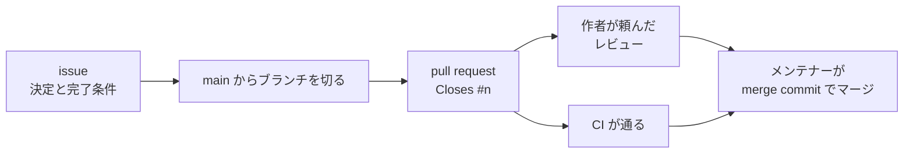

# BarPay への貢献

> `CONTRIBUTING.md` の日本語訳。内容が食い違う場合は `CONTRIBUTING.md` が正。

`main` にマージされる変更はすべて、1 つの issue を閉じ、作者が頼んだレビューを受け、CI を通った pull request を通して入る。

## issue からマージまで

作業は、何を決めたかと何をもって終わりとするかを書いた issue から始まり、それを閉じる pull request をメンテナーがマージして終わる。



図から読み取ること：pull request は、レビューと CI の両方が済んで初めてマージされる。

- **`main` にマージする変更は、先に issue を立てる。** 外部から変更を提案するときも同じ。issue の無い pull request には、照らし合わせる相手が無い。
- **`main` にマージされる pull request は、1 つの issue を閉じる。** 本文に `Closes #<番号>` と書く。作業の途中で別の決定が要ると分かったら、最初の issue を広げずに 2 つ目の issue を立てる。
- **`main` に直接 push しない。** 誤字の修正でも同じ。CI とレビューは pull request の上で行われ、変更の理由は pull request の本文に残る。

## ブランチ

最新の `main` からブランチを切り、`<種類>/<内容>` と名付ける。内容は小文字の単語を `-` でつなぐ。

| 種類 | 使う場面 | 例 |
|---|---|---|
| `feat` | BarPay、開発用ツール、サンプルアプリの振る舞いを足す・変える | `feat/exit-gate-charge` |
| `fix` | コードを文書に書かれた振る舞いに戻すバグの修正 | `fix/rate-rounding` |
| `refactor` | 振る舞いを変えないコードの変更 | `refactor/session-store` |
| `docs` | 文書だけ | `docs/api-spec` |
| `ci` | CI のワークフローと、それが動かすスクリプト | `ci/checks` |
| `chore` | 振る舞いを変えないそれ以外のもの：依存の更新、リポジトリの設定やツール | `chore/update-dependencies` |
| `tmp` | 検査が通る・落ちることを示す使い捨てのブランチ。pull request はマージせずに閉じ、その後ブランチを消す | `tmp/ci-fail-pair` |

マージするブランチの種類は、issue が何についてのものかで選ぶ。1 つのブランチに 2 つの種類が要りそうなら、たいてい issue が 2 つある。

## コミット

各コミットは 1 つの意図だけを持ち、単独で revert や cherry-pick をしても意味が通るようにする。

- **件名：** 何が変わるかを言う、英語の命令形の 1 文。末尾にピリオドを付けない。例：`Add the admin and pricing operations to the API contract`。
- **本文：** なぜ変えるか。制約、捨てた案、戻すと何が壊れるか。差分を見れば分かることは書かない。
- **テストはコードと一緒に。** テストと、それを通す実装は同じコミットに入れる。
- **両方の言語を一緒に。** 文書とその訳は同じコミットで変える。例外が 1 つある（[2 つの言語の文書](#2-つの言語の文書)を参照）。

自分のブランチは、マージされるまで書き換えてよい（amend、rebase、force-push）。レビューの指摘で直したものは「レビュー対応」のコミットとして積まず、それが属するコミットに取り込む。`main` と、他の人もコミットしているブランチは書き換えない。

## pull request とレビュー

`main` にマージされる pull request はすべて先にレビューを受け、メンテナーのマージが承認になる。

- **本文の見出し**は、この順に：何を変えたか（What changed） / なぜ（Why） / どう確かめたか（How it was checked） / 残した注意（What is left to watch）。issue が pull request に任せた決定は「なぜ」に書く。
- **issue の見出し**は、この順に：背景（Background） / 決定と理由（Decisions and reasons） / 内容（Contents） / 完了条件（Completion criteria） / やらないこと（Out of scope） / 関連（Related）。
- **英語で書くとき**は、括弧の英語の見出しを同じ順に使う。
- **ブランチが整ってからレビューを頼む。** issue の完了条件をすべて自分で確かめてから頼み、それぞれをどう確かめたかを本文に書く。
- **レビューする人：** ほかの貢献者の pull request は、メンテナーがレビューする。メンテナー自身の pull request は、マージの前に作者が頼んだレビューを受け、その結果を pull request の「どう確かめたか」かコメントに残す。

## マージ

pull request は merge commit でマージし、squash と rebase のマージは使わない。

ブランチの各コミットはすでに 1 つの意図になっているので、merge commit ならレビューされたときのまま `main` に残る。squash はその履歴を捨て、rebase のマージは、それらのコミットを pull request に結び付ける merge commit を残さない。

## 言語

文章の種類ごとに言語を決める。ただし、メンテナー以外の貢献者からの issue と pull request は英語でもよい。

| 対象 | 言語 | 理由 |
|---|---|---|
| コミットメッセージ | 英語 | 履歴は、`git log` や `git blame` を通して、リポジトリを使うすべての人に読まれる |
| issue と pull request | 日本語。ほかの貢献者からは英語も受け付ける | メンテナーは日本語で作業する。ほかの人に日本語を求めると、貢献できなくなる |
| コード、コメント、識別子 | 英語 | コミットメッセージと同じ理由 |
| Markdown の文書 | 英語と、その日本語訳 | [2 つの言語の文書](#2-つの言語の文書)を参照 |

## 2 つの言語の文書

すべての Markdown の文書には、隣に日本語訳がある。決まりは [`.claude/skills/bilingual-docs/SKILL.md`](.claude/skills/bilingual-docs/SKILL.md) に、検査は [`scripts/check-bilingual-docs.sh`](scripts/check-bilingual-docs.sh) にある。

日本語の側を書けないときは、英語のファイルだけを変え、そのことを pull request に書く。メンテナーがマージの前に訳を足す（[skill の例外](.claude/skills/bilingual-docs/SKILL.md)を参照）。英語だけの新しい文書は、訳を足すまで CI が失敗する。

## 検査を手元で走らせる

レビューを頼む前に、CI と同じ検査を走らせる。スクリプトがある検査はそのスクリプトを、無い検査は該当するワークフローのステップを実行する。

- **スクリプトがある検査：** [`scripts/`](scripts/) のスクリプトを実行する。例：

  ```sh
  scripts/check-bilingual-docs.sh
  ```

- **スクリプトが無い検査：** [`.github/workflows/`](.github/workflows/) でその検査のワークフローを開き、`uses:` のステップが用意するツールを入れて、`run:` のステップにあるコマンドをリポジトリの直下で実行する。ワークフローは検査の対象で名付けてある（`ci-<対象>.yaml`）ので、変えたファイルに対応するものを選ぶ。

何をどの版のツールで検査するかは、ワークフローとスクリプトが正。手元で通って CI で落ちるときは CI を信じ、手元のツールをワークフローが用意する版と比べる。
