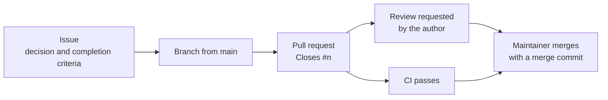

# Contributing to BarPay

`CONTRIBUTING.ja.md` is the Japanese translation of this file.

Every change that is merged into `main` arrives through a pull request that closes one issue, has had the review its author requested, and passes CI.

## From issue to merge

Work starts from an issue that states what is decided and how to tell it is done, and ends when the maintainer merges the pull request that closes it.



What to read from the diagram: a pull request is merged only when both the review and CI are done.

- **Open an issue first** for every change that is to be merged into `main`, including one you want to propose from outside. A pull request without an issue has nothing to be checked against.
- **Every pull request that is merged into `main` closes one issue.** Write `Closes #<number>` in the body. If the work turns out to need a second decision, open a second issue rather than widening the first.
- **No direct pushes to `main`**, not even for a typo. CI and review happen on the pull request, and the pull request body is where the reason for the change is kept.

## Branches

Branch from the latest `main` and name the branch `<kind>/<topic>`, with the topic in lowercase words joined by `-`.

| Kind | Use it for | Example |
|---|---|---|
| `feat` | New or changed behaviour of BarPay, the development tools or the example app | `feat/exit-gate-charge` |
| `fix` | A bug fix that brings the code back in line with the documented behaviour | `fix/rate-rounding` |
| `refactor` | A change to code that does not change behaviour | `refactor/session-store` |
| `docs` | Documents only | `docs/api-spec` |
| `ci` | CI workflows and the scripts they run | `ci/checks` |
| `chore` | Anything else that does not change behaviour: dependency updates, repository settings and tooling | `chore/update-dependencies` |
| `tmp` | A throwaway branch to show a check passes or fails; its pull request is closed, never merged, and the branch is deleted afterwards | `tmp/ci-fail-pair` |

For a branch that is to be merged, pick the kind from what the issue is about. If a branch seems to need two kinds, it is usually two issues.

## Commits

Each commit holds one intent, so that it can be reverted or cherry-picked on its own and still make sense.

- **Subject:** one English sentence in the imperative mood that says what changes, with no trailing period. For example: `Add the admin and pricing operations to the API contract`.
- **Body:** why the change is made — the constraint, the option you rejected, what breaks if it is undone. Leave out what the diff already shows.
- **Tests with the code.** A test and the implementation that makes it pass go in the same commit.
- **Both languages together.** A document and its translation change in the same commit, with one exception (see [Documents in two languages](#documents-in-two-languages)).

You may rewrite your own branch (amend, rebase, force-push) until it is merged. Fold fixes from review into the commit they belong to instead of adding a "review fixes" commit. Never rewrite `main`, or a branch someone else is also committing to.

## Pull requests and review

Every pull request that is merged into `main` is reviewed first, and the maintainer's merge is the approval.

- **Body headings**, in this order: 何を変えたか (What changed) / なぜ (Why) / どう確かめたか (How it was checked) / 残した注意 (What is left to watch). Put the decisions the issue left to the pull request under なぜ.
- **Issue headings**, in this order: 背景 (Background) / 決定と理由 (Decisions and reasons) / 内容 (Contents) / 完了条件 (Completion criteria) / やらないこと (Out of scope) / 関連 (Related).
- **Writing in English**, use the English headings in brackets, in the same order.
- **Ask for review when the branch is ready.** Check every completion criterion of the issue yourself first, and say in the body how you checked each one.
- **Who reviews:** the maintainer reviews pull requests from other contributors. The maintainer's own pull requests get a review the author requests before merging, and its result is recorded in the pull request, under どう確かめたか or in a comment.

## Merging

Pull requests are merged with a merge commit; squash and rebase merges are not used.

Each commit on the branch is already one intent, so a merge commit keeps them on `main` as they were reviewed. Squashing would throw that history away, and a rebase merge would drop the merge commit that ties those commits to their pull request.

## Language

Each kind of text has a fixed language, except that issues and pull requests from contributors other than the maintainer may also be in English.

| What | Language | Why |
|---|---|---|
| Commit messages | English | The history is read by everyone who uses the repository, through `git log` and `git blame` |
| Issues and pull requests | Japanese; English is also accepted from other contributors | The maintainer works in Japanese. Asking others to write Japanese would keep them from contributing |
| Code, comments and identifiers | English | Same reason as commit messages |
| Markdown documents | English with a Japanese translation | See [Documents in two languages](#documents-in-two-languages) |

## Documents in two languages

Every Markdown document has a Japanese translation beside it; the rules are in [`.claude/skills/bilingual-docs/SKILL.md`](.claude/skills/bilingual-docs/SKILL.md) and the check is [`scripts/check-bilingual-docs.sh`](scripts/check-bilingual-docs.sh).

If you cannot write the Japanese side, change only the English file and say so in the pull request; the maintainer adds the translation before merging (see the [exception in the skill](.claude/skills/bilingual-docs/SKILL.md)). CI fails for a new English-only document until its translation is added.

## Running the checks locally

Run the same checks CI runs before you ask for review: a script for the checks that have one, and the steps of the matching workflow for the rest.

- **A check with a script:** run the script from [`scripts/`](scripts/). For example:

  ```sh
  scripts/check-bilingual-docs.sh
  ```

- **A check without a script:** open the workflow for it in [`.github/workflows/`](.github/workflows/), install the tools its `uses:` steps set up, and run the commands in its `run:` steps from the repository root. Each workflow is named after what it checks (`ci-<target>.yaml`), so pick the one for the files you changed.

The workflows and scripts are the source of truth for what is checked and with which tool versions. If a check passes locally and fails in CI, trust CI and compare your tools with the versions the workflow sets up.
