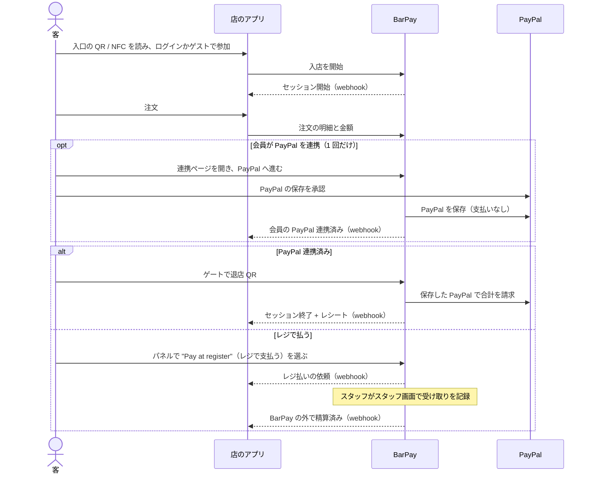
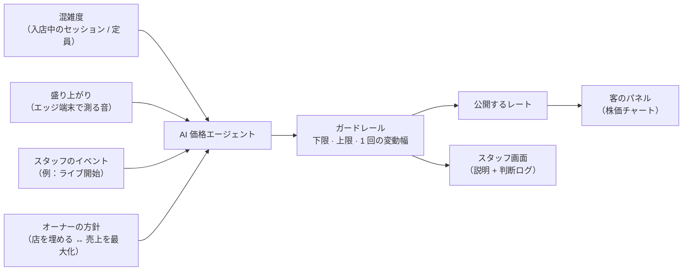
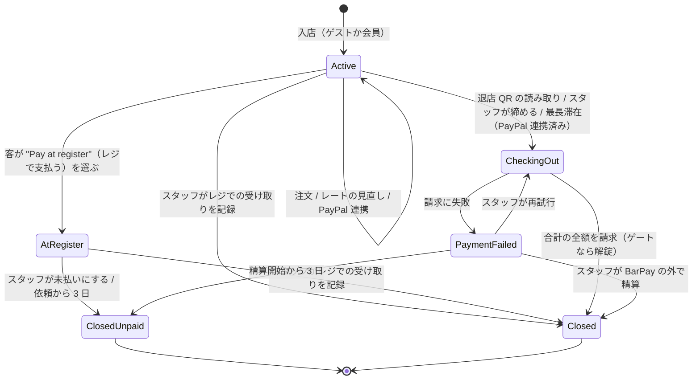
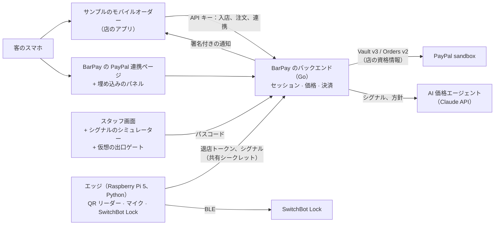

# PRD — BarPay

> `PRD.md` の日本語訳。内容が食い違う場合は `PRD.md` が正。

BarPay が何であり、何を保証し、何をあえて扱わないかの正。
API の形やデータモデルはコードと設計文書に、開発の予定は issue に書く。

## 1. 目的

BarPay は、バーが自店のモバイルオーダーシステムに組み込む決済・価格モジュールである。店の混雑と盛り上がりに応じて株価のように動くチャージ料を加え、PayPal を連携した会員は、店を出るだけで来店全体の精算を済ませられる。

- **客**は、店が閑散としていても満席でも同じ固定のチャージ料（席料・お通し）を払い、会計で初めて知ることも多い。特に海外からの客は驚く。滞在中に自分が何に払っているのかが見えず、帰るときにはレジに並ぶ。
- **バーのオーナー**は、暇な夜に値下げして客を呼ぶことも、満席の夜に価値を取り込むこともできない。モバイルオーダーは注文を受けるが、需要に応じてチャージ料を決めたり、客がそのまま出て行けるようにしたりするものは無い。
- **モバイルオーダーの開発者**は、需要に応じた価格と、退店時の精算を自分で作ることになる。

BarPay はこれをモジュールとして解決する。店は自分のアプリ、メニュー、会員をそのまま使い、BarPay が、動くチャージ料、来店のたびに退店 QR をそのまま精算に変える、会員向けの任意の PayPal 連携、それ以外の客のためのレジでの支払いを加える。お金は店自身の PayPal アカウントに入る。

## 2. ハッカソンとの対応

応募先：[PayPal AI Hackathon](https://paypalaihackathon.devpost.com/)、締め切りは **2026-11-12 12:00 PST**（2026-11-13 05:00 JST）。1 人で作る。リポジトリ：[sumiredc/barpay](https://github.com/sumiredc/barpay)。

| 審査基準 | BarPay の答え |
|---|---|
| Technological Implementation | PayPal Vault v3 で支払いなしに会員の PayPal を保存し、退店時に保存した PayPal で Orders v2 による merchant-initiated の請求を 1 回だけ行う。AI の価格エージェントが店内のシグナルからオーナーの方針に沿って判断し、すべての判断を記録する |
| Design | 入口の QR からゲートの解錠までがひと続きの体験。BarPay の API で作ったサンプルのモバイルオーダーで見せる |
| Potential Impact | 具体的な困りごと（分かりにくいチャージ料、空いた時間帯、レジの行列）と具体的な相手（小さなバー）。既存のモバイルオーダーが組み込めるモジュールとして届ける |
| Innovation | AI が株価のように値付けし、その理由をスタッフ向けに記録するチャージ料。精算は店を出るだけ |
| Presentation | 動画で、店の様子に合わせて価格が動くことと、支払いでゲートが開くことを見せる |

規約の必須要件。BarPay はすべて満たす：

- PayPal（sandbox）と AI の**両方**を意味のある形で使う。
- 審査員が実際に動かせる**動作するデモ**：サンプルのモバイルオーダーをホストした URL と、リポジトリ内の完全なセットアップ・実行手順。審査員は Raspberry Pi もスマートロックも持っていない。モックアップや静的な試作は認められない。
- ホストしたデモは、**審査期間が終わる 2026-12-15 08:00 PT まで**、無料・無制限で使える状態を保つ。AI の API キーとその予算も含む。
- 全ソース・素材・実行手順を含む**公開リポジトリ**（GitHub、GitLab、Bitbucket）と、GitHub の About に表示される、ルートに置いたオープンソースの `LICENSE`。審査期間が終わるまで公開を保つ。
- 機能の**説明文**と、使った AI のモデルやサービスと使い方を書いた**ツールの説明**。
- YouTube に置く 3 分未満の**デモ動画**。実機のスマホで BarPay が動く様子を見せ、第三者の商標や著作権のある音楽を含めない（BGM の流れるバーの場面は現実的な危険）。
- 応募物はすべて**英語**（または英訳付き）。このプロジェクトはさらに、日本語だけのものを公開リポジトリに置かない。
- スポンサーが、スマホとパソコン以外のハードウェア（Raspberry Pi）の実物を求めることがある。
- 応募期間中に作る。コミット履歴がその証拠になる。

## 3. 利用者

| 利用者 | 目的 |
|---|---|
| 客 | 入店し、飲んで食べ、払っている額を見て、店を出るだけで（PayPal を連携した会員）、またはレジで払って帰る |
| 店のアプリ | 店のモバイルオーダー（ここではサンプルアプリ）。来店を始め、注文を伝え、各来店がどう精算されたかを受け取る |
| スタッフ / オーナー | スタッフ画面で店の状態を見て、例外に対応する。オーナーは価格、上下限、チャージ料のルールをスタッフ画面の設定タブで決める |
| 審査員 | ハードウェア無しで、ノートパソコンから一連の流れを体験する |

## 4. 責務の分担

チャージ料とお金に関することは BarPay が持ち、メニューと客との関係に関することはすべて店のアプリが持つ。

| BarPay | 店のアプリ |
|---|---|
| 来店（セッション）：入店、滞在、精算、レジでの精算 | 店の QR / NFC タグから開く入口の画面、ログインかゲストでの参加 |
| チャージ料と、その AI による値付け | メニュー、注文画面、厨房。商品の価格と注文の中身 |
| PayPal：会員の PayPal の保存（任意）、退店時の請求、会員が求めたときの削除 | 会員とログイン。会員が PayPal を連携したり削除したりする設定画面 |
| 客が PayPal を承認する PayPal 連携ページ | BarPay のページの前後で客がどこへ行くか |
| 埋め込めるパネル：レートの株価チャート、現在の合計、PayPal（退店 QR）かレジかを選ぶ"Pay"（お会計）ボタン | パネルをアプリのどこに置くか |
| 出口ゲートとスタッフ画面 | 自分の画面でのレシートと履歴（BarPay の結果から作る） |

読み取ること：入店に PayPal は要らない。会員が PayPal を承認するのは 1 回だけ、BarPay の連携ページで、その後の来店では確認なしに使う。店のアプリと BarPay はサーバー同士でやり取りする。

境界のルール：

- **入店**：店のアプリが自分のサーバーから入店を開始する。セッションはその場で始まり、その ID が返る。入店時に BarPay のページは出さない。
- **PayPal 連携**：連携は来店ではなく会員に付き、ゲストは連携できない。店のアプリが、ログイン中の会員の連携ページを BarPay に求め、会員をそこへ全画面で送る。パネルの中には出さない。埋め込みのフレームの中では PayPal の承認が動かないと考えられるため（推測、未確認）。PayPal は会員を BarPay へ戻し、BarPay が店のアプリへ戻す。保存した PayPal を持つ会員が入店すると、BarPay がセッションを自動で連携済みにする。
- **照会**：店のアプリは、セッションの状態とレシートを ID でいつでも読める。客が戻ってきたときの結果の確認と、取りこぼした通知の回復はこれで行う。
- **通知**：イベントは `session.started`、`session.paypal_linked`、`session.register_requested`、`session.closed`（レシート付き）、`session.payment_failed`、`session.settled_outside`、`session.closed_unpaid`、`gate.unlock_failed`、会員向けの `member.paypal_linked` と `member.saved_paypal_deleted`。それぞれイベント ID とセッションごとの通し番号を持ち、署名され、決まった間隔で最大 24 時間再送される。それを過ぎると、スタッフ画面で断念として示す。
- **パネル**：店のアプリがリンクするか、フレームとして埋め込む BarPay のページ。現在のレート、その変化とチャート、停止中や上限到達のときの 1 行、滞在時間、ここまでのチャージ料、注文、支払い方法（PayPal かレジ）、現在の合計、"Pay"（お会計）ボタンを出す。押すと選択肢が出る。PayPal（連携済みのときだけ出る）は退店 QR を開き、"Pay at register"（レジで支払う）はスタッフに受け取りを頼む。精算後、パネルは結果を出す。店のアプリは、通知か照会から自分の画面にレシートを出す。
- **API キー**：店のアプリは自分のサーバーから BarPay を呼ぶ。サンプルアプリにはキーを持つバックエンドがある。

## 5. 価格モデル

チャージ料は時間とともに変わる **1 時間あたりのレート**で、**枠**ごとに計上する。入店から 1 枠（設定タブ、初期値は店の時間で 10 分）が終わるたびに、終わった枠を、その時点で公開中のレートで計上する。

レートは AI がオーナーの方針に沿って決め、実際に請求できる範囲はオーナーが決めたガードレールが決める。

- **シグナル**：混雑度と盛り上がり（作者が考える中心の入力）と、スタッフのイベント。混雑度は人数ではなく入店中のスマホの数を数える（[未決事項 1](#13-未決事項) 次第で変わりうる）。盛り上がりはエッジ端末上でマイクから算出し、端末から出るのは数値だけ。エッジ端末が無いときはシミュレーターから入力する。
- **方針**：オーナーは、店を "fill the room"（店を埋める）と "maximize revenue"（売上を最大化）のあいだのどこに置くかを決める。エージェントは、判断ごとにその方針にどう沿うかを述べる。
- **間隔**：レートは決まった間隔（設定ファイル、初期値 5 分）で見直す。スタッフはその場で 1 回見直させることもでき、ほかの見直しと同じく 1 日の呼び出し上限に数える。
- **ガードレール**（設定タブ）：下限、上限、1 回の見直しあたりの最大変動幅（設定ファイル）。範囲外の提案は範囲内に切り詰め、公開するレートは範囲から出ないように通貨ごとのレートの刻み（固定：10 JPY、0.05 USD）に丸める。オーナーが下限か上限を変えたときは、公開中のレートを、変動幅を超えてでもすぐ新しい範囲内に合わせ、判断ログに記録する。
- **説明**：公開するレートには、切り詰めた後の実際の変化を述べる、短く平易な英語の理由を付ける（例："Room is half empty — rate down 5%"）。説明はスタッフ画面にだけ出す。客に見えるのは、レート、その変化、チャートである。
- **判断ログ**：毎回の入力、エージェントの提案と推論、公開したレートを残し、スタッフ画面に出す。
- **代替動作**：AI が時間内に答えない、または 1 日の呼び出し上限（設定ファイル）に達したときは、レートを直前の値のまま据え置き、ログにそう残す。
- **エージェントが動くとき**：入店中のセッションが 1 つ以上あるか、スタッフ画面が開いているときだけ。ホストしたデモが、使われていないあいだに AI の予算を使わないようにするため。
- **枠**：1 枠の額は、レート × 枠の長さを通貨の最小単位（1 JPY、0.01 USD）に切り捨てたもので、枠が終わった時点で決まり、その後は変わらない。入店そのものは 0 円で、精算が始まった時点で終わっていない枠は請求しない。
- **追加注文での停止**：来店の 1 件目の注文は対象外（ワンドリンク制）。それ以降の注文は、件数で数え、フードも含め、その注文から決まった時間（設定タブ、初期値 30 分、0 で無効）チャージ料を止める。新しい注文は停止を数え直し、足し合わせない。停止中に終わる枠は 0 円。
- **来店ごとの上限**（設定タブ、初期値 ¥3,000 / $30、0 で上限なし）：上限に達する枠は上限までしか計上せず、その後の枠は 0 円。
- **設定の変更**：枠の長さ、停止時間、上限は、入店中のセッションにも次の枠から反映する。上限を、セッションがすでに計上した額より低くすると、それ以降の枠は計上しない。すでに計上した額は減らさない。
- **デモモード**：店全体の時間倍率（設定ファイル、初期値はちょうど 10）で、店の 1 分を実時間の 6 秒で進める。枠、停止、見直しの間隔、最長滞在は店の時間で数える。再解錠の受付時間、退店 QR の更新、3 日の期限、通知の再送は実時間で数える。

## 6. 決済モデル

PayPal の連携は任意で、お金は動かない。会員の PayPal をこの店用に保存するだけで、来店全体は退店時に 1 回で請求する。

| 時点 | PayPal で起きること |
|---|---|
| 入店 | 保存した PayPal を持つ会員なら、まだ使えるかを BarPay が確かめる。ほかは何もしない |
| PayPal 連携（会員のみ、任意） | 会員が、merchant-initiated の請求のために PayPal を保存することを承認し、BarPay がそれを会員 ID のもとに持つ。支払いは無い |
| 滞在 | 何もしない。注文とチャージ料は BarPay が記録する |
| 精算、合計 = 0 | 何も請求しない |
| 精算、合計 > 0 | 保存した PayPal で合計を 1 回、客の承認なしに請求する。ゲートはそれが成功した後にだけ開く |
| 精算後 | 何もしない。会員の保存した PayPal は、会員が削除するまで次の来店のために残す（UC9） |

- **現在の合計** = 注文 + ここまでのチャージ料。
- ゲスト、保存した PayPal を持たない会員、レジを選んだ客はレジで払う。BarPay が合計を確定し、スタッフが BarPay の外でお金を受け取って記録すると、セッションは BarPay の外で精算済みとして終わる。

## 7. 保証すること

| 観点 | BarPay が保証すること |
|---|---|
| 同意 | 保存した PayPal に請求するのは、客が連携時に「来店の合計を、退店時に追加の承認なしで請求する」ことに同意した後だけで、退店時だけである。客は滞在中ずっと現在の合計を見られる |
| 透明性 | 滞在中、客は現在のレート、その変化とチャート、ここまでのチャージ料、停止中か上限到達か、現在の合計を見られる。入店前の料金のルールは店が掲示する（[扱わないこと](#8-扱わないこと) を参照） |
| この来店のためだけの請求 | BarPay が会員の保存した PayPal に請求するのは、その会員のセッションの精算中か、スタッフによるその再試行のときだけ。スタッフが再試行できるのは、精算開始から最大 3 日。保存した PayPal は会員が求めたときに削除し、それを使うセッションが終わるまでは削除しない |
| 正確さ | BarPay の精算でセッションが終わったとき、請求した額は精算の瞬間にサーバーが確定した最終金額に等しく、レシートはその合計と PayPal の capture ID を示す。レジまたは BarPay の外で精算したときは、レシートは合計とスタッフが記録した額を示す。BarPay では何も請求していない |
| 価格の範囲 | レートは常に店の下限と上限のあいだにある。定期でも手動でも、1 回の見直しで変動幅を超えて動くことは無い。ただし、オーナーが下限か上限を変えたときは例外で、判断ログに記録する |
| 支払いは 1 回 | 各セッションの精算は 1 回だけ。読み取りの繰り返し、ネットワークエラーやタイムアウト後の再試行、スタッフの再試行で、同じ額を二重に請求することは無い。結果の分からない呼び出しを再試行する前に、BarPay は PayPal でその状態を確かめる |
| 支払ってから解錠 | BarPay が出口ゲートを開けるのは、全額を請求したか、スタッフがレジまたは BarPay の外での受け取りを記録して終わったセッションに対してだけで、終わってから再解錠の受付時間内に限る。セッションが終わると、その退店 QR は変わらなくなる。スタッフはスタッフ画面から手でゲートを開けることもできる |
| 店への通知 | 店のアプリには、すべてのセッションの開始、PayPal 連携、レジ払いの依頼、結果を通知する。通知は署名され、イベント ID と通し番号を持ち、最大 24 時間再送されるので、店のアプリは同じ通知を複数回、または順不同で受け取ることがある。現在の状態はいつでも照会で読める |
| アクセス | 入店の開始、注文の報告、会員の PayPal 連携ページの要求、会員の保存した PayPal の削除ができるのは、店の API キーを持つ店のアプリだけ。セッションのリンクで触れられるのはそのセッションだけ（パネルとレジ払いの依頼。依頼は合計を確定するが、何も請求しない）。精算を起こせるのは、認証されたエッジ端末、スタッフ用パスコードを持つスタッフ、最長滞在に達したときの BarPay 自身だけ。レジでの受け取りの記録と設定の変更ができるのはスタッフだけ。退店トークンはセッションのリンクとは別。ホストしたデモではパスコードは公開している（[扱わないこと](#8-扱わないこと) を参照） |
| 永続性 | セッション、注文、設定、capture ID、保存した PayPal への参照は、バックエンドを再起動しても残る |
| プライバシー | 生の音声（使うなら映像も）は保存せず、エッジ端末の外に出さない |
| 可観測性 | 失敗した請求、失敗した解錠、レジ払いの依頼、拒否した遅れた注文、最長滞在を超えたセッション、断念した通知、失敗した削除はスタッフ画面に出る。失敗した請求と解錠は店のアプリにも送る |

## 8. 扱わないこと

| 扱わないこと | 理由 |
|---|---|
| 実際のお金での決済 | ハッカソンでは PayPal の sandbox だけを使う |
| 店の登録画面、1 つのデプロイで複数の店 | 1 つの店を設定ファイルで用意する。価格とチャージ料のルールはスタッフ画面で変える |
| 決済の仲介者としての BarPay（プラットフォーム手数料、マルチパーティ） | 各店は自分の PayPal アカウントで受け取る |
| チェーンの店舗をまたいだ保存した PayPal の利用 | 将来。店舗が 1 つの PayPal アカウントを共有すれば動くかもしれないが、未確認 |
| 会員とログイン | 店のアプリの仕事。BarPay は、店のアプリが渡す ID のもとに会員の保存した PayPal を持つだけ（UC2、UC9） |
| ゲストの PayPal | 保存した PayPal には来店をまたぐ持ち主が要るので、連携には店のアカウントが要る。ゲストはレジで払う |
| メニュー、注文画面、厨房の流れ | 店のアプリの仕事。BarPay は注文の明細と金額だけを記録する |
| 入店前に料金のルールを見せること | 店が、自分のサイトか店内に掲示する（変動制のレート、枠の長さ、来店ごとの上限）。店のアプリの参加画面には出さない |
| レジでのお金の受け取り | 店の仕事。BarPay は合計を確定し、スタッフが受け取ったと言う額を記録する |
| ホストしたデモでのスタッフ操作の保護 | 審査員がスタッフ画面を使えるよう、パスコードは README に載せる。どの審査員でも設定を変え、店をリセットし、セッションを締められる |
| デモの訪問者ごとに別の店 | 審査員は 1 つのデモ店を共有する。かわりに "Reset demo"（デモをリセット）ボタンでセッションと設定を元に戻す |
| 注文の明細の取り消しや訂正 | 一度伝えた注文は合計に残る。店は PayPal のダッシュボードから返金する |
| 店のアプリが伝える内容の正しさ | BarPay は店のアプリが伝えた注文の金額を請求し、送られた会員 ID を信じる。それを確かめるのは店のアプリの仕事 |
| 24 時間の再送の後の通知 | 店のアプリは照会で回復する |
| 店を出た客からの、拒否された請求の回収 | スタッフ画面に未払いの額として残る。回収は BarPay の外での店の仕事 |
| グループ内での割り勘 | スマホ 1 台が 1 セッション。割り勘は別のプロダクト |
| 入店時の価格の固定 | 株価のような仕組みが成り立たなくなる。客は、来店ごとの上限と現在の合計の表示で守る |
| 入店時のデポジットやお金の確保 | ゲートは支払いの後にだけ開くので、請求が失敗した客はまだ店内にいて、レジで払える。確保すると、請求が 2 件になり、客の明細に保留中の額が残る |
| 返金と異議申し立て | PayPal のダッシュボードで扱う |
| 税の計算 | すべての価格は税込み |
| 日本語の UI | 応募は英語でなければならない。通貨（JPY/USD）は選べるが、言語は選べない |
| 客を閉じ込めること | 扉は内側から常に開けられなければならない。鍵は、出ていく体験の一部として出口ゲートを開けるもので、客が出ていくのを止めるためのものではない |

## 9. 動かせない前提

- **sandbox で確認済み（2026-10-28、USD）**：`payment_source.paypal.vault_id` だけを付けた `CAPTURE` の注文は、買い手の承認なしに、作成時の応答で `COMPLETED` になった。このとき使った保存した PayPal は、注文の承認から作ったもので、BarPay が今使う setup token の流れから作ったものではない。[未決事項 5](#13-未決事項) を参照。
- **信じる前に確かめる**：客が PayPal から戻ってきたら、バックエンドは、自分が作った setup token が承認されたことと、そこから保存した PayPal を作れたことを確かめてから、それを会員に保存する。
- **冪等性**：PayPal を保存する、お金を動かす、保存した PayPal を削除する PayPal の呼び出しにはすべて、セッション・手順・試行回数から作った `PayPal-Request-Id` を付け、呼び出す前に保存しておく。ネットワークの再試行では同じものを使い、スタッフの再試行では新しい試行にする。退店時の請求にはセッションごとの `invoice_id` を付け、PayPal は重複を拒否すると想定している（未検証、[未決事項 5](#13-未決事項) を参照）。呼び出しの結果が分からない（タイムアウト）ときは、再試行の前に、BarPay がその状態を確かめる。
- **店自身の PayPal**：BarPay は店の REST の資格情報で PayPal を呼び、それを秘密情報として持つ。
- **保存した PayPal の承認**：本番では、merchant-initiated の請求のために PayPal を保存するには、PayPal から reference transactions の承認を得る必要がある。sandbox のデモの妨げにはならない。
- **通貨**：店ごとに JPY か USD を選び、その店の金額はすべてその通貨にする。JPY には小数点以下が無い。sandbox での JPY は [未決事項 4](#13-未決事項) 次第。
- **ハードウェア**：Raspberry Pi 5、キーボードとして動く USB の QR リーダー、BLE でつなぐ SwitchBot Lock。鍵には MAC アドレス、キー ID、暗号鍵が必要で、環境変数から読む。
- **秘密情報**：PayPal の資格情報、店の API キー、AI の API キー、SwitchBot の鍵は公開リポジトリに入れない。
- **ハードウェア無しでの審査**：ハードウェアを使う手順にはすべて、ブラウザでの代役がある（仮想の出口ゲート、シグナルのシミュレーター）。
- **共有のデモ**：ホストしたデモを複数の審査員が同時に使うことがある。README には PayPal sandbox の買い手アカウントを複数載せ、1 人の審査員がパスワードを変えても、ほかの人が締め出されないようにする。
- **言語**：UI、README、動画、説明文は英語。リポジトリ内の対象外でない `.md` にはすべて `.ja.md` の訳がある（`.claude/skills/bilingual-docs` を参照）。

## 10. ユースケース

読み取ること：セッションが終わるのは、請求が成功したとき、スタッフがレジでの受け取りや精算を記録したとき、スタッフか 3 日の期限で未払いとして閉じたときだけ。決済の失敗でも、客のレジ払いの依頼でも、セッションは終わらない。セッションそのものを消すのは "Reset demo"（デモをリセット）だけ。

### UC1 — 客が入店する

- **事前条件**：BarPay のバックエンドが動いていて、レートが公開されている。
- **主フロー**：客が店の入口の QR コードを読むか NFC タグにかざすと、店のアプリが開く。ログインするかゲストとして参加すると、店のアプリが BarPay に入店を求め、セッションが始まる。店のアプリに通知が届き、メニューを出す。BarPay のパネルはアプリの中にある。
- **代替フロー**：保存した PayPal を持つ会員が入店する → セッションはその場で始まる。BarPay はその後、保存した PayPal がまだ使えることを PayPal で確かめ、セッションを連携済みにする。会員は何もしない。
- **例外**：会員の保存した PayPal がもう使えない（客が PayPal で削除した、拒否された）→ セッションは未連携のまま。BarPay は保存した PayPal を削除して店のアプリに通知する（`member.saved_paypal_deleted`）。会員はもう一度連携する（UC2）か、レジで払える。
- **例外**：店のアプリの API キーが無いか間違っている → 拒否し、何も作らない。
- **例外**：店のアプリが同じ入店を 2 回始める（同じ冪等キー）→ 同じセッションを返す。終わっていないセッションを持つ会員 → 拒否する。
- **事後条件**：セッションは滞在中で、会員が使える保存した PayPal を持つときだけ連携済み。チャージ料はまだ 0 円。最初の枠は入店から枠 1 つ分の時間で終わる。店の混雑度にこのセッションが含まれる。

### UC2 — 会員が PayPal を連携する

- **事前条件**：客が店のアプリに会員としてログインしていて、保存した PayPal が無い。
- **主フロー**：店のアプリの設定で、会員が PayPal の連携を選ぶ。店のアプリはその会員の連携ページを BarPay に求め、全画面で開く。会員は PayPal へ進み、店が来店の合計を、退店時に追加の確認なしに請求してよいことを承認する。BarPay は保存した PayPal を会員 ID のもとに持ち、会員を店のアプリへ戻す。会員が滞在中のセッションを持っていれば、それはすぐ連携済みになる。持っていなければ、次の入店から使う（UC1）。店のアプリに通知が届く。
- **例外**：客がゲスト → 店のアプリは連携を出さず、アカウントが必要だと伝える。会員 ID の無い連携の要求は BarPay が拒否する。
- **例外**：会員が連携ページから戻るか、PayPal でキャンセルする → 何も保存しない。会員は後からやり直すか、レジで払える。
- **例外**：setup token が承認されていない、または PayPal の保存に失敗する → 何も保存しない。会員にはエラーを出し、やり直せる。
- **例外**：会員が承認した後、BarPay が PayPal を保存する前にタブを閉じる → 何も保存しない。もう一度連携すると最初からやり直しになる。
- **例外**：会員のセッションがもう滞在中ではない（レジ待ち、精算中、終了）→ 保存した PayPal は次の来店のために持つ。そのセッションは連携しない。
- **事後条件**：会員は保存した PayPal を持つ。その会員の滞在中のセッションは連携済み。お金は動いていない。

### UC3 — 客が滞在し、価格を見る

- **事前条件**：セッションが滞在中である。
- **主フロー**：店のアプリの中の BarPay のパネルに、来店のあいだのレートを階段状の株価チャートで、その直近の変化、滞在時間、ここまでのチャージ料、注文の合計、支払い方法、現在の合計を出す。停止や上限が効いているあいだは、パネルにそう出す。
- **例外**：セッションが最長滞在（設定ファイル、初期値 12 時間）に達する → PayPal 連携済みなら、UC5 と同じようにゲートなしで精算し、客はもう一度入店できる。未連携なら滞在中のままで、スタッフ画面に示し、スタッフが客に声をかけられるようにする。
- **事後条件**：表示するチャージ料は、入店から終わった枠の額の合計に等しい。停止中の枠と上限後の枠は 0 円として数える。

### UC4 — 店のアプリが注文を伝える

- **事前条件**：セッションが滞在中である。
- **主フロー**：客が店のアプリで注文し、店のアプリが注文の明細と金額を BarPay に送る。BarPay はそれをセッションに加える。来店の 2 件目の注文からは、[価格モデル](#5-価格モデル) のとおりチャージ料を止める。
- **例外**：セッションが滞在中ではない（レジ待ち、精算中、決済失敗、終了、未払いで終了、不明）→ 拒否し、スタッフ画面に出す。提供済みのものは、店が BarPay の外で回収する。
- **例外**：同じ注文が 2 回伝えられる（同じ注文 ID）→ 1 回だけ記録し、停止も数え直さない。
- **例外**：金額が負、または別の通貨 → 拒否する。
- **事後条件**：現在の合計にその注文が含まれる。

### UC5 — 客が出口ゲートで精算する

- **事前条件**：セッションが滞在中で、PayPal が連携されている。
- **主フロー**：客がパネルの "Pay"（お会計）を押して PayPal を選び、退店 QR を出口のリーダーに見せる。QR は決まった間隔（設定ファイル、初期値 30 秒）で変わるため、古いスクリーンショットは使えない。サーバーはその瞬間に最終金額を確定してチャージ料を止め、[決済モデル](#6-決済モデル) のとおり保存した PayPal で合計を 1 回請求し、ゲートを開ける。パネルには合計と PayPal の capture ID を出し、店のアプリにはレシート付きで通知する。
- **代替フロー**：成功の後、再解錠の受付時間（設定ファイル、初期値 2 分）内に同じ退店 QR をもう一度読ませる → ゲートをもう一度開ける。何も請求しない。
- **例外**：セッションに PayPal が連携されていない → 拒否する。リーダーには "Please pay at the register"（お会計はレジでお願いします）と出す。何も請求しない。
- **例外**：請求が失敗するか拒否される → ゲートは閉じたまま、客には "Please see staff"（スタッフにお声がけください）と出し、セッションは PaymentFailed になって未払いの額がスタッフ画面に出る。店のアプリに通知する。
- **例外**：PayPal の呼び出しがタイムアウトする → BarPay は、ほかのことをする前に PayPal でその状態を確かめる。結果が分かるまでゲートは閉じたまま。
- **例外**：請求は成功したが解錠に失敗する → 支払いは有効のまま。スタッフ画面に示し、スタッフがゲートを開けられるようにする。
- **例外**：退店 QR が不明か期限切れ、終わってから再解錠の受付時間を過ぎたセッションのもの、または PaymentFailed のセッションのもの → 拒否し、何も請求せず、ゲートは閉じたまま。
- **例外**：同じ QR の読み取りが同時に 2 回届く → 精算は 1 回だけ走り、両方が同じ結果を受け取る。
- **事後条件（成功時）**：請求した額 = レシートの最終金額。セッションは終わっている。チャージ料は止まっている。会員の保存した PayPal は残っている。

### UC6 — 客がレジで払う

- **事前条件**：セッションが滞在中である（PayPal の連携の有無は問わない）。
- **主フロー**：客がパネルの "Pay"（お会計）を押して "Pay at register"（レジで支払う）を選ぶ。BarPay は最終金額を確定してチャージ料を止め、セッションをレジ待ちにする。店のアプリとスタッフ画面に通知する。レジでスタッフがお金を受け取り、スタッフ画面に記録する。セッションは BarPay の外で精算済みとして終わり、店のアプリに通知する。パネルには、再解錠の受付時間内ならゲートを開けられる退店 QR を出す。
- **代替フロー**：客がそのままレジに来る → スタッフがお客さん一覧から受け取りを記録する。合計はその時点で確定する。
- **代替フロー**：スタッフが合計と違う額を記録する → レシートは両方を示す。差額を BarPay で請求することは無い。
- **例外**：客がレジを選んだ後、払わずに出ていく → スタッフがセッションを未払いにするか、依頼から 3 日で未払いとして閉じる。どちらの場合も未払いの合計を記録し、PayPal には何も請求しない。
- **例外**：客がレジを選んだ後に PayPal で払いたくなる → 依頼は取り消せない。レジで払う。チャージ料は止まっているので、最長滞在はもう効かない。
- **事後条件**：セッションは終わっている。レシートは合計とレジで記録した額を示す。BarPay では何も請求していない。

### UC7 — スタッフが店を回す

- **事前条件**：スタッフが BarPay のスタッフ画面でスタッフ用パスコードを入れた。
- **主フロー**：スタッフ画面には 4 つのタブがある：
  - **Room**（店内）：直近の説明付きのレートのチャート、レートを今すぐ見直すボタン、連携済みのセッション向けの仮想の出口ゲート、警告。
  - **Guests**（お客さん）：すべてのセッションと、入店時刻、滞在時間、注文の件数、現在の合計、支払い方法（PayPal かレジ）、状態、停止や上限。
  - **Settings**（設定）：下限と上限、枠の長さ、追加注文での停止時間、来店ごとの上限、価格の方針、スタッフのイベント（例：ライブ）を含むシグナルのシミュレーター、"Reset demo"（デモをリセット）。
  - **System log**（システムログ）：AI の判断ログ、店のアプリへの通知、起動時に読んだ設定ファイル。
- **代替フロー**：連携済みの客が別の扉から出た、または電池が切れた → スタッフがセッションを締め、UC5 と同じようにゲートなしで精算する。
- **代替フロー**：スタッフが UC6 のとおりレジでの受け取りを記録する。客が払わずに出ていったときは、レジ待ちのセッションを未払いにする。
- **代替フロー**：スタッフが設定を変える → [価格モデル](#5-価格モデル) のとおりに反映する。下限と上限が 0 より大きく下限が上限より小さいこと、枠が 1 分以上であること、停止時間と上限が 0 以上であることが必要で、満たさない変更は拒否する。
- **代替フロー**：スタッフがデモ店をリセットする → 状態にかかわらずすべてのセッションを消し、その未払いの額も捨てる。会員の保存した PayPal は残す。警告と通知を消し、価格、チャージ料のルール、方針を設定ファイルの初期値に戻す。シグナルのシミュレーターはそのまま。
- **例外**：セッションが PaymentFailed → スタッフが再試行すると、新しい試行として、保存した PayPal で合計をもう一度請求する。または、精算した額を入れて BarPay の外で精算済みにすると、セッションを閉じる。
- **例外**：PaymentFailed のセッションが精算開始から 3 日に達する → 再試行をやめ、未払いの額を記録して未払いとして閉じる。

### UC8 — 店が BarPay とつながる

- **主フロー**：オーナーは、起動時に読む設定ファイルに、店の PayPal の REST の資格情報、店の API キー、店のアプリの通知先 URL と署名用シークレット、スタッフ用パスコード、通貨（JPY/USD）、1 回の変動幅、見直しの間隔、AI の 1 日の呼び出し上限、定員、最長滞在、再解錠の受付時間、退店 QR の更新間隔、デモの時間倍率、設定タブの初期値を書く。
- **例外**：初期値の下限が初期値の上限より小さくない、最長滞在が 3 日以上、または資格情報が無い → BarPay は起動せず、理由を示す。
- **例外**：終わっていないセッションがあるときに通貨を変えた → BarPay は前の通貨で起動し、変更をスタッフ画面に示し、終わっていないセッションが無い状態での最初の再起動で反映する。
- **事後条件**：BarPay は設定ファイルの値で動く。設定タブは、そこで最後に保存した値を持つ。初めての起動と "Reset demo"（デモをリセット）の後は初期値を持つ。

### UC9 — 会員が保存した PayPal を削除する

- **事前条件**：会員が保存した PayPal を持っている。
- **主フロー**：会員が店のアプリの設定で削除すると、店のアプリが BarPay に求め、BarPay が PayPal で削除する。店のアプリに通知が届く。
- **例外**：それを使うセッションがまだ終わっていない → 拒否する。店のアプリは、支払いの後なら削除できると伝える。
- **例外**：PayPal が削除を確認しない → BarPay は確認できるまで再試行する。失敗し続ける削除はスタッフ画面に示す。
- **事後条件**：会員は保存した PayPal を持たない。次の入店は未連携で始まり、もう一度連携するには PayPal の承認を通る（UC2）。

### UC10 — 審査員がハードウェア無しで BarPay を試す

- **主フロー**：審査員は、ホストしたサンプルアプリから、スマホかノートパソコンで会員としてログインして入店し、注文し、README の sandbox の買い手アカウントで PayPal を連携し、README のパスコードでスタッフ画面を開き、シグナルのスライダーを動かして AI が値付けし直すのを見て、仮想の出口ゲートで自分のセッションを選んで精算する。ゲストとして参加してレジで払い、スタッフ画面で受け取りを記録することもできる。
- **事後条件**：PayPal で精算したときは、レシートに PayPal の capture ID が出て、sandbox の買い手アカウントの取引履歴に支払いが出る。レジで払ったときは、レシートに記録した額が出る。

## 11. システム概要

読み取ること：PayPal と AI と話すのは BarPay のバックエンドだけ。店のアプリはサーバー同士で注文を伝え、客のスマホが送る金額を BarPay が信じることは無い。

実装の注記：

- 連携では `POST /v3/vault/setup-tokens`（`payment_source.paypal` に `usage_type: MERCHANT` と、BarPay へ戻る return と cancel の URL を持つ `experience_context`）で setup token を作り、承認の後、その setup token から `POST /v3/vault/payment-tokens` で保存した PayPal を作る。
- 入店時、会員の保存した PayPal を `GET /v3/vault/payment-tokens/{id}` で確かめる。
- 退店時の請求は、intent が `CAPTURE` で、`payment_source.paypal.vault_id` と `invoice_id` を持つ注文にする。
- 会員の保存した PayPal は、求めに応じて `DELETE /v3/vault/payment-tokens/{id}` で削除する。
- エッジ端末は、USB の QR リーダーを `stdin` ではなく入力デバイス（`evdev`）から読む。バックグラウンドのサービスとして動かせるようにするため。

## 12. 優先度

| 優先度 | 範囲 |
|---|---|
| P0 — 必ず出す | BarPay：仮想の出口ゲート、再試行、"settled outside BarPay"（BarPay の外で精算）を含む UC1〜UC7 と UC9。設定ファイルとしての UC8。BarPay のページとしての PayPal 連携ページとパネル。セッションの照会を含む店向けの API。簡単な再送付きの署名した通知。方針、ガードレール、説明、判断ログを持つ AI の値付け。停止と上限を含む枠ごとのチャージ料。設定タブ。USD。デモモード。デモのリセット。自分のバックエンドを持つサンプルアプリ：入口の画面、会員登録・ログイン・ゲストでの参加、メニュー、注文、PayPal 連携を含む設定、BarPay のパネル、レシート。UC10。ホストしたデモ。`LICENSE`。API の表を含む README。動画。Devpost の文章 |
| P1 | 実物のエッジ端末：QR リーダー → 精算 → SwitchBot の解錠、マイクでの盛り上がり。JPY（未決事項 4 の後） |
| P2 | 店の登録画面。チェーンの店舗をまたいだ保存した PayPal。価格以外の AI の提案（例：レシートに滞在のまとめ） |

締め切りに向けた範囲のルール：

- **2026-11-05** までに P0 が端から端まで動いていなければ、スタッフの再試行を P1 に移す。"Settled outside BarPay"（BarPay の外で精算）は残す。
- **2026-11-07** までに動いていない P1 は落とし、動画では仮想の出口ゲートを使う。
- **2026-11-10〜11-12** は動画、Devpost の文章、README に充てる。新しい機能は入れない。

## 13. 未決事項

1〜3 は、`mock/` にモックを作った後、**2026-10-31** までに決める。モックは素の HTML、CSS、JavaScript だけの使い捨ての試作で、動作するデモではなく、git で管理しないので公開リポジトリには入らない。UI は作者のために日本語にしている。訳の対応付けと、製品のテストと CI の対象外。第三者の商標や素材を使わないことは変わらず守る。

1. **盛り上がりの測り方**：マイクの音量だけか、端末上の音声の分類（歓声、音楽、笑い声）か。カメラでの人数も数えるか（その場合は混雑度の数え方が変わる）。モックでは、ブラウザのマイクの音量で代用できる。
2. **ホスティング**：Cloudflare Tunnel の後ろの自宅サーバーか、Render（Render のスポンサー賞の対象にもなる）か。2026-12-15 まで動かし続けなければならない。
3. **動画での出口ゲートの見せ方**：鍵が物理的に何を守るのか。「客が閉じ込められる」話に見えないようにする。動画には SwitchBot や Raspberry Pi のロゴを映さず、著作権のある音楽を流さない。
4. **sandbox での JPY**：sandbox のビジネスアカウントが、JPY を保留にせず受け取れるかを確かめる。
5. **未検証の PayPal の挙動**：支払いなしに setup token で PayPal を保存し、その `vault_id` で買い手の承認なしに請求できるか。ID で保存した PayPal を確かめること。保存した PayPal の削除。`PayPal-Request-Id` の再送。拒否される請求。拒否された請求の後、スタッフの再試行が `invoice_id` の重複として拒否されるかどうか。
6. **AI のモデルとプロンプトの方針**：実装時に決め、ツールの説明に書く。
