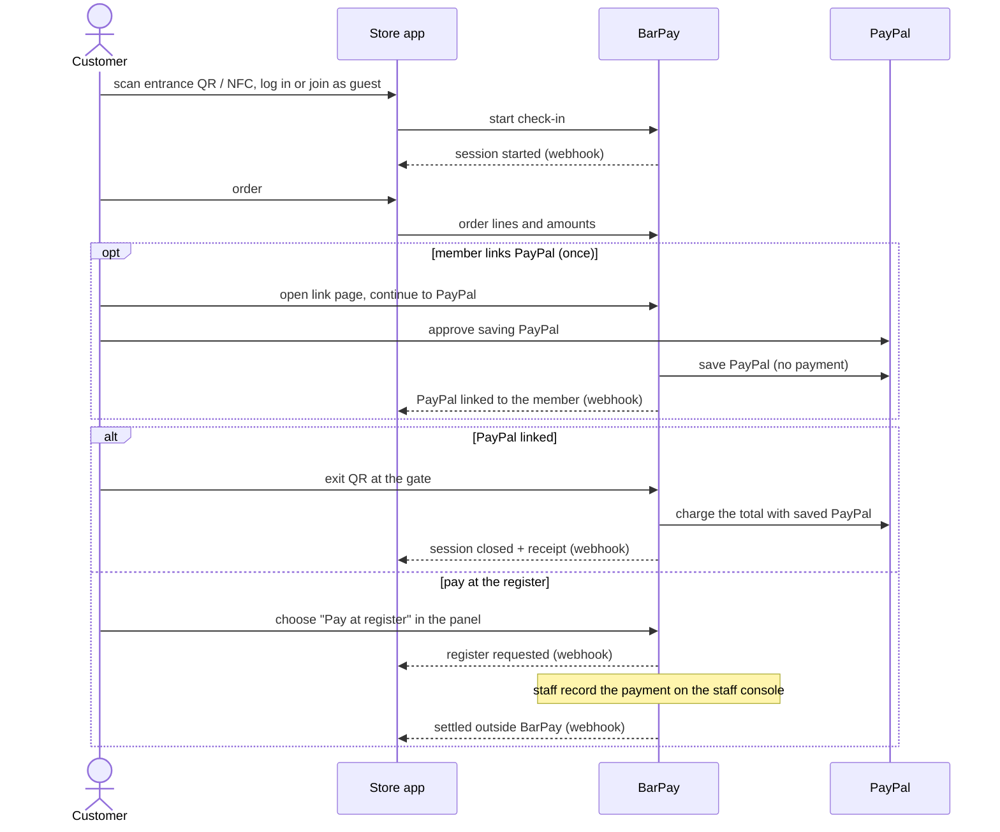
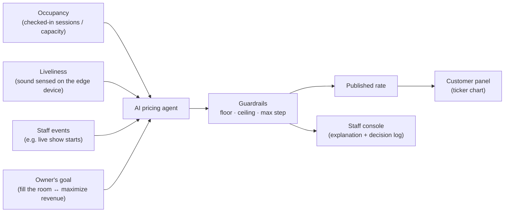
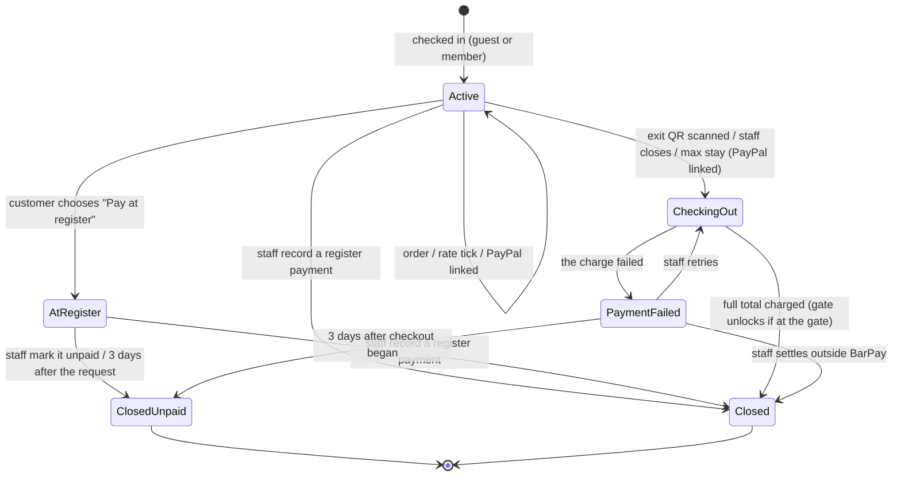
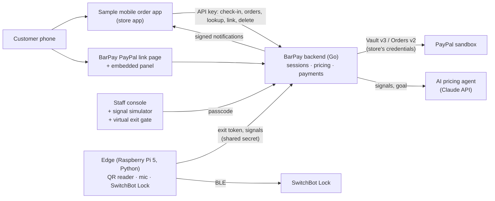

# PRD — BarPay

`PRD.ja.md` is the Japanese translation of this file.

## 1. Purpose

BarPay is a payment and pricing module that a bar plugs into its own mobile order system. It adds a cover charge that moves like a stock price with how crowded and lively the room is, and lets a member who linked PayPal settle the whole visit by walking out.

- **Customers** pay a flat cover charge (table charge / *otoshi* in Japan) whether the bar is dead or packed, and often learn about it only on the bill. Foreign visitors in particular find it surprising. They cannot see what they are paying for while they stay, and they queue at the register to leave.
- **Bar owners** cannot lower prices to fill a slow evening or capture value on a packed one. Mobile order systems take orders, but none of them prices the cover charge by demand or lets the customer simply walk out.
- **Mobile order system developers** would have to build demand pricing and walk-out settlement themselves.

BarPay solves this as a module: the store keeps its own app, menu and members; BarPay adds the live cover charge, an optional PayPal link for members that turns the exit QR into the checkout on every visit, and a register path for everyone else, paid into the store's own PayPal account.

## 2. Users

| User | Goal |
|---|---|
| Customer | Enter, drink and eat, see what they are paying, and leave by walking out (a member with PayPal linked) or by paying at the register |
| Store app | The store's mobile order system (here: the sample app). Starts visits, reports orders, and learns how each visit was settled |
| Staff / owner | Watch the room's state and handle the exceptions on the staff console; the owner sets prices, limits and cover-charge rules on its settings tab |
| Demo visitor | Try the full flow from a laptop, without hardware |

## 3. Responsibilities

BarPay owns what is about the cover charge and the money; the store app owns everything about the menu and the customer relationship.

| BarPay | Store app |
|---|---|
| Visits (sessions): check-in, stay, checkout, register settlement | The entrance landing reached from the store's QR / NFC tag, login or guest join |
| The cover charge and its AI pricing | Menu, order screen, kitchen; item prices and order contents |
| PayPal: saving a member's PayPal (optional), the checkout charge, deleting it when the member asks | Members and login; the settings screen where a member links or deletes their PayPal |
| The PayPal link page, where the customer approves PayPal | Where the customer goes before and after BarPay's pages |
| An embeddable panel: rate ticker, running total, the Pay button with the choice of PayPal (exit QR) or register | Where the panel is placed in the app |
| The exit gate and the staff console | Receipts and history in its own UI (from BarPay's results) |

Read: checking in needs no PayPal; a member approves PayPal once, on BarPay's link page, and every later visit uses it without asking; the store app and BarPay talk server to server.

Boundary rules:

- **Check-in**: the store app starts a check-in from its server; the session starts at once and its ID is returned. No BarPay page is shown at check-in.
- **PayPal link**: linking belongs to a member, not to a visit, and guests cannot link. The store app asks BarPay for a link page for a logged-in member and sends them there as a full page, never inside the panel, because PayPal approval is not expected to run inside an embedded frame (believed, not verified). A link page works for 30 minutes, and a new request replaces an earlier unused one. PayPal returns the member to BarPay, which returns them to the store app. When a member with a saved PayPal checks in, BarPay links the session by itself.
- **Lookup**: the store app can read a session's state and receipt by its ID, and whether a member has a saved PayPal by the member ID, at any time. This is how it confirms the result when the customer returns, decides whether its settings screen offers linking or deleting, and recovers missed notifications.
- **Notifications**: the events are `session.started`, `session.paypal_linked`, `session.register_requested`, `session.closed`, `session.payment_failed`, `session.settled_outside`, `session.closed_unpaid`, `gate.unlock_failed`, and for members `member.paypal_linked` and `member.saved_paypal_deleted`. Each carries an event ID and a sequence number per session (per member for `member.*` events) and is signed. A notification not acknowledged is retried 1 minute, 5 minutes, 30 minutes, 2 hours, 6 hours, 12 hours and 24 hours after the first attempt; after that it is marked as given up on the staff console. A session ends with exactly one of `session.closed` (checked out through BarPay: charged, or a total of 0), `session.settled_outside` (staff recorded a register or outside payment) or `session.closed_unpaid`, and that event carries the receipt.
- **Panel**: a BarPay page that the store app links to or embeds as a frame. It shows the live rate, its change and chart, a line while the cover charge is paused or capped, time stayed, cover charge so far, orders, payment method (PayPal or register), the running total, and a Pay button. Pay opens a choice: PayPal (shown only when linked) opens the exit QR; "Pay at register" asks staff to collect. After checkout the panel shows the result. The store app shows the receipt in its own UI from the notification or lookup.
- **API key**: the store app calls BarPay from its server; the sample app has a backend that holds the key.

## 4. Pricing model

The cover charge is a **rate per hour** that changes over time, charged in **blocks**: every block (settings tab, default 10 store minutes) after check-in, the block that just ended is charged at the rate published at that moment.

The AI decides the rate toward the owner's goal; guardrails set by the owner decide what can actually be charged.

- **Signals**: occupancy and liveliness (the author's core inputs), plus staff events. Occupancy counts checked-in phones, not people (this may change with [Open question 1](#12-open-questions)). Liveliness is computed on the edge device from the microphone, and only numbers leave the device; without the edge device, it comes from the simulator.
- **Goal**: the owner sets where the store sits between "fill the room" and "maximize revenue". The agent states how each decision serves that goal.
- **Cadence**: the rate is re-evaluated on a fixed tick (config file, default 5 minutes). Staff can also trigger one evaluation now; it counts toward the daily call cap like any other.
- **Guardrails** (settings tab): floor, ceiling, and maximum change per evaluation (config file). A proposal outside them is clamped, and the published rate is rounded to the currency's rate step (fixed: 10 JPY, 0.05 USD) without leaving the range. When the owner changes the floor or ceiling, the published rate moves into the new range at once, even beyond the max step, and the decision log records it.
- **Explanation**: each published rate carries a short, plain-English reason that states the change actually published, after clamping (e.g. "Room is half empty — rate down 5%"). It is shown on the staff console only; the customer sees the rate, its change and its chart.
- **Decision log**: every tick's inputs, the agent's proposal and reasoning, and the published rate are kept and shown on the staff console.
- **Fallback**: if the AI does not answer in time, or the daily call cap (config file) is reached, the rate stays at its last value and the log says so.
- **When the agent runs**: only while at least one session is active or the staff console is open, so the hosted demo does not spend AI budget while idle.
- **Blocks**: a block's amount is the rate × block length, rounded down to the currency's smallest unit (1 JPY, 0.01 USD), and is fixed when the block ends; it never changes afterwards. Check-in itself costs nothing, and a block that has not ended when checkout begins is not charged.
- **Pause for additional orders**: the first order of a visit does not count (one-drink rule). Each later order, counted by order and including food, pauses the cover charge for a set time (settings tab, default 30 minutes, 0 turns it off) from that order; a new order restarts the pause rather than adding to it. A block that ends during a pause costs 0.
- **Cap per visit** (settings tab, default ¥3,000 / $30, 0 for none): the block that reaches the cap is charged only up to the cap, and later blocks cost 0.
- **Settings changes**: block length, pause and cap apply to active sessions from their next block. A cap lowered below what a session has already accrued stops further blocks; nothing already accrued is reduced.
- **Demo mode**: a store-wide time factor (config file, default exactly 10) makes a store minute pass in 6 real seconds. Blocks, pauses, tick length and maximum stay use store time. The re-unlock window, the exit QR's refresh, the 3-day limits and notification retries are real time.

## 5. Payment model

Linking PayPal is optional and moves no money: it saves a member's PayPal for this store, and the whole visit is charged once, at checkout.

| Moment | What happens in PayPal |
|---|---|
| Check-in | For a member with a saved PayPal, BarPay checks that it still works; nothing else |
| Link PayPal (members only, optional) | The member approves saving their PayPal for merchant-initiated charges; BarPay keeps it under the member ID. No payment is made |
| Stay | Nothing. Orders and cover charge are recorded by BarPay |
| Checkout, total = 0 | Nothing is charged |
| Checkout, total > 0 | The total is charged once with the saved PayPal, without the customer's approval; the gate unlocks only after it succeeds |
| After checkout | Nothing. The member's saved PayPal is kept for later visits until they delete it (UC9) |

- The **running total** = orders + cover charge so far.
- A guest, a member without a saved PayPal, or anyone who chooses the register pays at the register. BarPay fixes the total, staff take the money outside BarPay and record it, and the session is closed as settled outside BarPay.

## 6. Guarantees

| Area | BarPay guarantees |
|---|---|
| Consent | A saved PayPal is charged only after the customer agreed, when linking, to have the visit's total charged at checkout without further approval, and only at checkout. They see the running total throughout |
| Transparency | While staying, the customer sees the current rate, its change and chart, the cover charge so far, whether it is paused or capped, and the running total. The pricing rules before check-in are posted by the store (see [Out of scope](#7-out-of-scope)) |
| Charges only for this visit | BarPay charges a member's saved PayPal only during the checkout of that member's session or a staff retry of it, and staff can retry for at most 3 days after checkout began. A saved PayPal is deleted when the member asks, never while a session that uses it is not yet closed |
| Accuracy | When a session is closed through BarPay checkout, the amount charged equals the final total the server fixed at the moment of checkout, and the receipt shows that total with its PayPal capture ID. When it is settled at the register or outside BarPay, the receipt shows the total and the amount staff recorded; nothing was charged through BarPay |
| Price bounds | The rate is always within the store's floor and ceiling. It never moves more than the max step per evaluation, scheduled or manual, except when the owner changes the floor or ceiling, which the decision log records |
| Single payment | Each session is settled once. A repeated scan, a retry after a network error or timeout, or a staff retry never charges the same amount twice. Before retrying a call whose outcome is unknown, BarPay checks its status in PayPal |
| Unlock only on payment | BarPay unlocks the exit gate only for a closed session that was fully charged, or whose payment staff recorded at the register or outside BarPay, and only within the re-unlock window after it closed. Once a session is closed its exit QR stops changing. Staff can also open the gate by hand from the console |
| Store notified | The store app is notified of every session start, PayPal link, register request and result. Notifications are signed, carry an event ID and a sequence number, and are retried for up to 24 hours, so the store app may receive one more than once or out of order; it can always read the current state by lookup |
| Access | Only the store app with the store's API key can start check-ins, report orders, read sessions and members, request a PayPal link page for a member and delete a member's saved PayPal. A session link gives access to that session only: its panel and its register request, which fixes the total but charges nothing. Checkout is triggered only by an authenticated edge device, by staff with the staff passcode, or by BarPay itself at the maximum stay. Only staff can record a register payment or change settings. The exit token is separate from the session link. In the hosted demo the passcode is public (see [Out of scope](#7-out-of-scope)) |
| Durability | Sessions, orders, settings, capture IDs and saved-PayPal references survive a backend restart |
| Privacy | Raw audio (and video, if used) is never stored or sent off the edge device |
| Observability | Failed charges, failed unlocks, register requests, rejected late orders, sessions past the maximum stay, notifications given up and failed deletions appear on the staff console; failed charges and unlocks are also sent to the store app |

## 7. Out of scope

| Not doing | Why |
|---|---|
| Real-money payments | Charging saved PayPal in production needs PayPal's approval for reference transactions (see [Fixed constraints](#8-fixed-constraints)); everything is built and shown in the PayPal sandbox |
| Store onboarding screens, more than one store per deployment | One store is set up with a config file; prices and cover-charge rules are changed on the staff console |
| BarPay as a payment intermediary (platform fees, multiparty) | Each store is paid into its own PayPal account |
| Using a saved PayPal across a chain's stores | Future: may work when the stores share one PayPal account; not verified |
| Members and login | The store app's job. BarPay only keeps a member's saved PayPal under the ID the store app gives it (UC2, UC9) |
| PayPal for guests | A saved PayPal needs an owner across visits, so linking needs a store account; guests pay at the register |
| Menu, order screen, kitchen workflow | The store app's job; BarPay records order lines and amounts only |
| Showing the pricing rules before check-in | The store posts them (variable rate, block length, cap per visit) on its website or in the store; the store app's join screen does not show them |
| Taking money at the register | The store's job; BarPay fixes the total and records what staff say they received |
| Protecting staff actions in the hosted demo | The passcode is published in the README so demo visitors can use the staff console; any visitor can change settings, reset the store or close a session |
| A separate store per demo visitor | Demo visitors share one demo store; a "Reset demo" button restores its sessions and settings instead |
| Cancelling or correcting an order line | Once reported, an order stays in the total; the store refunds through the PayPal dashboard |
| Correctness of what the store app reports | BarPay charges the order amounts the store app reports and trusts the member ID it sends; checking them is the store app's job |
| Notifications after 24 hours of retries | The store app recovers through lookup |
| Collecting a declined charge from a customer who has left | It stays as an unpaid amount on the staff console; collecting it is the store's job outside BarPay |
| Splitting a bill within a group | Each phone is its own session; splitting is a separate product |
| Locking in a price at entry | Would undo the stock-like model; the customer is protected by the cap per visit and the running total instead |
| A deposit or holding funds at check-in | The gate opens only after payment, so a customer whose charge fails is still inside and pays at the register; a hold would add a second charge and a pending amount on the customer's statement |
| Refunds and disputes | Handled in the PayPal dashboard |
| Tax calculation | All prices are tax-inclusive |
| Japanese UI | A second language doubles every screen and string, and English serves foreign visitors, who are most surprised by cover charges; currency (JPY/USD) is selectable, language is not |
| Locking customers in | The door must always open from inside; the lock unlocks an exit gate as part of the walk-through experience, not as a way to stop customers from leaving |

## 8. Fixed constraints

- **Verified in the sandbox (2026-10-28, USD)**: a `CAPTURE` order with only `payment_source.paypal.vault_id` was `COMPLETED` in the create response, without buyer approval. The saved PayPal used then came from an order approval, not from the setup-token flow BarPay now uses; see [Open question 5](#12-open-questions).
- **Verify before trusting**: after the customer returns from PayPal, the backend checks that the setup token it created was approved and that creating the saved PayPal from it succeeded before saving it to the member.
- **Idempotency**: every PayPal call that saves PayPal, moves money or deletes a saved PayPal carries a `PayPal-Request-Id` derived from the session, the step and the attempt, stored before the call. A network retry reuses it; a staff retry starts a new attempt. The checkout charge carries an `invoice_id` per session, which PayPal is expected to reject as a duplicate (not verified; see [Open question 5](#12-open-questions)). When a call's outcome is unknown (timeout), BarPay checks its status before any retry.
- **The store's own PayPal**: BarPay calls PayPal with the store's REST credentials and keeps them as secrets.
- **Approval for saved PayPal**: in production, saving PayPal for merchant-initiated charges needs PayPal's approval for reference transactions. It does not block the sandbox demo.
- **Currency**: each store picks JPY or USD; all amounts in that store use it. JPY has no decimal places. JPY in the sandbox depends on [Open question 4](#12-open-questions).
- **Hardware**: Raspberry Pi 5, a USB QR reader that acts as a keyboard, a SwitchBot Lock over BLE. The lock needs its MAC address, key ID and encryption key, read from environment variables.
- **Secrets**: PayPal credentials, the store API key, the AI API key and the SwitchBot keys never enter the public repository.
- **Trying without hardware**: every hardware step has a browser stand-in (virtual exit gate, signal simulator).
- **Shared demo**: several demo visitors may use the hosted demo at the same time, and the README lists several PayPal sandbox buyer accounts so one visitor changing a password does not lock out the others.
- **Language**: UI and README in English. Every non-exempt `.md` in the repo has a `.ja.md` translation (see `.claude/skills/bilingual-docs`).

## 9. Use cases

Read: a session only ends through a successful charge, a register payment or settlement that staff record, or being closed as unpaid by staff or at a 3-day limit; neither a payment failure nor a customer's register request closes it. Only "Reset demo" removes sessions outright.

### UC1 — Customer checks in

- **Precondition**: the BarPay backend is running and a rate has been published.
- **Main flow**: the customer scans the store's entrance QR code or taps its NFC tag, which opens the store app. They log in or join as a guest; the store app asks BarPay for a check-in and the session starts. The store app is notified and shows its menu, with BarPay's panel in the app.
- **Alternative flow**: a member with a saved PayPal checks in → the session starts at once; BarPay then checks with PayPal that the saved PayPal still works and links the session. The member does nothing.
- **Exception**: the member's saved PayPal no longer works (deleted by the customer in PayPal, declined) → the session stays unlinked; BarPay deletes the saved PayPal and notifies the store app (`member.saved_paypal_deleted`); the member can link again (UC2) or pay at the register.
- **Exception**: the store app's API key is missing or wrong → rejected; nothing is created.
- **Exception**: no rate has been published yet → rejected; nothing is created; the store app can try again.
- **Exception**: the store app starts the same check-in twice (same idempotency key) → the same session is returned. A member who already has an open session → rejected.
- **Postcondition**: the session is active, linked only if the member has a working saved PayPal, with no cover charge yet; its first block ends one block length after check-in; the store's occupancy count includes it.

### UC2 — Member links PayPal

- **Precondition**: the customer is logged in to the store app as a member and has no saved PayPal.
- **Main flow**: in the store app's settings, the member chooses to link PayPal. The store app asks BarPay for a link page for that member and opens it as a full page. The member continues to PayPal and approves that the store may charge a visit's total at checkout without asking again. BarPay keeps the saved PayPal under the member ID and returns the member to the store app. If the member has an active session, it becomes linked at once; otherwise the next check-in uses it (UC1). The store app is notified.
- **Exception**: the customer is a guest → the store app does not offer linking and says that it needs an account; BarPay rejects a link request without a member ID.
- **Exception**: the member already has a saved PayPal, or its deletion is still pending → rejected.
- **Exception**: the store app asks to return the member to a URL outside its origin (config file) → rejected; no link page is created.
- **Exception**: the member opens the link page after it stopped working → nothing is saved; the member is returned to the store app and can start again.
- **Exception**: the member goes back from the link page or cancels in PayPal → nothing is saved; the member can try again later or pay at the register.
- **Exception**: the setup token was not approved, or saving PayPal fails → nothing is saved; the member sees an error and can try again.
- **Exception**: the member closes the tab after approving but before BarPay saves PayPal → nothing is saved; linking again starts over.
- **Exception**: the member's session is no longer active (at the register, checking out, closed) → the saved PayPal is kept for the next visit; that session is not linked.
- **Postcondition**: the member has a saved PayPal; an active session of theirs is linked; no money has moved.

### UC3 — Customer stays and watches the price

- **Precondition**: the session is active.
- **Main flow**: BarPay's panel in the store app shows the rate as a stepped ticker chart over the visit, its latest change, time stayed, the cover charge so far, the orders' total, the payment method and the running total. While a pause or the cap applies, the panel says so.
- **Exception**: the session reaches the maximum stay (config file, default 12 hours) → if PayPal is linked, it is checked out as in UC5 without the gate, and the customer can check in again; if not, it stays active and the staff console flags it so staff can speak to the customer.
- **Postcondition**: the cover charge shown equals the sum of the ended blocks' amounts since check-in, with blocks in a pause or after the cap counted as 0.

### UC4 — Store app reports an order

- **Precondition**: the session is active.
- **Main flow**: the customer orders in the store app; the store app sends BarPay the order lines and amounts. BarPay adds them to the session. From the second order of the visit, the cover charge pauses as in the [Pricing model](#4-pricing-model).
- **Exception**: the session is not active (at the register, checking out, payment failed, closed, closed unpaid, unknown) → rejected and shown on the staff console; anything already served is collected by the store outside BarPay.
- **Exception**: the same order is reported twice (same order ID) → recorded once, and the pause is not restarted; this holds even after the session is no longer active.
- **Exception**: an order ID already recorded comes with different lines → rejected; the recorded order stays as it was.
- **Exception**: an amount is negative or in another currency → rejected.
- **Postcondition**: the running total includes the order.

### UC5 — Customer checks out at the exit gate

- **Precondition**: the session is active and PayPal is linked.
- **Main flow**: the customer taps Pay in the panel, chooses PayPal, and shows the exit QR to the reader at the exit. The QR changes at a fixed interval (config file, default 30 seconds), so an old screenshot does not work. The server fixes the final total at that moment and stops the cover charge, charges the total once with the saved PayPal as in the [Payment model](#5-payment-model), and unlocks the gate. The panel shows the result with the total and the PayPal capture ID, and the store app is notified with the receipt.
- **Alternative flow**: the same exit QR is scanned again within the re-unlock window (config file, default 2 minutes) after success → the gate unlocks again; nothing is charged.
- **Exception**: the session has no PayPal linked → rejected; the reader shows "Please pay at the register"; nothing is charged.
- **Exception**: the charge fails or is declined → the gate stays locked, the customer sees "Please see staff", the session becomes PaymentFailed with the unpaid amount on the staff console, and the store app is notified.
- **Exception**: a PayPal call times out → BarPay checks its status in PayPal before doing anything else; the gate stays locked until the outcome is known.
- **Exception**: the charge succeeds but unlocking fails → the payment stands; the staff console flags it so staff can open the gate.
- **Exception**: the exit QR is unknown or expired, belongs to a session closed longer ago than the re-unlock window, or belongs to a PaymentFailed session → rejected, nothing charged, the gate stays locked.
- **Exception**: two scans of the same QR arrive at the same time → only one checkout runs; both get the same result.
- **Postcondition (on success)**: total charged = final total on the receipt; the session is closed; the cover charge has stopped; the member's saved PayPal is kept.

### UC6 — Customer pays at the register

- **Precondition**: the session is active, with or without PayPal linked.
- **Main flow**: the customer taps Pay in the panel and chooses "Pay at register". BarPay fixes the final total, stops the cover charge, sets the session's payment method to register, and marks the session as waiting at the register; the store app and the staff console are notified. At the register, staff take the money and record it on the staff console. The session is closed as settled outside BarPay, the store app is notified (`session.settled_outside` with the receipt), and the panel shows an exit QR that opens the gate within the re-unlock window.
- **Alternative flow**: the customer goes straight to the register → staff record the payment from the guest list; the total is fixed at that moment.
- **Alternative flow**: staff record an amount different from the total → the receipt shows both; BarPay charges nothing for the difference.
- **Exception**: the customer leaves after choosing the register without paying → staff mark the session unpaid, or it is closed as unpaid 3 days after the request. Either way the unpaid total is recorded and nothing is charged to PayPal.
- **Exception**: the customer wants to pay with PayPal after choosing the register → the request cannot be withdrawn; they pay at the register. The maximum stay no longer applies, because the cover charge has stopped.
- **Postcondition**: the session is closed; the receipt shows the total and the amount recorded at the register; nothing was charged through BarPay.

### UC7 — Staff runs the room

- **Precondition**: the staff member entered the staff passcode on BarPay's staff console.
- **Main flow**: the console has four tabs:
  - **Room**: the rate chart with the latest explanation, a button to re-evaluate the rate now, the virtual exit gate for linked sessions, and alerts.
  - **Guests**: every session with check-in time, stay, number of orders, running total, payment method (PayPal or register), state and any pause or cap.
  - **Settings**: floor and ceiling, block length, pause for additional orders, cap per visit, the pricing goal, the signal simulator with staff events (e.g. a live show), and "Reset demo".
  - **System log**: the AI decision log, notifications to the store app, and the config file loaded at start.
- **Alternative flow**: a linked customer leaves through another door or has no battery → staff close the session, which checks out as in UC5 without the gate.
- **Alternative flow**: staff record a register payment as in UC6, or mark a session waiting at the register as unpaid when the customer left without paying.
- **Alternative flow**: staff change a setting → it applies as in the [Pricing model](#4-pricing-model). Floor and ceiling above 0 with the floor below the ceiling, a block of at least 1 minute, and a pause or cap of 0 or more are required; otherwise the change is rejected.
- **Alternative flow**: staff reset the demo store → every session is removed whatever its state, and its unpaid amount is discarded; members' saved PayPal is kept; alerts and notifications are cleared; prices, cover-charge rules and the goal return to the config file's starting values. The signal simulator is left as it is.
- **Exception**: a session is PaymentFailed → staff retry, which charges the total again with the saved PayPal as a new attempt; or staff mark it settled outside BarPay with the amount settled, which closes the session.
- **Exception**: a PaymentFailed session reaches 3 days after checkout began → retries stop, it is closed as unpaid with the unpaid amount recorded.

### UC8 — Store connects to BarPay

- **Main flow**: the owner sets, in a config file loaded at start: the store's PayPal REST credentials, the store API key, the store app's notification URL and signing secret, the store app's origin (the only place BarPay returns members to after linking and the only site that may embed the panel), the staff passcode, currency (JPY/USD), max step, tick length, daily AI call cap, capacity, maximum stay, re-unlock window, exit QR refresh interval, demo time factor, and the starting values of the settings tab.
- **Exception**: starting floor not below starting ceiling, maximum stay of 3 days or more, or missing credentials → BarPay does not start, and says why.
- **Exception**: currency changed while sessions are open → BarPay starts with the previous currency, flags the change on the staff console, and applies it at the first restart with no open session.
- **Postcondition**: BarPay runs with the config file's values; the settings tab holds the values last saved there, or the starting values on first start and after "Reset demo".

### UC9 — Member deletes their saved PayPal

- **Precondition**: the member has a saved PayPal.
- **Main flow**: the member deletes it in the store app's settings; the store app asks BarPay, which deletes it in PayPal. The store app is notified.
- **Exception**: a session that uses it is not yet closed → rejected; the store app says it can be deleted after paying.
- **Alternative flow**: PayPal does not confirm the deletion at once → BarPay accepts the request and retries until PayPal confirms. Until then the saved PayPal shows as being deleted: the member cannot link again and a check-in starts unlinked. The store app is notified when the deletion is confirmed; a deletion that keeps failing is flagged on the staff console.
- **Postcondition**: the member has no saved PayPal; their next check-in starts unlinked, and linking again goes through PayPal approval (UC2).

### UC10 — Demo visitor tries BarPay without hardware

- **Main flow**: from the hosted sample app, the visitor logs in as a member on their phone or laptop, checks in, orders, links PayPal with a sandbox buyer account from the README, opens the staff console with the passcode from the README, moves the signal sliders to watch the AI reprice, and checks out by picking their session in the virtual exit gate. They can also join as a guest and pay at the register, recording the payment on the staff console.
- **Postcondition**: for a PayPal checkout, the receipt shows the PayPal capture ID and the payment appears in the sandbox buyer account's activity; for a register payment, the receipt shows the amount recorded.

## 10. System overview

Read: only the BarPay backend talks to PayPal and the AI; the store app reports orders server to server, and the customer's phone never sends amounts BarPay trusts.

Implementation notes:

- Linking creates a setup token with `POST /v3/vault/setup-tokens` (`payment_source.paypal` with `usage_type: MERCHANT` and `experience_context` return and cancel URLs back to BarPay), and after approval creates the saved PayPal with `POST /v3/vault/payment-tokens` from that setup token.
- At check-in, a member's saved PayPal is checked with `GET /v3/vault/payment-tokens/{id}`.
- The checkout charge is an order with intent `CAPTURE`, `payment_source.paypal.vault_id` and an `invoice_id`.
- A member's saved PayPal is deleted, on request, with `DELETE /v3/vault/payment-tokens/{id}`.
- The edge device reads the USB QR reader through the input device (`evdev`), not `stdin`, so it works as a background service.

## 11. Priorities

| Priority | Scope |
|---|---|
| P0 — must ship | BarPay: UC1–UC7 and UC9 with the virtual exit gate, retry and "settled outside BarPay"; UC8 as a config file; the PayPal link page and the panel as BarPay pages; store API with session and member lookup; signed notifications with simple retries; AI pricing with goal, guardrails, explanations and decision log; cover charge in blocks with the pause and the cap; the settings tab; USD; demo mode; reset demo. Sample app with its own backend: entrance landing, sign-up, login and guest join, menu, ordering, settings with PayPal link, BarPay panel, receipt. UC10; hosted demo; README with an API table |
| P1 | Real edge device: QR reader → checkout → SwitchBot unlock, microphone liveliness; JPY (after Open question 4) |
| P2 | Store onboarding screens; saved PayPal across a chain's stores; AI suggestions beyond pricing (e.g. a summary of the stay on the receipt) |

## 12. Open questions

Questions 1 and 3 are decided after building a mock in `mock/`. The mock is a throwaway prototype in plain HTML, CSS and JavaScript only, is not the demo, and is not tracked in git, so it never reaches the public repository. Its UI is Japanese, for the author. It is exempt from translation pairing and from the product's tests and CI.

1. **Liveliness sensing**: microphone loudness only, or an on-device audio classifier (cheering, music, laughter)? Camera people-count as well (which would change how occupancy is counted)? The mock can stand in with browser microphone loudness.
2. **Hosting**: home server behind Cloudflare Tunnel, or Render? Whichever keeps the hosted demo reachable at all times at the lower cost.
3. **Exit gate framing**: what the lock physically secures, so BarPay does not read as "customers are locked in".
4. **JPY in the sandbox**: confirm a sandbox business account can receive JPY without holding it as pending.
5. **Untested PayPal behavior**: saving PayPal with a setup token and no payment, then charging with that `vault_id` without buyer approval; checking a saved PayPal by ID; deleting a saved PayPal; replaying a `PayPal-Request-Id`; a declined charge; and whether a staff retry after a declined charge is rejected as a duplicate `invoice_id`.
6. **AI model and prompt approach**: chosen at implementation time.
