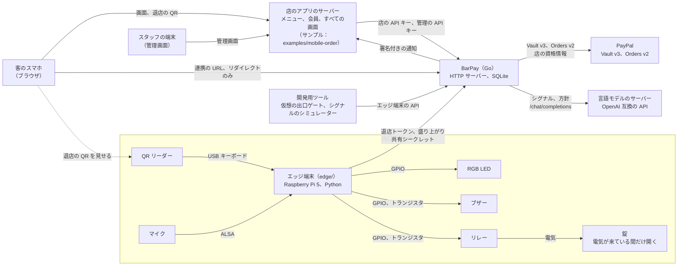
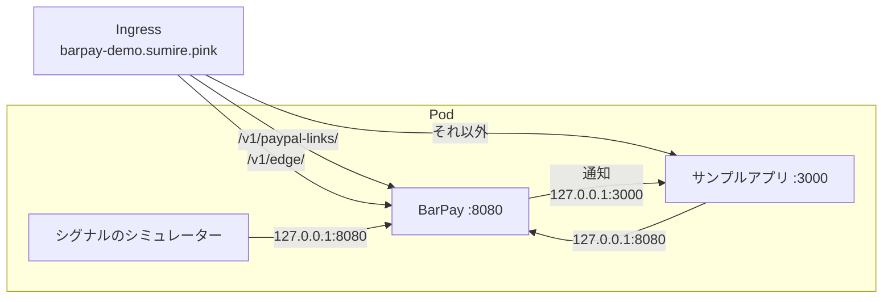
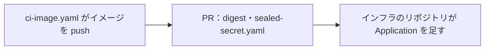

# BarPay

> `README.md` の日本語訳。内容が食い違う場合は `README.md` が正。

BarPay は、バーが自分のモバイルオーダーに組み込む決済と値付けのモジュール。店の混み具合と賑わいで動くチャージ料、PayPal を連携した会員の歩いて出るだけの精算、それ以外の客のレジ精算を受け持つ。

## BarPay が何をし、何をしないか

BarPay は、店のアプリが自分のサーバーから呼ぶ HTTP のサーバーで、画面を持たない。
来店、チャージ料とその AI の値付け、PayPal での請求を受け持ち、起きたことを署名付きの通知で店のアプリに伝える。店のアプリは、メニュー、会員と、客のパネルやスタッフの管理画面を含むすべての画面を受け持つ。

- BarPay がなぜあるか：[目的](docs/PRD.ja.md#1-目的)
- BarPay と店のアプリがそれぞれ何を受け持つか：[責務の分担](docs/PRD.ja.md#3-責務の分担)
- BarPay がしないこと：[扱わないこと](docs/PRD.ja.md#7-扱わないこと)

## 部品のつながり

BarPay は、店のアプリ、PayPal、言語モデル、出口のゲートのエッジ端末をつなぐ。PayPal と言語モデルとやり取りするのは BarPay だけ。開発用ツールは、エッジ端末とその部品の代わりになる。



- 店のアプリの呼び出しと BarPay の通知：[API](#api)
- エッジ端末、その部品と配線：[エッジ端末の動かし方](#エッジ端末の動かし方)
- 言語モデルの接続先とモデル：[`barpay.example.toml`](barpay.example.toml) の `[llm]`

## BarPay の起動

BarPay は、見本からコピーして値を入れた設定ファイルで動く。Go（版は [`go.mod`](go.mod) のもの）と、PayPal の sandbox のアプリの REST の資格情報が要る。

```sh
cp barpay.example.toml barpay.toml
```

`barpay.toml` の空の値をすべて埋める。各キーに何を入れるかはファイルのコメントにあり、どの値を省けるか、どんなときに BarPay が起動しないかは [UC8](docs/PRD.ja.md#uc8--店が-barpay-とつながる) にある。`keys.store_api_key`、`keys.admin_api_key`、`keys.edge_shared_secret`、`notifications.signing_secret` は自分で決めたランダムな文字列で、`[keys]` の各値は互いに違うものにする。`llm.address` で LLM が答えなくても BarPay は起動し、レートの見直しは [価格モデル](docs/PRD.ja.md#4-価格モデル) のとおり代替動作になる。サンプルアプリを動かすなら、`store_app_origin` と `notifications.url` は [`mobile-order.example.conf`](examples/mobile-order/mobile-order.example.conf) の先頭のコメントから取る。

```sh
go run ./cmd/barpay
```

`BarPay started` と待ち受けるアドレスをログに出せば、BarPay は動いている。値が間違っていれば、どの値かを言って起動しない。

## API

店のアプリは、次の操作を自分のサーバーから、BarPay の URL の `/v1` の下に、`barpay.toml` の店の API キーか管理の API キーで呼ぶ。要求と応答の形、エラー、振る舞いは [`docs/api/openapi.yaml`](docs/api/openapi.yaml) にある。

| メソッド | パス | 鍵 | operationId | 何をするか |
|---|---|---|---|---|
| `POST` | `/checkins` | 店 | `createCheckin` | 入店を始める |
| `GET` | `/sessions/{session_id}` | 店 | `getSession` | セッションを読む |
| `POST` | `/sessions/{session_id}/member` | 店 | `attachMember` | ゲストのセッションに会員を付ける |
| `POST` | `/sessions/{session_id}/orders` | 店 | `reportOrder` | 注文を伝える |
| `POST` | `/sessions/{session_id}/register-request` | 店 | `requestRegister` | 客がレジで払うことを選ぶ |
| `GET` | `/sessions/{session_id}/exit-token` | 店 | `getExitToken` | セッションの今の退店トークンを得る |
| `GET` | `/rate` | 店 | `getRate` | 公開中のレートを読む |
| `GET` | `/rate/history` | 店 | `getRateHistory` | ある期間に公開したレートを読む |
| `POST` | `/rate-evaluations` | 店 | `requestRateEvaluation` | BarPay にレートの見直しを頼む |
| `GET` | `/members/{member_id}` | 店 | `getMember` | 会員の保存した PayPal を読む |
| `POST` | `/members/{member_id}/paypal-link` | 店 | `createPaypalLink` | PayPal 連携の URL を求める |
| `POST` | `/members/{member_id}/paypal-link/confirm` | 店 | `confirmPaypalLink` | PayPal 連携を確定する |
| `DELETE` | `/members/{member_id}/saved-paypal` | 店 | `deleteSavedPaypal` | 会員の保存した PayPal を削除する |
| `GET` | `/admin/sessions` | 管理 | `listSessions` | セッションの一覧 |
| `POST` | `/admin/sessions/{session_id}/close` | 管理 | `closeSession` | スタッフが連携済みのセッションを締める |
| `POST` | `/admin/sessions/{session_id}/retry` | 管理 | `retryCharge` | スタッフが失敗した請求を再試行する |
| `POST` | `/admin/sessions/{session_id}/register-payment` | 管理 | `recordRegisterPayment` | スタッフがレジでの支払いを記録する |
| `POST` | `/admin/sessions/{session_id}/settle-outside` | 管理 | `settleOutside` | スタッフが失敗した請求を BarPay の外で精算する |
| `POST` | `/admin/sessions/{session_id}/mark-unpaid` | 管理 | `markUnpaid` | スタッフがレジ待ちのセッションを未払いにする |
| `POST` | `/admin/gate/unlock` | 管理 | `unlockGate` | スタッフが手で出口ゲートを開ける |
| `GET` | `/admin/settings` | 管理 | `getSettings` | 設定を読む |
| `PUT` | `/admin/settings` | 管理 | `updateSettings` | 設定を変える |
| `GET` | `/admin/decisions` | 管理 | `listDecisions` | 判断ログを読む |
| `GET` | `/admin/alerts` | 管理 | `listAlerts` | 警告を読む |
| `GET` | `/admin/notifications` | 管理 | `listNotifications` | 通知の記録を読む |

BarPay は次の通知を、署名して `barpay.toml` の `notifications.url` に送る。形と署名の確かめ方は [`docs/api/openapi.yaml`](docs/api/openapi.yaml) の `webhooks` にある。

| イベントの種類 | いつ |
|---|---|
| `session.started` | セッションが始まった |
| `session.member_attached` | ゲストのセッションに会員が付いた |
| `session.paypal_linked` | セッションが会員の保存した PayPal に結び付いた |
| `session.register_requested` | 客がレジで払うことを選んだ |
| `session.closed` | セッションが BarPay で精算された |
| `session.payment_failed` | 精算の請求が失敗した、または確かめられなかった |
| `session.settled_outside` | スタッフが BarPay の外で受け取った支払いを記録した |
| `session.closed_unpaid` | セッションが未払いで閉じられた |
| `gate.unlock_failed` | 支払い済みのセッションで出口ゲートが開かなかった |
| `member.paypal_linked` | 会員が PayPal を保存した |
| `member.saved_paypal_deleted` | 会員の保存した PayPal が削除された |

## 開発用ツールの動かし方

[`cmd/barpay-dev`](cmd/barpay-dev) の開発用ツールは、エッジ端末のハードウェアの代わりをする（[ハードウェア無しでの開発](docs/PRD.ja.md#8-動かせない前提)）。仮想の出口ゲートと、シグナルのシミュレーター。
ツールはエッジ端末の API（[`docs/api/edge.yaml`](docs/api/edge.yaml)）で BarPay を呼び、エッジ端末の共有シークレットを環境変数から読む。`barpay.toml` は読まない。BarPay を動かしたまま、リポジトリの直下で、それぞれを別の端末で動かす。プレースホルダーは `keys.edge_shared_secret` の値に置き換える。

```sh
export BARPAY_EDGE_SHARED_SECRET='<keys.edge_shared_secret in barpay.toml>'
go run ./cmd/barpay-dev gate
```

```sh
export BARPAY_EDGE_SHARED_SECRET='<keys.edge_shared_secret in barpay.toml>'
go run ./cmd/barpay-dev signals
```

仮想の出口ゲートは、退店 QR の中身を、QR リーダーが打ち込むように行ごとに受け取る。店のアプリが出す退店 QR を任意の QR スキャナーで読み、その中身を貼り付ける。シグナルのシミュレーターは、止めるまで店の賑わいを送り、新しい値を行ごとに受け取る。`-vary` を付けると、入力を読まず、賑わいを自分で動かす。コンテナの中のように誰も打ち込まない場所でも値が変わり続ける。`-liveliness` を中心に上下 `-swing`（指定しなければ 0.3）まで動き、`-period`（指定しなければ 30 分）ごとに元に戻る。値は 0 から 1 に収める。

```sh
go run ./cmd/barpay-dev signals -vary
```

引数無しで動かすと、ツールは使い方（ほかに何を受け取るかと、別の場所で待ち受ける BarPay を指す `-barpay` フラグを含む）を表示し、エラーの終了ステータスで終わる。

```sh
go run ./cmd/barpay-dev
```

## エッジ端末の動かし方

エッジ端末（[`edge/`](edge)）は出口ゲートのソフトウェア。退店 QR を読み、ロックを動かし、結果を LED とブザーで示し、店の盛り上がりを BarPay に送る。Ubuntu Server 26.04 LTS の Raspberry Pi 5 の上で、専用のユーザーの systemd のサービスとして動き、起動のときに立ち上がる。使う部品は [動かせない前提](docs/PRD.ja.md#8-動かせない前提) のハードウェアにある。OS の入れ方とネットワークの設定はここでは扱わない。以下のコマンドは、Raspberry Pi 5 の上で、`sudo` を使えるユーザーで動かす。

### 入れ方

pyalsaaudio と evdev は Raspberry Pi 5 の上でソースから組み立てるので、先に組み立ての道具とヘッダーを入れる。

```sh
sudo apt install git build-essential libasound2-dev linux-libc-dev
```

自分のユーザーに [uv](https://docs.astral.sh/uv/) の 0.12.6 以降を入れ、ログインし直すか、その環境を読み込む。

```sh
curl -LsSf https://astral.sh/uv/install.sh | sh
source ~/.local/bin/env
uv --version
```

コードと uv が入れる Python は、自分が持ち主の `/opt/barpay-edge` の下に置く。サービスのユーザーは読めるが、書き換えられない。

```sh
sudo install -d -o "$USER" -g "$USER" -m 755 /opt/barpay-edge
git clone https://github.com/sumiredc/barpay.git /opt/barpay-edge/barpay
cd /opt/barpay-edge/barpay/edge
UV_PYTHON_INSTALL_DIR=/opt/barpay-edge/python uv sync --locked --managed-python --extra gpio --extra microphone --extra qr
```

extra は機器のライブラリを入れる。`gpio` はロック、LED、ブザー、`microphone` は ALSA、`qr` は QR リーダーの入力デバイスのため。サービスのユーザーを作る。ホームを持たず、ログインできない。

```sh
sudo useradd --system --user-group --no-create-home --home-dir /nonexistent --shell /usr/sbin/nologin barpay-edge
```

更新するときは、`/opt/barpay-edge/barpay/edge` で `git pull` と上の `uv sync` の行をもう一度動かし、サービスを立ち上げ直す。

### 時刻の合わせ方

Raspberry Pi 5 の時計には電池が無いので、電源が戻った後、時計は大きく遅れた時刻から始まる。すると chrony は NTS の時刻のサーバーの証明書をまだ有効でないと見て、それらのサーバーでは時計を合わせられない。Ubuntu には、証明書が 1970 年から有効な bootstrap のサーバーもあるが、それに届かないと時計は合わず、BarPay への呼び出しもすべて証明書の確認で失敗する。[`edge/deploy/chrony/barpay-edge.conf`](edge/deploy/chrony/barpay-edge.conf) は、OS の chrony の設定に足す分で、OS の NTS の時刻のサーバーはそのまま使う。NTS の時刻のサーバーだけを使い、起動のときに chronyd が立ち上がった後の最初の時刻の更新だけ証明書の有効期間を確かめず、時計を一度に直すのは chronyd が立ち上がった直後の更新だけにする。

```sh
sudo install -m 644 /opt/barpay-edge/barpay/edge/deploy/chrony/barpay-edge.conf /etc/chrony/conf.d/
sudo systemctl restart chrony
```

OS の `/etc/chrony/chrony.conf` は `/etc/chrony/conf.d` を読み（`confdir`）、その行より後で、より多く一度に直せる `makestep` を設定していないこと。時刻のサーバーはどれも Mode が `NTS` で、時計が同期していること。

```sh
grep -nE '^(confdir|sourcedir|makestep|nocerttimecheck)' /etc/chrony/chrony.conf
sudo chronyc -N authdata
timedatectl
```

サービスは時刻の同期を待たない。BarPay に届くまでは、BarPay に届かないほかのときと同じく、スキャンで「BarPay に届かない」を示す。

### 設定

エッジ端末は設定を環境変数から読み、サービスはそれを `/etc/barpay-edge/barpay-edge.env` から取る。見本をそこへ写し、共有シークレットを持つので root だけが読めるようにする。systemd が root で読み、値をエッジ端末に渡す。

```sh
sudo install -d -m 700 /etc/barpay-edge
sudo install -m 600 /opt/barpay-edge/barpay/edge/deploy/barpay-edge.example.env /etc/barpay-edge/barpay-edge.env
sudoedit /etc/barpay-edge/barpay-edge.env
```

`BARPAY_URL` と `BARPAY_EDGE_SHARED_SECRET`（`barpay.toml` の `keys.edge_shared_secret`）を埋める。`BARPAY_URL` は `https` でなければならない。ただし、ループバックの IP アドレス（`127.0.0.0/8` か `::1`）への `http`（確認のために同じマシンで動かす BarPay など）は除く。ネットワーク越しの平文の `http` では、そのネットワーク上の誰でも共有シークレットを読め、BarPay の答え（解錠を含む）を読むことも偽ることもできる。これ以外の `BARPAY_URL`（`localhost` のような名前への `http` など）では、エッジ端末は起動しない。別のマシンの BarPay で確かめるときは、その BarPay を `https` で出すか、SSH のポート転送で Raspberry Pi のループバックのアドレスに持ってくる。`BARPAY_EDGE_MICROPHONE_DEVICE` にはマイクのカードを指定する。ALSA の既定の機器はマイクのカードとは限らない。各変数が何を取るかはファイルのコメントにある。ほかの値は、Raspberry Pi 5 と下の配線に合わせて入れてある。値が無いか形が違えば、エッジ端末はどの値かをログに出し、起動しない。

サービスが動き始めた後は、ファイルを変える前にサービスを止め、変えた後に起動する。止まった後の処理はファイルを読み直すので、動いている間に線の番号を変えると、その処理は新しい線を low にし、古い線はそのままにしてしまう。

```sh
sudo systemctl stop barpay-edge
sudoedit /etc/barpay-edge/barpay-edge.env
sudo systemctl start barpay-edge
```

### 権限

サービスのユーザーは、udev の規則 [`edge/deploy/99-barpay-edge.rules`](edge/deploy/99-barpay-edge.rules) で、そのグループを通じて 3 つの機器だけを使える。QR リーダーのキーボードの機器、マイクのカードの制御と録音の機器、ヘッダーの GPIO のチップ（ロック、LED、ブザーの線を含む）。ほかの入力や音の機器と `uinput` は使えない。QR リーダーの `ID_SERIAL` と、マイクのカードの ID（角かっこの中）を調べる。

```sh
ls /dev/input/by-id/
udevadm info /dev/input/by-id/<the reader>-event-kbd | grep ID_SERIAL=
cat /proc/asound/cards
```

規則と見本は、ヘッダーの GPIO のチップ（`pinctrl-rp1` という名前のもの）を `gpiochip0` としている。`gpiodetect`（`gpiod` のパッケージ）でそのチップの番号が違えば、規則の `KERNEL` と `BARPAY_EDGE_GPIO_CHIP` をそのチップに変える。

```sh
sudo apt install gpiod
gpiodetect
```

規則を入れ、その 2 つのプレースホルダーを調べた値に置き換えて、当てる。

```sh
sudo install -m 644 /opt/barpay-edge/barpay/edge/deploy/99-barpay-edge.rules /etc/udev/rules.d/
sudoedit /etc/udev/rules.d/99-barpay-edge.rules
sudo udevadm control --reload
sudo udevadm trigger
ls -lL /dev/input/barpay-edge-qr /dev/gpiochip0 /dev/snd/
```

QR リーダーの機器、マイクのカードの `controlC` と `pcmC…c` の機器、`/dev/gpiochip0` のグループが `barpay-edge` になる。規則は QR リーダーの機器を `/dev/input/barpay-edge-qr` としてもリンクする。これが見本の `BARPAY_EDGE_QR_DEVICE`。

### ロックの配線

ロックの線（`BARPAY_EDGE_LOCK_LINE`。既定は GPIO 24、ヘッダーの 18 番ピン）は、NPN トランジスタを通してリレーを動かす。リレーのコイルはふつう 5 V で、3.3 V の GPIO の線では直接動かせない。まず錠の代わりに、リレーの接点に LED をつなぐ。

| 部品 | 値 | 理由 |
|---|---|---|
| リレー | コイルは 5 V で 100 mA 以下（コイルの抵抗が 50 Ω 以上）、接点は錠の電圧と電流に耐える | ヘッダーの 5 V のピンから動かす |
| NPN トランジスタ | コレクタ電流 500 mA 以上、コレクタ・エミッタ間の電圧 30 V 以上、100 mA での電流増幅率 100 以上 | 下のベース電流で完全にオンになる |
| ベースの抵抗 | 1 kΩ | GPIO の線から約 2.6 mA、ほぼすべてがベースに流れる |
| プルダウンの抵抗 | 10 kΩ、ベースからグラウンドへ | 線を動かしていない間（起動の途中、入力になっている間、手放した後）にリレーが入らない |
| コイルに並べるダイオード | シリコンの整流ダイオード、1 A、100 V 以上 | コイルを切ったときに出る電圧を逃がす。逃がさないとトランジスタと Raspberry Pi 5 を壊しうる |
| 代わりの LED とその抵抗 | 任意の LED、330 Ω | 5 V から約 9 mA |

| つなぐ元 | つなぐ先 |
|---|---|
| GPIO 24（ヘッダーの 18 番ピン） | ベースの抵抗を通して、トランジスタのベース |
| トランジスタのベース | プルダウンの抵抗を通して、グラウンド（ヘッダーの 20 番ピン） |
| トランジスタのエミッタ | グラウンド（ヘッダーの 20 番ピン） |
| トランジスタのコレクタ | リレーのコイルの一方の端と、ダイオードのアノード |
| リレーのコイルのもう一方の端 | 5 V（ヘッダーの 2 番ピン）と、ダイオードのカソード（帯のある側） |
| 5 V（ヘッダーの 4 番ピン） | リレーの共通の接点（COM） |
| リレーの常時開の接点（NO） | LED の抵抗を通して、LED のアノード |
| LED のカソード | グラウンド（ヘッダーの 6 番ピン） |

LED は解錠のたびに解錠の秒数（`BARPAY_EDGE_UNLOCK_SECONDS`）だけ点き、それ以外は消えている。トランジスタとダイオードを載せた出来合いのリレーのモジュールも、入力が high の間に入るものなら使える。入力が low の間に入るものは、起動の途中を含め、線が low の間ずっとゲートを開けてしまう。

錠を動かすときは、LED の場所に錠をつなぎ替える。錠の電源を、リレーの COM と NO の接点を通して錠につなぎ、リレーが入っている間だけ錠に電気が届くようにする。コードと設定は何も変わらない。使う錠は、電気が無い間は施錠され、電気がある間だけ開き、電気が無くても内側からは常に開けられるものに限る（[客を閉じ込めること](docs/PRD.ja.md#7-扱わないこと)）。錠が直流のコイルで、自分で逆向きの電圧を抑えないものなら、同じダイオードを錠にも並べる。カソードを錠のプラスの端子に向ける。

### LED とブザーの配線

LED の 3 本の線（`BARPAY_EDGE_LED_RED_LINE`、`BARPAY_EDGE_LED_GREEN_LINE`、`BARPAY_EDGE_LED_BLUE_LINE`。既定は GPIO 17、27、22）は、抵抗を通して各色を直接点ける。ブザーの線（`BARPAY_EDGE_BUZZER_LINE`。既定は GPIO 23）は、ロックの線がリレーを動かすのと同じく、NPN トランジスタを通して 5 V でブザーを鳴らす。アクティブブザーは数十 mA を流すことが多く、GPIO の 1 本の線には多すぎる。

| 部品 | 値 | 理由 |
|---|---|---|
| RGB LED | カソード共通 | 各色は、その線が high の間だけ点く（[動かせない前提](docs/PRD.ja.md#8-動かせない前提)のハードウェアの Indicator） |
| 赤の抵抗 | 330 Ω | 3.3 V の線から約 4 mA（順方向の電圧が 2.0 V のとき） |
| 緑と青の抵抗 | それぞれ 100 Ω | それぞれ約 3 mA（順方向の電圧が 3.0 V のとき。3.3 V のうち抵抗に残る電圧が小さい）。3 色とも点く白で約 10 mA、3 本の線に分かれる |
| ブザー | 5 V のアクティブブザー、100 mA 以下、電気がある間ずっと鳴るもの | エッジ端末は線を入れて切るだけ |
| NPN トランジスタ | ロックと同じ | ブザーの電流を流しても、下のベース電流で完全にオンになる |
| ベースの抵抗 | 1 kΩ | GPIO の線から約 2.6 mA、ほぼすべてがベースに流れる |
| プルダウンの抵抗 | 10 kΩ、ベースからグラウンドへ | 線を動かしていない間（起動の途中、入力になっている間、手放した後）にブザーが鳴らない |

| つなぐ元 | つなぐ先 |
|---|---|
| GPIO 17（ヘッダーの 11 番ピン） | 赤の抵抗を通して、LED の赤の足 |
| GPIO 27（ヘッダーの 13 番ピン） | 緑の抵抗を通して、LED の緑の足 |
| GPIO 22（ヘッダーの 15 番ピン） | 青の抵抗を通して、LED の青の足 |
| LED の共通の足（いちばん長い足） | グラウンド（ヘッダーの 9 番ピン） |
| GPIO 23（ヘッダーの 16 番ピン） | ベースの抵抗を通して、トランジスタのベース |
| トランジスタのベース | プルダウンの抵抗を通して、グラウンド（ヘッダーの 9 番ピン） |
| トランジスタのエミッタ | グラウンド（ヘッダーの 9 番ピン） |
| トランジスタのコレクタ | ブザーの − の足 |
| ブザーの + の足（`+` の印があるか、長いほう） | 5 V（ヘッダーの 4 番ピン） |

LED のほかの足のどれが何色かは部品によって違うので、部品のデータシートで確かめる。グラウンドの 9 番ピンには何本もつなぐので、たとえばブレッドボードのグラウンドのレールを通して分ける。ヘッダーの 5 V のピンは 2 本ともロックの配線が使うので、ブザーは 4 番ピンをリレーの共通の接点と分け合う。たとえば、ブレッドボードの電源のレールを通して分ける。錠の代わりの LED を錠に替えた後は、リレーの共通の接点には錠の電源をつなぐので、4 番ピンはブザーだけにつながる。

ブザーは配線する前に、+ の足を 5 V に、もう一方をグラウンドに、少しの間だけ直接つないで確かめる。アクティブブザーはつないでいる間ずっと鳴る。パッシブブザーはつないだときと外したときにカチッと鳴るだけで、エッジ端末では鳴らせない。キットには見た目のよく似た両方が入っていることがあり、表示が逆のこともある。トランジスタを載せた出来合いのブザーのモジュールも、入力が high の間に鳴るものなら使える。入力が low の間に鳴るものは、起動の途中やエッジ端末が止まっている間を含め、線が low の間ずっと鳴ってしまう。

配線を確かめるには、[サービスの起動と止め方](#サービスの起動と止め方)のとおりに `barpay_edge.indicator_gpio` の確認を動かす。表の状態を順に示し、線の値を確かめる。ブザーの音と LED の光は確かめられないので、各状態の見え方と鳴り方が表のとおりかを、目と耳で確かめる。

### QR リーダーをコンソールから切り離す

QR リーダーはキーボード。エッジ端末は動いている間それを専有するが、起動の途中、落ちてから立ち上げ直すまで、QR リーダーを差した直後は、打った文字がコンソールに届く。ログインの画面に届けば退店トークンがユーザー名としてログに残り、ログインしたままのシェルに届けばコマンドとして動く。udev の規則では、カーネルがキーボードのキーをコンソールに送るのを止められないので、代わりにどの仮想端末でもログインの画面を動かさない。[`edge/deploy/logind/barpay-edge.conf`](edge/deploy/logind/barpay-edge.conf) で logind がそれを立ち上げないようにし、tty1 のログインの画面と、`getty-static.service` の予備のログインの画面はマスクする。SSH でのログインには影響しない。コンソールにログインしたままのシェルは再起動まで動き続けるので、この手順は SSH から動かし、先にすべてのコンソールからログアウトしておく。

```sh
sudo install -D -m 644 /opt/barpay-edge/barpay/edge/deploy/logind/barpay-edge.conf /etc/systemd/logind.conf.d/barpay-edge.conf
sudo systemctl mask getty@tty1.service getty-static.service
sudo reboot
```

再起動の後、動いているログインの画面のユニットは無く、コンソールのセッションも無く（`loginctl` が示すセッションは、TTY が無いか `pts/` のもの）、tty1 で動くプロセスも無い。

```sh
systemctl list-units --all 'getty@*' 'autovt@*' getty-static.service
loginctl list-sessions
ps -t tty1
```

### サービスの起動と止め方

```sh
sudo install -m 644 /opt/barpay-edge/barpay/edge/deploy/barpay-edge.service /etc/systemd/system/
sudo systemctl daemon-reload
sudo systemctl enable --now barpay-edge
systemctl status barpay-edge
```

サービスは起動のときに、ネットワークも時刻も待たずに立ち上がる。`systemctl stop` 以外で終わったら、初めは 2 秒後に立ち上げ直す。待つ時間はその後の終わりごとに 10 秒まで延び、次に `systemctl` でサービスを起動するまで 10 秒のままになる。立ち上げ直しはやめない。どの止まり方の後も（落ちたときや `kill -9` を含む）ロックの線と、LED とブザーの線を low にするので、エッジ端末が動いていない間に、ゲートが開いたままにならず、状態が示されたままにもならない。

```sh
sudo systemctl restart barpay-edge
sudo systemctl stop barpay-edge
sudo systemctl disable --now barpay-edge
```

`barpay_edge.indicator_gpio` と `barpay_edge.lock_gpio` の確認は、同じ GPIO の線を使うので、サービスを止めてから動かす。同じ変数を読むので、root で、環境変数のファイルの値とともに動かす。たとえば次のとおり。

```sh
cd /opt/barpay-edge/barpay/edge
sudo sh -c 'set -a; . /etc/barpay-edge/barpay-edge.env; exec .venv/bin/python -m barpay_edge.indicator_gpio'
```

### ログの見方

エッジ端末はジャーナルにログを出す。立ち上がると、動かす部品とともに `started:` を出し、その後、スキャンごとの結果、解錠ごと、送った盛り上がりごとに出す。共有シークレットと退店トークンは出さない。設定が無いか形が違うときは、`barpay-edge:` と変数の名前を出し、終了ステータス 2 で終わる。

```sh
journalctl -u barpay-edge -f
journalctl -u barpay-edge -b
```

## サンプルアプリの動かし方

[`examples/mobile-order`](examples/mobile-order) は店のアプリの見本で、上の API と通知だけで BarPay を使うバーのモバイルオーダー。
BarPay のコードに依存しない別の Go モジュールで、[優先度](docs/PRD.ja.md#11-優先度) のサンプルアプリの行が挙げる画面を描く。[BarPay の起動](#barpay-の起動) のとおりに `store_app_origin` と `notifications.url` を設定した BarPay が動いている必要がある。

```sh
cd examples/mobile-order
cp mobile-order.example.conf mobile-order.conf
```

`mobile-order.conf` の空の値をすべて埋める。`barpay.toml` の店の API キー、管理の API キー、通知の署名用シークレットと、コメントにあるとおりスタッフの ID とパスワードのハッシュを持つ `staff` の行。次のコマンドがパスワードを読んでハッシュを表示する。

```sh
go run . hash-password
```

```sh
go run .
```

開く URL をログに出せば、サンプルアプリは動いている。その URL をブラウザで開くと入口の画面が出る。スタッフは `/admin` で管理画面にログインする。

## Kubernetes で動かす

[`deploy/`](deploy) は、BarPay・サンプルアプリ・シグナルのシミュレーターを、自宅の Kubernetes クラスターの 1 つの Pod で PayPal sandbox に対して動かし、`https://barpay-demo.sumire.pink` で公開する。`deploy/` は Argo CD が `main` から適用する。その Application は、namespace `barpay` も作り、クラスターのインフラのリポジトリにある。イメージは 3 つのプログラムを持ち、BarPay の本番のビルドではない。[`ci-image.yaml`](.github/workflows/ci-image.yaml) が、`deploy/` 以外も変える `main` への push で [`Dockerfile`](Dockerfile) からビルドし、クラスターの registry に `10.1.1.10:5000/barpay/demo:<commit SHA>` として push し、その commit と digest を実行のサマリーに書く。サンプルアプリは時刻を店のタイムゾーンで表示する。それは [`deploy/deployment.yaml`](deploy/deployment.yaml) にあるそのコンテナの `TZ`（`America/Los_Angeles`）。



エッジ端末は `/v1/edge/` を通ってこの BarPay に届く。その環境ファイルで、`BARPAY_URL=https://barpay-demo.sumire.pink`、`BARPAY_EDGE_SHARED_SECRET` を Secret の `edge_shared_secret`、`BARPAY_EDGE_MICROPHONE=fake` にする。盛り上がりはシグナルのシミュレーターが送っていて、2 つの送り手は互いに上書きする。

### 設定ファイルを作る

設定ファイルは秘密を持つので、SealedSecret `barpay-demo` を通してだけ Pod に届く。雛形をコピーする。雛形は、秘密以外の値を Pod 向けに埋めてある。2 つのコピーは git が無視する。

```sh
cp deploy/barpay.example.toml deploy/barpay.toml
cp deploy/mobile-order.example.conf deploy/mobile-order.conf
```

空の値をすべて埋める。PayPal sandbox のアプリの認証情報と、残りは [BarPay の起動](#barpay-の起動) と同じく自分で決めたランダムな文字列。`llm.address` には、`qwen3:8b` を出すクラスターの外の Ollama が埋めてある。別の場所にあるなら変える。違っていると、どの判定もフォールバックする。`staff` の行は `staff = <スタッフの ID> <パスワードのハッシュ>`。管理画面にはインターネットから届くので、強く、ほかで使っていないパスワードにする。次のコマンドがそのハッシュを表示する。

```sh
go run -C examples/mobile-order . hash-password
```

次の値は、両方の場所で同じにする。

| `deploy/barpay.toml` | 同じにする相手 |
|---|---|
| `keys.store_api_key` | `deploy/mobile-order.conf` の `store_api_key` |
| `keys.admin_api_key` | `deploy/mobile-order.conf` の `admin_api_key` |
| `notifications.signing_secret` | `deploy/mobile-order.conf` の `notification_signing_secret` |
| `keys.edge_shared_secret` | Secret のキー `edge_shared_secret`。シミュレーターは `BARPAY_EDGE_SHARED_SECRET` として受け取る |

### Secret に封をする

2 つのファイルとエッジ端末の共有シークレットを、`deploy/sealed-secret.yaml` に封をする。`kubeseal` はクラスターの公開鍵で暗号化するので、`kubectl` がクラスターに届くマシンで、リポジトリのルートで実行する。SealedSecret は、namespace `barpay` の `barpay-demo` としてしか開かない。別の名前か namespace で封をすると、Pod は起動しない。聞かれたら `deploy/barpay.toml` の `keys.edge_shared_secret` を入力する。

```sh
printf 'keys.edge_shared_secret: '; read -rs EDGE_SHARED_SECRET; echo
kubectl create secret generic barpay-demo --namespace barpay \
  --from-file=barpay.toml=deploy/barpay.toml \
  --from-file=mobile-order.conf=deploy/mobile-order.conf \
  --from-literal=edge_shared_secret="$EDGE_SHARED_SECRET" \
  --dry-run=client -o yaml \
  | kubeseal --format yaml > deploy/sealed-secret.yaml
unset EDGE_SHARED_SECRET
```

`deploy/sealed-secret.yaml` をコミットし、[`deploy/kustomization.yaml`](deploy/kustomization.yaml) の `resources` にそれがあることを確かめる。後で値を変えるときは、ファイルを直し、封をし直し、新しい `deploy/sealed-secret.yaml` をコミットする。コンテナは設定ファイルを、シミュレーターは環境変数を起動時にしか読まないので、Argo CD が SealedSecret を同期した後に Pod を再起動する。

```sh
kubectl -n barpay rollout restart deploy/barpay-demo
```

### 初めて配置する

次の順で入れる。まだ registry に無いイメージでは Pod が `ImagePullBackOff` で止まり、Secret が無ければ `CreateContainerConfigError` で止まる。



1. `main` への push の後、`ci-image.yaml` が終わるのを待ち、実行のサマリーから commit と `digest` を取る。イメージは、`barpay-dev signals` が `-vary` を受け付ける commit からビルドしたものにする。[`deploy/deployment.yaml`](deploy/deployment.yaml) がそれを渡すので、それより古いものでは signals のコンテナが起動時に止まる。クラスターのネットワークにあるマシンからは、registry が持つタグを一覧できる。

   ```sh
   curl -s http://10.1.1.10:5000/v2/barpay/demo/tags/list
   ```

2. 1 つの PR で、[`deploy/kustomization.yaml`](deploy/kustomization.yaml) の `digest` をその値に、その上のコメントをその commit にし、[Secret に封をする](#secret-に封をする) のとおりに SealedSecret を足す。
3. それが `main` に入ったら、インフラのリポジトリが Argo CD の Application を足す。

BarPay とサンプルアプリはユーザー 65532 で動く。それぞれがボリュームの自分のディレクトリ `barpay` と `mobile-order` に書く。kubelet はそれらを root で、ボリュームのディレクトリと同じ mode で作るので、その mode がほかのユーザーに書き込みを許すときだけ、ユーザーは書き込める。BarPay のログに `BarPay started` が出れば動いている。`not started: store: /data/barpay.db: … unable to open database file` が出たら、そのユーザーは書き込めていない。サンプルアプリはどちらでも起動し、最初に保存するときに初めて失敗するので、一度会員登録をして、ログにエラーが出ないことを確かめる。どれかのディレクトリに書き込めなければ、storage ノードでユーザー 65532 が書き込めるようにしてもらい、Pod を消す。シグナルのシミュレーターは 10 秒ごとに `liveliness … sent` をログに出す。`not sent: BarPay answered 401 …` が出たら、Secret の `edge_shared_secret` が `keys.edge_shared_secret` と違う。

```sh
kubectl -n barpay logs deploy/barpay-demo -c barpay
kubectl -n barpay logs deploy/barpay-demo -c mobile-order
kubectl -n barpay logs deploy/barpay-demo -c signals
```

### 新しいイメージを入れる

どのイメージも、[`deploy/kustomization.yaml`](deploy/kustomization.yaml) の `digest` と、その上のコメントの commit を、そのイメージを push した `ci-image.yaml` の実行のサマリーにある値に変える PR で入れる。何がいつ動いていたかが履歴に残る。`images` にタグは書かない。digest と並べたときのタグの扱いが、kustomize の版で違うため。Pod はイメージを digest で pull するので、registry でタグが上書きされても、動くものは変わらない。マージされると Argo CD が適用する。2 つの Pod が同時にボリュームを持てないので、古い Pod が止まってから新しい Pod が起動し、その間サイトは少しのあいだ止まる。

## 次に読むもの

- [`docs/PRD.ja.md`](docs/PRD.ja.md)：BarPay が何をし、何を保証し、何を扱わないか
- [`docs/api/openapi.yaml`](docs/api/openapi.yaml)：店のアプリと BarPay の間の契約
- [`CONTRIBUTING.ja.md`](CONTRIBUTING.ja.md)：変更の出し方
- [`LICENSE`](LICENSE)：ライセンス
