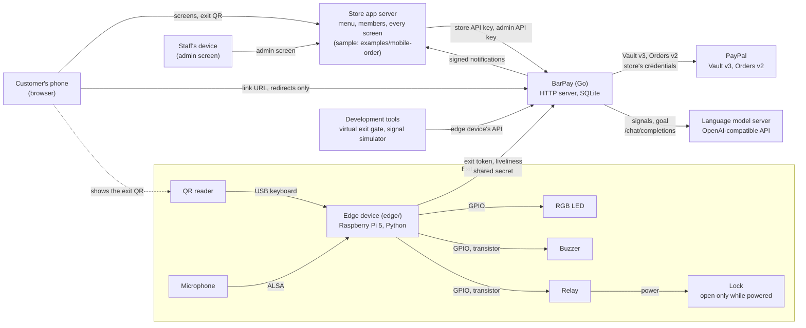
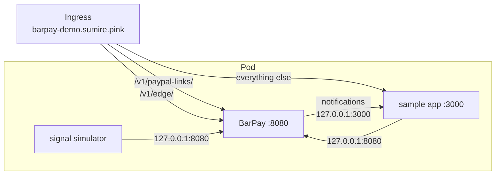
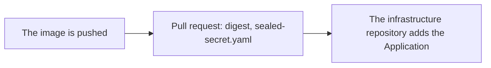

# BarPay

`README.ja.md` is the Japanese translation of this file.

BarPay is a payment and pricing module that a bar plugs into its own mobile order system: a cover charge that moves with how crowded and lively the room is, walk-out checkout for members who linked PayPal, and register settlement for everyone else.

## What BarPay does and does not do

BarPay is an HTTP server that the store app calls from its own server; it has no screens.
It owns the visits, the cover charge and its AI pricing, and the PayPal charges, and tells the store app what happened through signed notifications. The store app owns the menu, the members and every screen, including the customer's panel and the staff's admin screen.

- Why BarPay exists: [Purpose](docs/PRD.md#1-purpose)
- What BarPay and the store app each own: [Responsibilities](docs/PRD.md#3-responsibilities)
- What BarPay does not do: [Out of scope](docs/PRD.md#7-out-of-scope)

## How the parts connect

BarPay sits between the store app, PayPal, a language model and the edge device at the exit gate; only BarPay talks to PayPal and the language model. The development tools stand in for the edge device and its parts.



- The store app's calls and BarPay's notifications: [API](#api)
- The edge device, its parts and their wiring: [Running the edge device](#running-the-edge-device)
- The language model's address and model: `[llm]` in [`barpay.example.toml`](barpay.example.toml)

## Running BarPay

BarPay runs from a config file you copy from the sample and fill in; it needs Go (the version in [`go.mod`](go.mod)) and the REST credentials of a PayPal sandbox app.

```sh
cp barpay.example.toml barpay.toml
```

Fill in every empty value in `barpay.toml`. The comments in the file say what each key takes, and [UC8](docs/PRD.md#uc8--store-connects-to-barpay) says which values may be left out and when BarPay refuses to start. `keys.store_api_key`, `keys.admin_api_key`, `keys.edge_shared_secret` and `notifications.signing_secret` are random strings you choose; the three under `[keys]` must differ from each other. If no LLM answers at `llm.address`, BarPay still starts and rate evaluations fall back as the [Pricing model](docs/PRD.md#4-pricing-model) describes. To run the sample app, take `store_app_origin` and `notifications.url` from the comments at the top of [`mobile-order.example.conf`](examples/mobile-order/mobile-order.example.conf).

```sh
go run ./cmd/barpay
```

BarPay is running when it logs `BarPay started` with the address it listens on. If a value is wrong, it says which one and does not start.

## API

The store app calls these operations from its server, under `/v1` of BarPay's URL, with the store API key or the admin API key from `barpay.toml`. Request and response shapes, errors and behaviour are in [`docs/api/openapi.yaml`](docs/api/openapi.yaml).

| Method | Path | Key | operationId | What it does |
|---|---|---|---|---|
| `POST` | `/checkins` | Store | `createCheckin` | Start a check-in |
| `GET` | `/sessions/{session_id}` | Store | `getSession` | Read a session |
| `POST` | `/sessions/{session_id}/member` | Store | `attachMember` | Attach a member to a guest's session |
| `POST` | `/sessions/{session_id}/orders` | Store | `reportOrder` | Report an order |
| `POST` | `/sessions/{session_id}/register-request` | Store | `requestRegister` | The customer chooses to pay at the register |
| `GET` | `/sessions/{session_id}/exit-token` | Store | `getExitToken` | Get the session's current exit token |
| `GET` | `/rate` | Store | `getRate` | Read the published rate |
| `GET` | `/rate/history` | Store | `getRateHistory` | Read the published rates over a period |
| `POST` | `/rate-evaluations` | Store | `requestRateEvaluation` | Ask BarPay to evaluate the rate |
| `GET` | `/members/{member_id}` | Store | `getMember` | Read a member's saved PayPal |
| `POST` | `/members/{member_id}/paypal-link` | Store | `createPaypalLink` | Ask for a PayPal link URL |
| `POST` | `/members/{member_id}/paypal-link/confirm` | Store | `confirmPaypalLink` | Confirm a PayPal link |
| `DELETE` | `/members/{member_id}/saved-paypal` | Store | `deleteSavedPaypal` | Delete a member's saved PayPal |
| `GET` | `/admin/sessions` | Admin | `listSessions` | List sessions |
| `POST` | `/admin/sessions/{session_id}/close` | Admin | `closeSession` | Staff close a linked session |
| `POST` | `/admin/sessions/{session_id}/retry` | Admin | `retryCharge` | Staff retry a failed charge |
| `POST` | `/admin/sessions/{session_id}/register-payment` | Admin | `recordRegisterPayment` | Staff record a payment at the register |
| `POST` | `/admin/sessions/{session_id}/settle-outside` | Admin | `settleOutside` | Staff settle a failed charge outside BarPay |
| `POST` | `/admin/sessions/{session_id}/mark-unpaid` | Admin | `markUnpaid` | Staff mark a session at the register as unpaid |
| `POST` | `/admin/gate/unlock` | Admin | `unlockGate` | Staff open the exit gate by hand |
| `GET` | `/admin/settings` | Admin | `getSettings` | Read the settings |
| `PUT` | `/admin/settings` | Admin | `updateSettings` | Change the settings |
| `GET` | `/admin/decisions` | Admin | `listDecisions` | Read the decision log |
| `GET` | `/admin/alerts` | Admin | `listAlerts` | Read the alerts |
| `GET` | `/admin/notifications` | Admin | `listNotifications` | Read the notification log |

BarPay sends these notifications, signed, to `notifications.url` in `barpay.toml`. Their shapes and how to check the signature are under `webhooks` in [`docs/api/openapi.yaml`](docs/api/openapi.yaml).

| Event type | When |
|---|---|
| `session.started` | A session started |
| `session.member_attached` | A member was attached to a guest's session |
| `session.paypal_linked` | A session was linked to the member's saved PayPal |
| `session.register_requested` | The customer chose to pay at the register |
| `session.closed` | The session was checked out through BarPay |
| `session.payment_failed` | The checkout charge failed or could not be confirmed |
| `session.settled_outside` | Staff recorded a payment taken outside BarPay |
| `session.closed_unpaid` | The session was closed as unpaid |
| `gate.unlock_failed` | The session was paid but the exit gate did not unlock |
| `member.paypal_linked` | A member saved PayPal |
| `member.saved_paypal_deleted` | A member's saved PayPal was deleted |

## Running the development tools

The development tools in [`cmd/barpay-dev`](cmd/barpay-dev) stand in for the edge device's hardware ([Working without hardware](docs/PRD.md#8-fixed-constraints)): the virtual exit gate and the signal simulator.
They call BarPay through the edge device's API, [`docs/api/edge.yaml`](docs/api/edge.yaml), with the edge device's shared secret, which they read from an environment variable and never from `barpay.toml`. Run each in its own terminal at the repository root while BarPay is running, replacing the placeholder with the value of `keys.edge_shared_secret`:

```sh
export BARPAY_EDGE_SHARED_SECRET='<keys.edge_shared_secret in barpay.toml>'
go run ./cmd/barpay-dev gate
```

```sh
export BARPAY_EDGE_SHARED_SECRET='<keys.edge_shared_secret in barpay.toml>'
go run ./cmd/barpay-dev signals
```

The virtual exit gate takes the text of an exit QR, one per line, as a QR reader would type it: read the exit QR the store app shows with any QR scanner and paste its text. The signal simulator sends the room's liveliness until you stop it, and takes a new value, one per line. With `-vary` it reads no input and moves the liveliness by itself instead, so it keeps changing where nobody types, such as in a container: up to `-swing` (0.3 unless given) above and below `-liveliness` and back once every `-period` (30 minutes unless given), kept from 0 to 1:

```sh
go run ./cmd/barpay-dev signals -vary
```

Run without arguments, the tools print their usage, including what else they take and the `-barpay` flag for a BarPay that listens elsewhere, and exit with an error status:

```sh
go run ./cmd/barpay-dev
```

## Running the edge device

The edge device ([`edge/`](edge)) is the software at the exit gate: it reads exit QR codes, drives the lock, shows each result on the LED and the buzzer, and sends BarPay the room's liveliness. It runs on a Raspberry Pi 5 with Ubuntu Server 26.04 LTS as a systemd service under its own user, starting at boot. The parts it uses are listed under Hardware in [Fixed constraints](docs/PRD.md#8-fixed-constraints); installing the OS and setting up the network are not covered here. Run the commands below on the Raspberry Pi 5, as a user who can use `sudo`.

### Installing

pyalsaaudio and evdev are built from source on the Raspberry Pi 5, so install the build tools and headers first:

```sh
sudo apt install git build-essential libasound2-dev linux-libc-dev
```

Install [uv](https://docs.astral.sh/uv/) 0.12.6 or later for your user, then log in again or load its environment:

```sh
curl -LsSf https://astral.sh/uv/install.sh | sh
source ~/.local/bin/env
uv --version
```

The code and the Python that uv installs go under `/opt/barpay-edge`, owned by you: the service's user can read them but not change them.

```sh
sudo install -d -o "$USER" -g "$USER" -m 755 /opt/barpay-edge
git clone https://github.com/sumiredc/barpay.git /opt/barpay-edge/barpay
cd /opt/barpay-edge/barpay/edge
UV_PYTHON_INSTALL_DIR=/opt/barpay-edge/python uv sync --locked --managed-python --extra gpio --extra microphone --extra qr
```

The extras install the device libraries: `gpio` for the lock, the LED and the buzzer, `microphone` for ALSA, and `qr` for the QR reader's input device. Create the service's user, which has no home and cannot log in:

```sh
sudo useradd --system --user-group --no-create-home --home-dir /nonexistent --shell /usr/sbin/nologin barpay-edge
```

To update, run `git pull` and the `uv sync` line above again in `/opt/barpay-edge/barpay/edge`, then restart the service.

### Setting the clock

The Raspberry Pi 5 has no battery for its clock, so after power comes back the clock starts far behind. chrony then finds the NTS time servers' certificates not yet valid, and those servers cannot set the clock. Ubuntu also lists a bootstrap server whose certificate is valid from 1970, but when it cannot be reached, the clock is never set, and every call to BarPay fails its certificate check too. [`edge/deploy/chrony/barpay-edge.conf`](edge/deploy/chrony/barpay-edge.conf) adds to the OS's chrony settings, keeping its NTS time servers: only NTS sources are used, the certificate's times are not checked for the first clock update after chronyd starts at boot, and the clock is stepped only in the first updates after chronyd starts.

```sh
sudo install -m 644 /opt/barpay-edge/barpay/edge/deploy/chrony/barpay-edge.conf /etc/chrony/conf.d/
sudo systemctl restart chrony
```

The OS's `/etc/chrony/chrony.conf` must read `/etc/chrony/conf.d` (`confdir`) and must not set a `makestep` that allows more steps after that line. Each time server must show `NTS` under Mode, and the clock must be synchronized:

```sh
grep -nE '^(confdir|sourcedir|makestep|nocerttimecheck)' /etc/chrony/chrony.conf
sudo chronyc -N authdata
timedatectl
```

The service does not wait for the clock. Until BarPay can be reached, a scan shows BarPay unreachable, as it does whenever BarPay cannot be reached.

### Settings

The edge device reads its settings from environment variables, which the service takes from `/etc/barpay-edge/barpay-edge.env`. Copy the sample there, readable by root only, as it holds the shared secret; systemd reads it as root and passes the values to the edge device.

```sh
sudo install -d -m 700 /etc/barpay-edge
sudo install -m 600 /opt/barpay-edge/barpay/edge/deploy/barpay-edge.example.env /etc/barpay-edge/barpay-edge.env
sudoedit /etc/barpay-edge/barpay-edge.env
```

Fill in `BARPAY_URL` and `BARPAY_EDGE_SHARED_SECRET` (`keys.edge_shared_secret` in `barpay.toml`). `BARPAY_URL` must use `https`, except `http` to a loopback IP address (`127.0.0.0/8` or `::1`), such as a BarPay on the same machine for checks: over plain `http` across a network, anyone on it can read the shared secret and read or forge BarPay's answers, including an unlock. With any other `BARPAY_URL`, such as `http` to a name like `localhost`, the edge device does not start. To check against BarPay on another machine, serve it over `https`, or forward its port to the Raspberry Pi's loopback address with SSH. Set `BARPAY_EDGE_MICROPHONE_DEVICE` to the microphone's card, which ALSA's default device may not be. The comments in the file say what each variable takes; the other values are filled in for the Raspberry Pi 5 and the wiring below. When a value is missing or malformed, the edge device logs which one and does not start.

Once the service runs, stop it before changing the file and start it after. The step it runs after a stop reads the file again, so with a line number changed while it runs, that step would set the new line low and leave the old one as it was.

```sh
sudo systemctl stop barpay-edge
sudoedit /etc/barpay-edge/barpay-edge.env
sudo systemctl start barpay-edge
```

### Permissions

The service's user gets three devices only, through its group, by the udev rule [`edge/deploy/99-barpay-edge.rules`](edge/deploy/99-barpay-edge.rules): the QR reader's keyboard device, the microphone card's control and capture devices, and the GPIO chip of the header, whose lines include the lock's, the LED's and the buzzer's. It gets no other input or sound device and not `uinput`. Find the QR reader's `ID_SERIAL` and the microphone's card ID (in brackets):

```sh
ls /dev/input/by-id/
udevadm info /dev/input/by-id/<the reader>-event-kbd | grep ID_SERIAL=
cat /proc/asound/cards
```

The rule and the sample take `gpiochip0` as the header's GPIO chip, the one labelled `pinctrl-rp1`. If `gpiodetect` (in the `gpiod` package) shows another number for it, change the rule's `KERNEL` and `BARPAY_EDGE_GPIO_CHIP` to that chip.

```sh
sudo apt install gpiod
gpiodetect
```

Install the rule, replace its two placeholders with them, and apply it:

```sh
sudo install -m 644 /opt/barpay-edge/barpay/edge/deploy/99-barpay-edge.rules /etc/udev/rules.d/
sudoedit /etc/udev/rules.d/99-barpay-edge.rules
sudo udevadm control --reload
sudo udevadm trigger
ls -lL /dev/input/barpay-edge-qr /dev/gpiochip0 /dev/snd/
```

The QR reader's device, the microphone card's `controlC` and `pcmC…c` devices, and `/dev/gpiochip0` belong to the group `barpay-edge`. The rule also links the reader's device as `/dev/input/barpay-edge-qr`, the `BARPAY_EDGE_QR_DEVICE` of the sample.

### Wiring the lock

The lock's line (`BARPAY_EDGE_LOCK_LINE`, GPIO 24 by default, pin 18 of the header) switches a relay through an NPN transistor: a relay's coil usually takes 5 V, which a 3.3 V GPIO line cannot drive. The lock is first replaced by an LED on the relay's contacts.

| Part | Value | Why |
|---|---|---|
| Relay | 5 V coil of at most 100 mA (coil resistance at least 50 Ω), contacts rated for the lock's voltage and current | Powered from the header's 5 V pin |
| NPN transistor | Collector current at least 500 mA, collector–emitter voltage at least 30 V, current gain at least 100 at 100 mA | Fully on with the base current below |
| Base resistor | 1 kΩ | About 2.6 mA from the GPIO line, nearly all into the base |
| Pull-down resistor | 10 kΩ, base to ground | The relay stays off while the line is not driven: at boot, while it is an input, after it is released |
| Diode across the coil | Silicon rectifier diode, at least 1 A and 100 V | Takes the voltage the coil gives when switched off, which would otherwise damage the transistor and the Raspberry Pi 5 |
| Stand-in LED and its resistor | Any LED, 330 Ω | About 9 mA from 5 V |

| From | To |
|---|---|
| GPIO 24 (header pin 18) | Base resistor, then the transistor's base |
| Transistor's base | Pull-down resistor, then ground (header pin 20) |
| Transistor's emitter | Ground (header pin 20) |
| Transistor's collector | One end of the relay's coil, and the diode's anode |
| Other end of the relay's coil | 5 V (header pin 2), and the diode's cathode (the end with the band) |
| 5 V (header pin 4) | Relay's common contact (COM) |
| Relay's normally open contact (NO) | LED resistor, then the LED's anode |
| LED's cathode | Ground (header pin 6) |

The LED lights for the unlock time (`BARPAY_EDGE_UNLOCK_SECONDS`) at each unlock and is dark otherwise. A ready-made relay module with its own transistor and diode also works if it switches on while its input is high; one that switches on while its input is low would open the gate whenever the line is low, including at boot.

To drive the lock instead, move the LED's place to the lock: connect the lock's power supply through the relay's COM and NO contacts to the lock, so the lock has power only while the relay is on. Nothing else changes, in the code or the settings. Use only a lock that is locked without power, opens while powered, and always opens from inside, also without power ([Locking customers in](docs/PRD.md#7-out-of-scope)). If the lock is a DC coil without its own suppression, put another such diode across it, cathode to its positive terminal.

### Wiring the LED and the buzzer

The LED's three lines (`BARPAY_EDGE_LED_RED_LINE`, `BARPAY_EDGE_LED_GREEN_LINE` and `BARPAY_EDGE_LED_BLUE_LINE`, GPIO 17, 27 and 22 by default) light its colors directly through resistors. The buzzer's line (`BARPAY_EDGE_BUZZER_LINE`, GPIO 23 by default) switches the buzzer from 5 V through an NPN transistor, as the lock's line switches the relay: an active buzzer often takes tens of milliamperes, too much for one GPIO line.

| Part | Value | Why |
|---|---|---|
| RGB LED | Common cathode | Each color is on while its line is high (Indicator under Hardware in [Fixed constraints](docs/PRD.md#8-fixed-constraints)) |
| Red's resistor | 330 Ω | About 4 mA from the 3.3 V line, at a forward voltage of 2.0 V |
| Green's and blue's resistors | 100 Ω each | About 3 mA each, at a forward voltage of 3.0 V, which leaves little of the 3.3 V. White, all three on, is about 10 mA, split over three lines |
| Buzzer | Active buzzer for 5 V, at most 100 mA, that sounds for as long as it has power | The edge device only turns its line on and off |
| NPN transistor | As for the lock | Fully on at the buzzer's current with the base current below |
| Base resistor | 1 kΩ | About 2.6 mA from the GPIO line, nearly all into the base |
| Pull-down resistor | 10 kΩ, base to ground | The buzzer stays silent while the line is not driven: at boot, while it is an input, after it is released |

| From | To |
|---|---|
| GPIO 17 (header pin 11) | Red's resistor, then the LED's red leg |
| GPIO 27 (header pin 13) | Green's resistor, then the LED's green leg |
| GPIO 22 (header pin 15) | Blue's resistor, then the LED's blue leg |
| LED's common leg (the longest) | Ground (header pin 9) |
| GPIO 23 (header pin 16) | Base resistor, then the transistor's base |
| Transistor's base | Pull-down resistor, then ground (header pin 9) |
| Transistor's emitter | Ground (header pin 9) |
| Transistor's collector | Buzzer's negative leg |
| Buzzer's positive leg (marked `+`, or the longer one) | 5 V (header pin 4) |

Which of the LED's other legs is which color differs between parts: see the part's data sheet. Several wires go to ground pin 9, for example through a ground rail of a breadboard. Both 5 V pins of the header are taken by the lock's wiring, so the buzzer shares pin 4 with the relay's common contact, for example through a power rail of a breadboard. Once the lock replaces the stand-in LED, the relay's common contact takes the lock's power supply instead, and pin 4 feeds the buzzer only.

Check the buzzer before wiring it, by connecting it briefly straight across 5 V and ground, its positive leg to 5 V: an active buzzer sounds for as long as it is connected, while a passive buzzer only clicks when connected and disconnected, and the edge device cannot sound it. A kit may have both, looking alike, and their labels can be the wrong way round. A ready-made buzzer module with its own transistor also works if it sounds while its input is high; one that sounds while its input is low would sound whenever the line is low, including at boot and while the edge device is stopped.

To check the wiring, run the check in `barpay_edge.indicator_gpio` as in [Starting and stopping the service](#starting-and-stopping-the-service): it shows each state of the indicator table in turn and checks the lines' values. It cannot hear the buzzer or see the LED, so watch and listen that each state looks and sounds as the table says.

### Keeping the QR reader off the console

The QR reader is a keyboard. The edge device holds it while it runs, but at boot, between a crash and the restart, and just after the reader is plugged in, what it types goes to the console, where a login prompt would log an exit token as a user name and a logged-in shell would run it as a command. A udev rule cannot stop the kernel sending a keyboard's keys to the console, so no virtual terminal runs a login prompt instead: [`edge/deploy/logind/barpay-edge.conf`](edge/deploy/logind/barpay-edge.conf) stops logind starting them, and the prompt on tty1 and the fallback prompts of `getty-static.service` are masked. Logging in over SSH is not affected. Run these steps over SSH and log out of every console first, since a shell already logged in on a console keeps running until the reboot ends it:

```sh
sudo install -D -m 644 /opt/barpay-edge/barpay/edge/deploy/logind/barpay-edge.conf /etc/systemd/logind.conf.d/barpay-edge.conf
sudo systemctl mask getty@tty1.service getty-static.service
sudo reboot
```

After the reboot, no login prompt unit is active, no session is on a console (every session `loginctl` lists has no TTY or a `pts/` one) and no process runs on tty1:

```sh
systemctl list-units --all 'getty@*' 'autovt@*' getty-static.service
loginctl list-sessions
ps -t tty1
```

### Starting and stopping the service

```sh
sudo install -m 644 /opt/barpay-edge/barpay/edge/deploy/barpay-edge.service /etc/systemd/system/
sudo systemctl daemon-reload
sudo systemctl enable --now barpay-edge
systemctl status barpay-edge
```

The service starts at boot without waiting for the network or the clock. After any end other than `systemctl stop`, it starts again 2 seconds later at first; the wait grows over the next ends to 10 seconds and stays there until the service is next started with `systemctl`, and it never gives up. After every stop, also a crash or `kill -9`, it sets the lock's line and the LED's and the buzzer's lines low, so the gate does not stay open and no state stays showing while the edge device is not running.

```sh
sudo systemctl restart barpay-edge
sudo systemctl stop barpay-edge
sudo systemctl disable --now barpay-edge
```

Stop the service before running the checks in `barpay_edge.indicator_gpio` and `barpay_edge.lock_gpio`, which use the same GPIO lines. They read the same variables, so run them as root with the environment file's values, for example:

```sh
cd /opt/barpay-edge/barpay/edge
sudo sh -c 'set -a; . /etc/barpay-edge/barpay-edge.env; exec .venv/bin/python -m barpay_edge.indicator_gpio'
```

### Reading the logs

The edge device logs to the journal. It logs `started:` with the parts it runs once it starts, then the result of each scan, each unlock and each liveliness sent; it never logs the shared secret or an exit token. A setting that is missing or malformed is logged as `barpay-edge:` and the variable's name, with exit status 2.

```sh
journalctl -u barpay-edge -f
journalctl -u barpay-edge -b
```

## Running the sample app

[`examples/mobile-order`](examples/mobile-order) is a sample store app: a bar's mobile order system that uses BarPay only through the API and the notifications above.
It is a separate Go module that does not depend on BarPay's code, and draws the screens that the sample app's row of [Priorities](docs/PRD.md#11-priorities) names. It needs BarPay running with `store_app_origin` and `notifications.url` set as described in [Running BarPay](#running-barpay).

```sh
cd examples/mobile-order
cp mobile-order.example.conf mobile-order.conf
```

Fill in every empty value in `mobile-order.conf`: the store API key, the admin API key and the notification signing secret from `barpay.toml`, and a `staff` line with a staff ID and a password hash, as its comment shows. This command reads the password and prints the hash:

```sh
go run . hash-password
```

```sh
go run .
```

The sample app is running when it logs the URL to open. Open that URL in a browser for the entrance landing; staff sign in to the admin screen at `/admin`.

## Running on Kubernetes

[`deploy/`](deploy) runs BarPay, the sample app and the signal simulator against the PayPal sandbox in one Pod of the home Kubernetes cluster, at `https://barpay-demo.sumire.pink`. Argo CD applies `deploy/` from `main`; its Application, which also creates the namespace `barpay`, lives in the cluster's infrastructure repository. The image holds all three programs and is not a production build of BarPay: it is built by hand from the [`Dockerfile`](Dockerfile) at a commit on `main`, on the cluster's side, and pushed to the cluster's registry as `10.1.1.10:5000/barpay/demo:<commit SHA>`; this repository's workflows do not build it, as the registry has no authentication. The push prints the image's digest. The sample app shows times in the store's time zone, `TZ` of its container in [`deploy/deployment.yaml`](deploy/deployment.yaml) (`America/Los_Angeles`).



An edge device reaches this BarPay through `/v1/edge/`. In its environment file, set `BARPAY_URL=https://barpay-demo.sumire.pink`, `BARPAY_EDGE_SHARED_SECRET` to the Secret's `edge_shared_secret`, and `BARPAY_EDGE_MICROPHONE=fake`: the signal simulator already sends the liveliness, and two sources overwrite each other.

### Making the config files

The config files hold secrets, so they reach the Pod only through the SealedSecret `barpay-demo`. Copy the templates, whose values other than the secrets are filled in for the Pod; git ignores both copies:

```sh
cp deploy/barpay.example.toml deploy/barpay.toml
cp deploy/mobile-order.example.conf deploy/mobile-order.conf
```

Fill in every empty value: the PayPal sandbox app's credentials, and random strings you choose for the rest, as in [Running BarPay](#running-barpay). `llm.address` is filled in with the Ollama outside the cluster that serves `qwen3:8b`; change it if yours is elsewhere, or every evaluation falls back. The `staff` line is `staff = <staff ID> <password hash>`. The admin screen can be reached from the Internet, so use a strong password used nowhere else; this prints its hash:

```sh
go run -C examples/mobile-order . hash-password
```

These values must be the same in both places:

| `deploy/barpay.toml` | Must equal |
|---|---|
| `keys.store_api_key` | `store_api_key` in `deploy/mobile-order.conf` |
| `keys.admin_api_key` | `admin_api_key` in `deploy/mobile-order.conf` |
| `notifications.signing_secret` | `notification_signing_secret` in `deploy/mobile-order.conf` |
| `keys.edge_shared_secret` | The Secret's key `edge_shared_secret`, which the simulator gets as `BARPAY_EDGE_SHARED_SECRET` |

### Sealing the Secret

Seal both files and the edge device's shared secret into `deploy/sealed-secret.yaml`. Run this at the repository root on a machine whose `kubectl` reaches the cluster: `kubeseal` encrypts with the cluster's public key. The SealedSecret only opens as `barpay-demo` in the namespace `barpay`; sealed under another name or namespace, the Pod does not start. Type `keys.edge_shared_secret` from `deploy/barpay.toml` when asked:

```sh
printf 'keys.edge_shared_secret: '; read -rs EDGE_SHARED_SECRET; echo
kubectl create secret generic barpay-demo --namespace barpay \
  --from-file=barpay.toml=deploy/barpay.toml \
  --from-file=mobile-order.conf=deploy/mobile-order.conf \
  --from-literal=edge_shared_secret="$EDGE_SHARED_SECRET" \
  --dry-run=client -o yaml \
  | kubeseal --format yaml > deploy/sealed-secret.yaml
unset EDGE_SHARED_SECRET
```

Commit `deploy/sealed-secret.yaml` and make sure [`deploy/kustomization.yaml`](deploy/kustomization.yaml) lists it under `resources`. To change a value later, edit the files, seal again and commit the new `deploy/sealed-secret.yaml`; the containers read their config files and the simulator its environment only at start, so restart the Pod after Argo CD has synced the SealedSecret:

```sh
kubectl -n barpay rollout restart deploy/barpay-demo
```

### First deployment

Add things in this order. An image that is not in the registry yet stops the Pod with `ImagePullBackOff`, and a missing Secret with `CreateContainerConfigError`.



1. Have the image built and pushed as above, and take its commit and the `digest` the push printed. The image must be built from a commit whose `barpay-dev signals` takes `-vary`, which [`deploy/deployment.yaml`](deploy/deployment.yaml) passes; with an older one, the signals container stops at start. From a machine on the cluster's network, the registry lists the tags it has:

   ```sh
   curl -s http://10.1.1.10:5000/v2/barpay/demo/tags/list
   ```

2. In one pull request, set `digest` in [`deploy/kustomization.yaml`](deploy/kustomization.yaml) to that value and the comment above it to the commit, and add the SealedSecret as in [Sealing the Secret](#sealing-the-secret).
3. Once it is on `main`, the infrastructure repository adds the Argo CD Application.

BarPay and the sample app run as user 65532. Each writes its own directory of the volume, `barpay` and `mobile-order`, which the kubelet creates as root with the same mode as the volume's directory: the user can write them only if that mode lets others write. BarPay is running when its log shows `BarPay started`; if it shows `not started: store: /data/barpay.db: … unable to open database file`, the user cannot write there. The sample app starts either way and fails only when it first saves, so sign up once and check that its log shows no error. If a directory is not writable, have it made writable by user 65532 on the storage node and delete the Pod. The signal simulator logs `liveliness … sent` every 10 seconds; `not sent: BarPay answered 401 …` means the Secret's `edge_shared_secret` differs from `keys.edge_shared_secret`.

```sh
kubectl -n barpay logs deploy/barpay-demo -c barpay
kubectl -n barpay logs deploy/barpay-demo -c mobile-order
kubectl -n barpay logs deploy/barpay-demo -c signals
```

### Rolling out a new image

Every image is rolled out by a pull request that changes `digest` in [`deploy/kustomization.yaml`](deploy/kustomization.yaml), and the commit in the comment above it, to the image's commit and the digest its push printed, so the history shows what ran when. `images` names no tag, whose handling beside a digest differs between kustomize versions. The Pod pulls the image by its digest, so a tag overwritten in the registry does not change what runs. Argo CD applies it once it is merged. The old Pod stops before the new one starts, as both cannot hold the volume, so the site is down for a moment.

## Next to read

- [`docs/PRD.md`](docs/PRD.md): what BarPay does, guarantees and leaves out
- [`docs/api/openapi.yaml`](docs/api/openapi.yaml): the contract between the store app and BarPay
- [`CONTRIBUTING.md`](CONTRIBUTING.md): how to propose a change
- [`LICENSE`](LICENSE): the license
