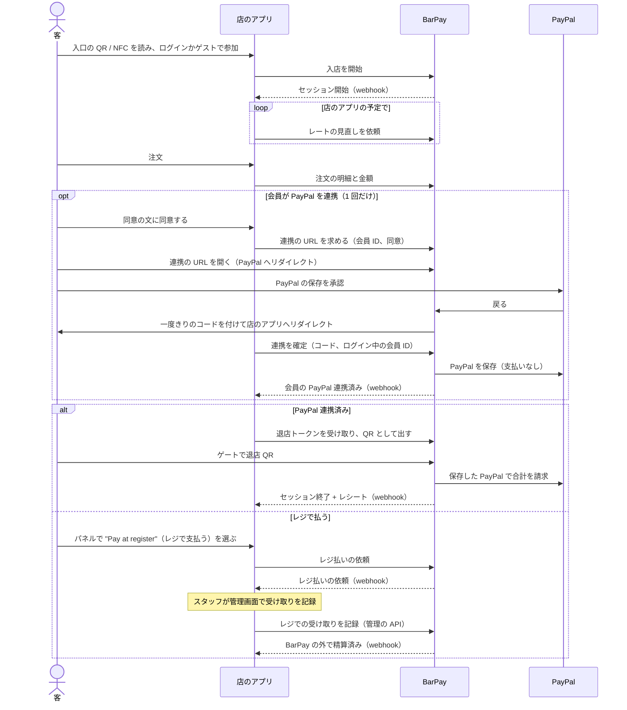
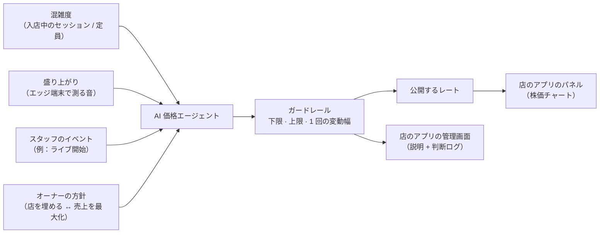
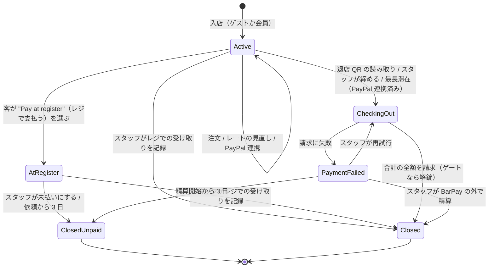
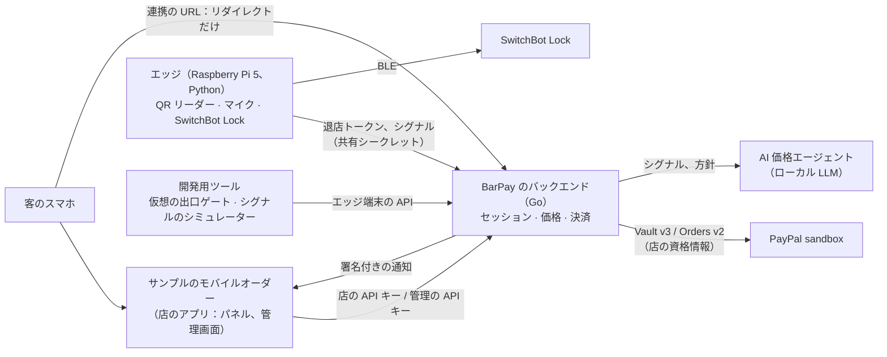

# PRD — BarPay

> `PRD.md` の日本語訳。内容が食い違う場合は `PRD.md` が正。

## 1. 目的

BarPay は、バーが自店のモバイルオーダーシステムに組み込む決済・価格モジュールである。店の混雑と盛り上がりに応じて株価のように動くチャージ料を加え、PayPal を連携した会員は、店を出るだけで来店全体の精算を済ませられる。

- **客**は、店が閑散としていても満席でも同じ固定のチャージ料（席料・お通し）を払い、会計で初めて知ることも多い。特に海外からの客は驚く。滞在中に自分が何に払っているのかが見えず、帰るときにはレジに並ぶ。
- **バーのオーナー**は、暇な夜に値下げして客を呼ぶことも、満席の夜に価値を取り込むこともできない。モバイルオーダーは注文を受けるが、需要に応じてチャージ料を決めたり、客がそのまま出て行けるようにしたりするものは無い。
- **モバイルオーダーの開発者**は、需要に応じた価格と、退店時の精算を自分で作ることになる。

BarPay はこれをモジュールとして解決する。店は自分のアプリ、メニュー、会員、画面をそのまま使い、BarPay が、動くチャージ料、来店のたびに退店 QR をそのまま精算に変える、会員向けの任意の PayPal 連携、それ以外の客のためのレジでの支払いを加える。お金は店自身の PayPal アカウントに入る。BarPay は自分の画面を持たない。API と署名付きの通知を提供し、何を見せるか、いつ BarPay を呼ぶかは店のアプリが決める。

## 2. 利用者

| 利用者 | 目的 |
|---|---|
| 客 | 入店し、飲んで食べ、払っている額を見て、店を出るだけで（PayPal を連携した会員）、またはレジで払って帰る |
| 店のアプリ | 店のモバイルオーダー（ここではサンプルアプリ）。来店を始め、注文を伝え、レートの見直しを依頼し、すべての画面（客のパネルとスタッフの管理画面）を描き、各来店がどう精算されたかを受け取る |
| スタッフ / オーナー | 店のアプリの管理画面で店の状態を見て、例外に対応する。オーナーは価格、上下限、チャージ料のルールをそこで決める |

## 3. 責務の分担

チャージ料とお金に関することは BarPay が持ち、メニュー、客との関係、画面に関することはすべて店のアプリが持つ。

| BarPay | 店のアプリ |
|---|---|
| 来店（セッション）：入店、滞在、精算、レジでの精算 | 店の QR / NFC タグから開く入口の画面、ログインかゲストでの参加 |
| チャージ料と、店のアプリが依頼したときに行う AI による値付け | メニュー、注文画面、厨房。商品の価格と注文の中身。いつレートの見直しを依頼するか |
| PayPal：会員の PayPal の保存（任意）、退店時の請求、会員が求めたときの削除 | 会員とログイン。会員が PayPal を連携したり削除したりする設定画面と、連携の前に見せる同意 |
| 会員を PayPal の承認へ送り出し、戻りを処理すること。ページは出さない | PayPal の前後で客がどこへ行くか |
| 退店トークンと、出口ゲートを開けるかの判断 | パネル：レートの株価チャート、現在の合計、PayPal（退店 QR）かレジかを選ぶ "Pay"（お会計）ボタン |
| 店を回すためのデータと操作（管理の API） | 管理画面と、そのスタッフの認証 |
| すべての結果の署名付きの通知 | 自分の画面でのレシートと履歴（BarPay の結果から作る） |

読み取ること：入店に PayPal は要らない。会員が PayPal を承認するのは 1 回だけで、その後の来店では確認なしに使う。店のアプリと BarPay はサーバー同士でやり取りし、客のブラウザが BarPay を通るのは PayPal へ行くときと戻るときだけ。

境界のルール：

- **入店**：店のアプリが自分のサーバーから入店を開始する。セッションはその場で始まり、その ID が返る。
- **PayPal 連携**：連携は来店ではなく会員に付き、ゲストは連携できない。連携の前に、店のアプリは会員に「来店の合計を、退店時に確認なしで請求する」ことを見せ、見せた同意の文の版を添えて、ログイン中の会員の連携の URL を BarPay に求める。会員はその URL を全画面で開き、フレームの中では開かない。埋め込みのフレームの中では PayPal の承認が動かないと考えられるため（推測、未確認）。連携の URL は 30 分間使え、新しい要求があると、まだ使われていない前の URL は使えなくなる。BarPay はページを出さない。ブラウザを PayPal へリダイレクトし、PayPal から戻ったら承認を確かめ、一度きりのコードを付けてブラウザを店のアプリへリダイレクトする。戻りが運ぶのは、結果、一度きりのコード、店のアプリ自身の `state` の値だけで、PayPal のトークンは付けない。BarPay のリダイレクトはリファラーを送らない。店のアプリは `state` を連携を求めたブラウザのセッションに結び付けるので、会員はログインしているのと同じブラウザで承認する必要がある。連携が保存されるのは、店のアプリのサーバーが `state` がそのブラウザのセッションのものだと確かめた上で、コードとログイン中の会員の ID で確定を依頼し、それが連携の URL を作った会員と同じときだけ。保存した PayPal を持つ会員が入店すると、BarPay がセッションを自動で連携済みにする。
- **レートの見直し**：店のアプリが、自分の予定で BarPay にレートの見直しを依頼する（サンプルアプリは 5 分ごと）。BarPay は自分からは見直さず、店の営業時間を知らない。
- **照会**：店のアプリは、セッションの状態、合計、来店中のレートの履歴、レシートをセッションの ID で、会員が保存した PayPal を持っているかを会員 ID で、公開中のレートを、いつでも読める。パネルを描くこと、客が戻ってきたときの結果の確認、設定画面に連携と削除のどちらを出すかの判断、取りこぼした通知の回復はこれで行う。
- **管理**：店のアプリの管理画面は、管理の API で、セッションの一覧、説明付きのレートの履歴、判断ログ、警告、通知の記録を読み、設定を変え、スタッフのイベントを送り、セッションを操作する（レジでの受け取りの記録、未払いにする、締める、請求の再試行、BarPay の外で精算、手でゲートを開ける）。管理の要求はそれぞれ、操作したスタッフを示し、BarPay はそれを記録する。スタッフの認証は店のアプリが行う。
- **退店トークン**：滞在中の連携済みのセッション、または終わってから再解錠の受付時間内のセッション（請求した、またはスタッフが記録した）について、店のアプリのサーバーが BarPay から現在の退店トークンを受け取り、そのセッションの客にだけ QR として見せる。トークンはセッションが終わるまで決まった間隔で変わり、出口ゲートでしか使えない。
- **通知**：イベントは `session.started`、`session.paypal_linked`、`session.register_requested`、`session.closed`、`session.payment_failed`、`session.settled_outside`、`session.closed_unpaid`、`gate.unlock_failed`、会員向けの `member.paypal_linked` と `member.saved_paypal_deleted`。それぞれイベント ID とセッションごと（`member.*` は会員ごと）の通し番号を持ち、署名される。受け取りが確認されない通知は、最初の送信の 1 分後、5 分後、30 分後、2 時間後、6 時間後、12 時間後、24 時間後に再送する。それを過ぎると、通知の記録に断念として残し、警告を出す。セッションは `session.closed`（BarPay を通して精算した。請求した、または合計が 0）、`session.settled_outside`（スタッフがレジまたは BarPay の外での支払いを記録した）、`session.closed_unpaid` のどれか 1 つだけで終わり、そのイベントがレシートを運ぶ。
- **パネル**：店のアプリ自身の画面。BarPay は照会で、現在のレート、その変化と履歴、チャージ料が停止中か上限到達か、滞在時間、ここまでのチャージ料、注文、支払い方法（PayPal かレジ）、現在の合計、精算後は結果を渡す。"Pay"（お会計）を押すと選択肢が出る。PayPal（連携済みのときだけ出る）は退店 QR を出し、"Pay at register"（レジで支払う）は、スタッフが受け取れるよう合計の確定を BarPay に依頼する。
- **API キー**：店のアプリは自分のサーバーからだけ BarPay を呼ぶ。客に関わる呼び出しには店の API キーを、管理の呼び出しには別の管理の API キーを使う。サンプルアプリには両方を持つバックエンドがある。

## 4. 価格モデル

チャージ料は時間とともに変わる **1 時間あたりのレート**で、**枠**ごとに計上する。入店から 1 枠（設定、初期値 10 分）が終わるたびに、終わった枠を、その時点で公開中のレートで計上する。

レートは AI がオーナーの方針に沿って決め、実際に請求できる範囲はオーナーが決めたガードレールが決める。

- **シグナル**：混雑度と盛り上がり（作者が考える中心の入力）と、スタッフのイベント。混雑度は人数ではなく入店中のスマホの数を数え（[未決事項 1](#12-未決事項) 次第で変わりうる）、最大で 1（満席）とする。盛り上がりはエッジ端末上でマイクから算出し、端末から出るのは数値だけ。エッジ端末が無いときは盛り上がりのシグナルは無く、開発ではシグナルのシミュレーターが入力する。スタッフのイベントは、店のアプリの管理画面から管理の API で届く。
- **方針**：オーナーは、店を "fill the room"（店を埋める）と "maximize revenue"（売上を最大化）のあいだのどこに置くかを決める。エージェントは、判断ごとにその方針にどう沿うかを述べる。
- **依頼による見直し**：レートは、店のアプリが依頼したときだけ見直す。BarPay が同時に行う見直しは 1 つまでで、最短の間隔（設定ファイル）に 1 回まで。見直しの最中に届いた依頼にはその見直しの結果を返し、前の見直しから最短の間隔が経つ前に届いた依頼には、新しく見直さずに現在のレートを返す。
- **最初のレート**：起動時に、BarPay は設定ファイルの開始のレートを公開する。最初の見直しの前でも入店できるようにするため。
- **ガードレール**（設定）：下限、上限、1 回の見直しあたりの最大変動幅（設定ファイル）。範囲外の提案は範囲内に切り詰め、公開するレートは範囲から出ないように通貨ごとのレートの刻み（固定：10 JPY、0.05 USD）に丸める。オーナーが下限か上限を変えたときは、公開中のレートを、変動幅を超えてでもすぐ新しい範囲内に合わせ、判断ログに記録する。
- **説明**：公開するレートには、切り詰めた後の実際の変化を述べる、短く平易な英語の理由を付ける（例："Room is half empty — rate down 5%"）。説明は管理の API でだけ読める。客に見えるのは、レート、その変化、チャートである。
- **判断ログ**：見直しごとの入力、エージェントの提案と推論、公開したレートを残し、管理の API で読めるようにする。
- **代替動作**：AI が時間内に答えない、またはその答えをレートとして読めないときは、レートを直前の値のまま据え置き、ログにそう残す。
- **枠**：1 枠の額は、レート × 枠の長さを通貨の最小単位（1 JPY、0.01 USD）に切り捨てたもので、枠が終わった時点で決まり、その後は変わらない。入店そのものは 0 円で、精算が始まった時点で終わっていない枠は請求しない。
- **追加注文での停止**：来店の 1 件目の注文は対象外（ワンドリンク制）。それ以降の注文は、件数で数え、フードも含め、その注文から決まった時間（設定、初期値 30 分、0 で無効）チャージ料を止める。新しい注文は停止を数え直し、足し合わせない。停止中に終わる枠は 0 円。
- **来店ごとの上限**（設定、初期値 ¥3,000 / $30、0 で上限なし）：チャージ料だけの上限で、注文の金額は含めない。上限に達する枠は上限までしか計上せず、その後の枠は 0 円。
- **設定の変更**：設定は管理の API で変える。枠の長さ、停止時間、上限は、入店中のセッションにも次の枠から反映する。上限を、セッションがすでに計上した額より低くすると、それ以降の枠は計上しない。すでに計上した額は減らさない。
- **時間**：この文書の時間と期間はすべて実時間。

## 5. 決済モデル

PayPal の連携は任意で、お金は動かない。会員の PayPal をこの店用に保存するだけで、来店全体は退店時に 1 回で請求する。

| 時点 | PayPal で起きること |
|---|---|
| 入店 | 保存した PayPal を持つ会員なら、まだ使えるかを BarPay が確かめる。ほかは何もしない |
| PayPal 連携（会員のみ、任意） | 会員が、merchant-initiated の請求のために PayPal を保存することを承認し、店のアプリが連携を確定すると、BarPay がそれを会員 ID のもとに持つ。支払いは無い |
| 滞在 | 何もしない。注文とチャージ料は BarPay が記録する |
| 精算、合計 = 0 | 何も請求しない |
| 精算、合計 > 0 | 保存した PayPal で合計を 1 回、客の承認なしに請求する。ゲートはそれが成功した後にだけ開く |
| 精算後 | 何もしない。会員の保存した PayPal は、会員が削除するまで次の来店のために残す（UC9） |

- **現在の合計** = 注文 + ここまでのチャージ料。
- ゲスト、保存した PayPal を持たない会員、レジを選んだ客はレジで払う。BarPay が合計を確定し、スタッフが BarPay の外でお金を受け取って店のアプリの管理画面で記録すると、セッションは BarPay の外で精算済みとして終わる。

## 6. 保証すること

| 観点 | BarPay が保証すること |
|---|---|
| 同意 | 保存した PayPal を持つのは、店のアプリが見せた同意の文の版を示した連携の要求に対してだけで、BarPay はその版を保存した PayPal とともに記録する。その文は「来店の合計を、退店時に追加の承認なしで請求する」と述べる。請求するのは退店時だけ。現在の合計は滞在中ずっと読める |
| 透明性 | セッションが終わるまで、BarPay は照会で、現在のレート、その変化と履歴、ここまでのチャージ料、停止中か上限到達か、現在の合計を渡す。それを見せるのは店のアプリの仕事。入店前の料金のルールは店が掲示する（[扱わないこと](#7-扱わないこと) を参照） |
| この来店のためだけの請求 | BarPay が会員の保存した PayPal に請求するのは、その会員のセッションの精算中か、スタッフによるその再試行のときだけ。スタッフが再試行できるのは、精算開始から最大 3 日。保存した PayPal は会員が求めたときに削除し、それを使うセッションが終わるまでは削除しない |
| 正確さ | BarPay の精算でセッションが終わったとき、請求した額は精算の瞬間にサーバーが確定した最終金額に等しく、レシートはその合計と PayPal の capture ID を示す。レジまたは BarPay の外で精算したときは、レシートは合計とスタッフが記録した額を示す。BarPay では何も請求していない |
| 価格の範囲 | レートは常に店の下限と上限のあいだにある。1 回の見直しで変動幅を超えて動くことは無く、見直しのあいだは最短の間隔以上あく。ただし、オーナーが下限か上限を変えたときは例外で、判断ログに記録する |
| 支払いは 1 回 | 各セッションの精算は 1 回だけ。読み取りの繰り返し、ネットワークエラーやタイムアウト後の再試行、管理の要求の繰り返し、スタッフの再試行で、同じ額を二重に請求することは無い。請求を起こしうる管理の要求には冪等キーを付け、PayPal を呼ぶ前にセッションを精算中にするので、同時に来たもう一方は拒否する。結果の分からない呼び出しを再試行する前に、BarPay は PayPal でその状態を確かめる |
| 支払ってから解錠 | BarPay が出口ゲートを開けるのは、全額を請求したか、スタッフがレジまたは BarPay の外での受け取りを記録して終わったセッションに対してだけで、終わってから再解錠の受付時間内に限る。セッションが終わると、その退店トークンは変わらなくなる。スタッフは管理の API で手でゲートを開けることもできる |
| 店への通知 | 店のアプリには、すべてのセッションの開始、PayPal 連携、レジ払いの依頼、結果を通知する。通知は署名され、イベント ID と通し番号を持ち、最大 24 時間再送されるので、店のアプリは同じ通知を複数回、または順不同で受け取ることがある。現在の状態はいつでも照会で読める |
| アクセス | 入店の開始、注文の報告、ID によるセッションの照会、会員・レートの照会、レートの見直しの依頼、レジ払いの依頼、退店トークンの受け取り、PayPal 連携の要求と確定、会員の保存した PayPal の削除ができるのは、店の API キーだけ。セッションの一覧、判断ログ・警告・通知の記録・設定の読み取り、設定の変更、スタッフのイベントの送信、記録・締める・再試行・精算・未払いにする・手でゲートを開ける操作ができるのは、管理の API キーだけで、管理の要求はそれぞれ操作したスタッフを示す。連携が保存されるのは、要求した会員についてだけで、店のアプリのサーバーが確定したときだけ。精算を起こせるのは、現在の退店トークンを示した認証済みのエッジ端末、管理の要求、最長滞在に達したときの BarPay 自身だけ。退店トークンは店の API キーにだけ発行し、出口ゲートでしか使えず、ログに残さない。2 つのキーが管理の操作を守れるのは、店のアプリが管理の API キーを分けて持つ範囲までで、両方を持つ店のバックエンドは何でもできる。示されたスタッフは記録のためのもので、認証ではない |
| 永続性 | セッション、注文、設定、判断ログ、capture ID、保存した PayPal への参照、警告、通知の記録（届いていない通知を含む）、店のアプリの `Idempotency-Key` の記録、公開したレートの履歴、管理の要求ごとに記録したスタッフは、バックエンドを再起動しても残る |
| プライバシー | 生の音声（使うなら映像も）は保存せず、エッジ端末の外に出さない |
| 可観測性 | 失敗した請求、失敗した解錠、レジ払いの依頼、拒否した遅れた注文、最長滞在を超えたセッション、断念した通知、失敗した削除は、管理の API で読める警告として出す。失敗した請求と解錠は店のアプリにも送る |

## 7. 扱わないこと

| 扱わないこと | 理由 |
|---|---|
| 実際のお金での決済 | 本番で保存した PayPal に請求するには PayPal の reference transactions の承認が要る（[動かせない前提](#8-動かせない前提) を参照）。作るのも動かすのも PayPal の sandbox で行う |
| 画面 | すべての画面は店のアプリが描く：パネル、管理画面、連携の前の同意。BarPay はデータと操作を提供する |
| スタッフの認証 | 店のアプリの仕事。BarPay は管理の API キーを確かめ、店のアプリが示したスタッフを記録する |
| いつレートを見直すかの判断 | 店のアプリの予定。BarPay は、依頼されたときに、最短の間隔の範囲で見直す |
| 店の登録画面、1 つのデプロイで複数の店 | 1 つの店を設定ファイルで用意する。価格とチャージ料のルールは管理の API で変える |
| 決済の仲介者としての BarPay（プラットフォーム手数料、マルチパーティ） | 各店は自分の PayPal アカウントで受け取る |
| チェーンの店舗をまたいだ保存した PayPal の利用 | 将来。店舗が 1 つの PayPal アカウントを共有すれば動くかもしれないが、未確認 |
| 会員とログイン | 店のアプリの仕事。BarPay は、店のアプリが渡す ID のもとに会員の保存した PayPal を持つだけ（UC2、UC9） |
| ゲストの PayPal | 保存した PayPal には来店をまたぐ持ち主が要るので、連携には店のアカウントが要る。ゲストはレジで払う |
| メニュー、注文画面、厨房の流れ | 店のアプリの仕事。BarPay は注文の明細と金額だけを記録する |
| 入店前に料金のルールを見せること | 店が、自分のサイトか店内に掲示する（変動制のレート、枠の長さ、来店ごとの上限） |
| レジでのお金の受け取り | 店の仕事。BarPay は合計を確定し、スタッフが受け取ったと言う額を記録する |
| 注文の明細の取り消しや訂正 | 一度伝えた注文は合計に残る。店は PayPal のダッシュボードから返金する |
| 店のアプリが伝える内容の正しさ | BarPay は店のアプリが伝えた注文の金額を請求し、送られた会員 ID とスタッフを信じる。それを確かめること、1 回の来店で注文できる額を制限すること、各退店トークンをそのセッションの客にだけ見せることは店のアプリの仕事 |
| 入店の制限 | 誰が入店できるかは店のアプリが決める。ゲストの参加の回数の制限も含む |
| 読み込んだ設定ファイルの表示 | オーナーはファイルを読む。効いている設定は管理の API で読める |
| 24 時間の再送の後の通知 | 店のアプリは照会で回復する |
| 店を出た客からの、拒否された請求の回収 | 管理の API で読める未払いの額として残る。回収は BarPay の外での店の仕事 |
| グループ内での割り勘 | スマホ 1 台が 1 セッション。割り勘は別のプロダクト |
| 入店時の価格の固定 | 株価のような仕組みが成り立たなくなる。客は、来店ごとの上限と現在の合計の表示で守る |
| 入店時のデポジットやお金の確保 | ゲートは支払いの後にだけ開くので、請求が失敗した客はまだ店内にいて、レジで払える。確保すると、請求が 2 件になり、客の明細に保留中の額が残る |
| 返金と異議申し立て | PayPal のダッシュボードで扱う |
| 税の計算 | すべての価格は税込み |
| BarPay が返す日本語の文 | 説明とエラーの文は英語。画面の言語は店のアプリが決める。通貨（JPY/USD）は選べる |
| 客を閉じ込めること | 扉は内側から常に開けられなければならない。鍵は、出ていく体験の一部として出口ゲートを開けるもので、客が出ていくのを止めるためのものではない |

## 8. 動かせない前提

- **sandbox で確認済み（2026-10-28、USD）**：`payment_source.paypal.vault_id` だけを付けた `CAPTURE` の注文は、買い手の承認なしに、作成時の応答で `COMPLETED` になった。このとき使った保存した PayPal は、注文の承認から作ったもので、BarPay が今使う setup token の流れから作ったものではない。[未決事項 4](#12-未決事項) を参照。
- **信じる前に確かめる**：BarPay の return と cancel の URL には、推測できない連携の ID を付ける。客が PayPal から戻ってきたら、バックエンドはその連携とともに保存した setup token だけを使い、URL に付いたトークンの ID は無視し、戻りは連携ごとに 1 回だけ受け付け、setup token が承認されたことを確かめる。その setup token から保存した PayPal を作るのは店のアプリが連携を確定したときだけで、それが成功してから会員に保存する。
- **冪等性**：PayPal を保存する、お金を動かす、保存した PayPal を削除する PayPal の呼び出しにはすべて、セッション・手順・試行回数から作った `PayPal-Request-Id` を付け、呼び出す前に保存しておく。ネットワークの再試行では同じものを使い、スタッフの再試行では新しい試行にする。退店時の請求にはセッションごとの `invoice_id` を付け、PayPal は重複を拒否すると想定している（未検証、[未決事項 4](#12-未決事項) を参照）。呼び出しの結果が分からない（タイムアウト）ときは、再試行の前に、BarPay がその状態を確かめる。
- **店自身の PayPal**：BarPay は店の REST の資格情報で PayPal を呼び、それを秘密情報として持つ。
- **保存した PayPal の承認**：本番では、merchant-initiated の請求のために PayPal を保存するには、PayPal から reference transactions の承認を得る必要がある。sandbox の妨げにはならない。
- **通貨**：店ごとに JPY か USD を選び、その店の金額はすべてその通貨にする。JPY には小数点以下が無い。sandbox での JPY は [未決事項 3](#12-未決事項) 次第。
- **ハードウェア**：Raspberry Pi 5、キーボードとして動く USB の QR リーダー、BLE でつなぐ SwitchBot Lock。鍵には MAC アドレス、キー ID、暗号鍵が必要で、環境変数から読む。
- **AI**：価格エージェントは、BarPay のバックエンドがネットワーク越しに呼ぶローカル LLM で動く。呼び出しごとの費用は無い。
- **秘密情報**：PayPal の資格情報、店の API キー、管理の API キー、通知の署名用シークレット、エッジ端末の共有シークレット、SwitchBot の鍵は公開リポジトリに入れない。
- **ハードウェア無しでの開発**：ハードウェアを使う手順にはすべて、その代わりをする開発用ツールがあり（仮想の出口ゲート、シグナルのシミュレーター）、エッジ端末の API を使う。ツールは店の API キーも管理の API キーも持たず、本番のビルドには入らない。
- **言語**：BarPay が返す文、サンプルアプリの UI、README は英語。リポジトリ内の対象外でない `.md` にはすべて `.ja.md` の訳がある（`.claude/skills/bilingual-docs` を参照）。

## 9. ユースケース

読み取ること：セッションが終わるのは、請求が成功したとき、スタッフがレジでの受け取りや精算を記録したとき、スタッフか 3 日の期限で未払いとして閉じたときだけ。決済の失敗でも、客のレジ払いの依頼でも、セッションは終わらない。セッションを消すことは無い。

スタッフは店のアプリの管理画面で操作し、管理画面が BarPay の管理の API を呼ぶ。

### UC1 — 客が入店する

- **事前条件**：BarPay のバックエンドが動いている（レートは起動時から公開されている）。
- **主フロー**：客が店の入口の QR コードを読むか NFC タグにかざすと、店のアプリが開く。ログインするかゲストとして参加すると、店のアプリが BarPay に入店を求め、セッションが始まる。店のアプリに通知が届き、メニューとパネルを出す。
- **代替フロー**：保存した PayPal を持つ会員が入店する → セッションはその場で始まる。BarPay はその後、保存した PayPal がまだ使えることを PayPal で確かめ、セッションを連携済みにする。会員は何もしない。
- **例外**：会員の保存した PayPal がもう使えない（客が PayPal で削除した、拒否された）→ セッションは未連携のまま。BarPay は保存した PayPal を削除して店のアプリに通知する（`member.saved_paypal_deleted`）。会員はもう一度連携する（UC2）か、レジで払える。
- **例外**：店の API キーが無いか間違っている → 拒否し、何も作らない。
- **例外**：店のアプリが同じ入店を 2 回始める（同じ冪等キー）→ 同じセッションを返す。終わっていないセッションを持つ会員 → 拒否する。
- **事後条件**：セッションは滞在中で、会員が使える保存した PayPal を持つときだけ連携済み。チャージ料はまだ 0 円。最初の枠は入店から枠 1 つ分の時間で終わる。店の混雑度にこのセッションが含まれる。

### UC2 — 会員が PayPal を連携する

- **事前条件**：客が店のアプリに会員としてログインしていて、保存した PayPal が無い。
- **主フロー**：店のアプリの設定で、会員が PayPal の連携を選び、「来店の合計を、退店時に確認なしで請求する」という同意の文に同意する。店のアプリは同意の版を添えて、その会員の連携の URL を BarPay に求め、全画面で開く。BarPay は会員を PayPal へリダイレクトし、会員はこの店のために PayPal を保存することを承認する。PayPal は会員を BarPay へ戻し、BarPay は承認を確かめて、一度きりのコードを付けて会員を店のアプリへリダイレクトする。店のアプリのサーバーは、そのコードとログイン中の会員の ID で連携を確定し、BarPay はその会員 ID のもとに PayPal を保存する。会員が滞在中のセッションを持っていれば、それはすぐ連携済みになる。持っていなければ、次の入店から使う（UC1）。店のアプリに通知が届く。
- **例外**：客がゲスト → 店のアプリは連携を出さず、アカウントが必要だと伝える。会員 ID の無い連携の要求は BarPay が拒否する。
- **例外**：会員がすでに保存した PayPal を持っている、またはその削除がまだ終わっていない → 拒否する。
- **例外**：店のアプリが、自分のオリジン（設定ファイル）の外の URL へ会員を戻すよう求める → 拒否し、連携の URL を作らない。
- **例外**：会員が、使えなくなった連携の URL を開く → 何も保存しない。会員を店のアプリへ戻し、最初からやり直せる。
- **例外**：会員が PayPal でキャンセルする → 何も保存しない。会員を店のアプリへ戻し、後からやり直すか、レジで払える。
- **例外**：setup token が承認されていない → 何も保存しない。失敗を添えて会員を店のアプリへ戻し、やり直せる。
- **例外**：店のアプリが、知らない・使用済み・期限切れのコードで、または連携の URL を作った会員とは別の会員 ID で確定する → 拒否し、何も保存しない。そのコードはもう使えない。
- **例外**：戻りが、連携を求めたのとは別のブラウザのセッションに届く（`state` が合わない）→ 店のアプリは確定しない。何も保存しない。
- **例外**：会員が承認した後にタブを閉じる、または店のアプリが確定しない → 何も保存しない。もう一度連携すると最初からやり直しになる。
- **例外**：確定のときに PayPal の保存に失敗する → 何も保存しない。店のアプリはエラーを出し、会員はやり直せる。
- **例外**：会員のセッションがもう滞在中ではない（レジ待ち、精算中、終了）→ 保存した PayPal は次の来店のために持つ。そのセッションは連携しない。
- **事後条件**：会員は、同意の版を記録した保存した PayPal を持つ。その会員の滞在中のセッションは連携済み。お金は動いていない。

### UC3 — 客が滞在し、価格を見る

- **事前条件**：セッションが滞在中である。
- **主フロー**：店のアプリのパネルに、BarPay の照会から、来店のあいだのレートを階段状の株価チャートで、その直近の変化、滞在時間、ここまでのチャージ料、注文の合計、支払い方法、現在の合計を出す。停止や上限が効いているあいだは、パネルにそう出す。
- **例外**：セッションが最長滞在（設定ファイル、初期値 12 時間）に達する → PayPal 連携済みなら、UC5 と同じようにゲートなしで精算し、客はもう一度入店できる。未連携なら滞在中のままで、BarPay が警告を出し、スタッフが客に声をかけられるようにする。
- **事後条件**：チャージ料は、入店から終わった枠の額の合計に等しい。停止中の枠と上限後の枠は 0 円として数える。

### UC4 — 店のアプリが注文を伝える

- **事前条件**：セッションが滞在中である。
- **主フロー**：客が店のアプリで注文し、店のアプリが注文の明細と金額を BarPay に送る。BarPay はそれをセッションに加える。来店の 2 件目の注文からは、[価格モデル](#4-価格モデル) のとおりチャージ料を止める。
- **例外**：セッションが滞在中ではない（レジ待ち、精算中、決済失敗、終了、未払いで終了、不明）→ 拒否し、警告を出す。提供済みのものは、店が BarPay の外で回収する。
- **例外**：同じ注文が 2 回伝えられる（同じ注文 ID）→ 1 回だけ記録し、停止も数え直さない。セッションがもう滞在中でなくても同じ。
- **例外**：記録済みの注文 ID が、違う明細で伝えられる → 拒否し、記録済みの注文はそのまま。
- **例外**：金額が負、または別の通貨 → 拒否する。
- **事後条件**：現在の合計にその注文が含まれる。

### UC5 — 客が出口ゲートで精算する

- **事前条件**：セッションが滞在中で、PayPal が連携されている。
- **主フロー**：客が店のアプリのパネルの "Pay"（お会計）を押して PayPal を選ぶ。店のアプリはセッションの退店トークンを BarPay から受け取って QR として出し、トークンが変わるたび（設定ファイル、初期値 30 秒ごと）に新しいものを受け取るため、古いスクリーンショットは使えない。客は QR を出口のリーダーに見せる。サーバーはその瞬間に最終金額を確定してチャージ料を止め、[決済モデル](#5-決済モデル) のとおり保存した PayPal で合計を 1 回請求し、ゲートを開ける。店のアプリにはレシート付きで通知し、店のアプリが結果を出す。
- **代替フロー**：成功の後、再解錠の受付時間（設定ファイル、初期値 2 分）内に同じ退店 QR をもう一度読ませる → ゲートをもう一度開ける。何も請求しない。
- **例外**：セッションに PayPal が連携されていない → 退店トークンを発行せず、読み取ったトークンも拒否する。リーダーには "Please pay at the register"（お会計はレジでお願いします）と出す。何も請求しない。
- **例外**：請求が失敗するか拒否される → ゲートは閉じたまま、客には "Please see staff"（スタッフにお声がけください）と出し、セッションは PaymentFailed になって未払いの額を持ち、警告を出して店のアプリに通知する。
- **例外**：PayPal の呼び出しがタイムアウトする → BarPay は、ほかのことをする前に PayPal でその状態を確かめる。結果が分かるまでゲートは閉じたまま。
- **例外**：請求は成功したが解錠に失敗する → 支払いは有効のまま。警告を出して店のアプリに通知し、スタッフが手でゲートを開けられるようにする。
- **例外**：退店トークンが不明か期限切れ、終わってから再解錠の受付時間を過ぎたセッションのもの、または PaymentFailed のセッションのもの → 拒否し、何も請求せず、ゲートは閉じたまま。
- **例外**：同じ QR の読み取りが同時に 2 回届く → 精算は 1 回だけ走り、両方が同じ結果を受け取る。
- **事後条件（成功時）**：請求した額 = レシートの最終金額。セッションは終わっている。チャージ料は止まっている。会員の保存した PayPal は残っている。

### UC6 — 客がレジで払う

- **事前条件**：セッションが滞在中である（PayPal の連携の有無は問わない）。
- **主フロー**：客が店のアプリのパネルの "Pay"（お会計）を押して "Pay at register"（レジで支払う）を選び、店のアプリがそれを BarPay に依頼する。BarPay は最終金額を確定してチャージ料を止め、セッションの支払い方法をレジにして、セッションをレジ待ちにし、警告を出して店のアプリに通知する。レジでスタッフがお金を受け取り、店のアプリの管理画面で記録する。セッションは BarPay の外で精算済みとして終わり、店のアプリに通知する（レシート付きの `session.settled_outside`）。再解錠の受付時間内なら、店のアプリはゲートを開けられる退店トークンを受け取れる。
- **代替フロー**：客がそのままレジに来る → スタッフがセッションの一覧から受け取りを記録する。合計はその時点で確定する。
- **代替フロー**：スタッフが合計と違う額を記録する → レシートは両方を示す。差額を BarPay で請求することは無い。
- **例外**：客がレジを選んだ後、払わずに出ていく → スタッフがセッションを未払いにするか、依頼から 3 日で未払いとして閉じる。どちらの場合も未払いの合計を記録し、PayPal には何も請求しない。
- **例外**：客がレジを選んだ後に PayPal で払いたくなる → 依頼は取り消せない。レジで払う。チャージ料は止まっているので、最長滞在はもう効かない。
- **事後条件**：セッションは終わっている。レシートは合計とレジで記録した額を示す。BarPay では何も請求していない。

### UC7 — スタッフが店を回す

- **事前条件**：店のアプリが管理画面でスタッフを認証していて、管理の API キーを持っている。
- **主フロー**：店のアプリが作る管理画面は、管理の API で次を出す：すべてのセッションと、入店時刻、滞在時間、注文の件数、現在の合計、支払い方法（PayPal かレジ）、状態、停止や上限。説明付きのレートの履歴と判断ログ。警告と通知の記録。設定：下限と上限、枠の長さ、追加注文での停止時間、来店ごとの上限、価格の方針。スタッフはスタッフのイベント（例：ライブ）を送れる。店のアプリは今すぐの見直しを依頼できる（店の API キー）。
- **代替フロー**：連携済みの客が別の扉から出た、または電池が切れた → スタッフがセッションを締め、UC5 と同じようにゲートなしで精算する。
- **代替フロー**：スタッフが UC6 のとおりレジでの受け取りを記録する。客が払わずに出ていったときは、レジ待ちのセッションを未払いにする。
- **代替フロー**：解錠に失敗した後、スタッフが手でゲートを開ける。
- **代替フロー**：スタッフが設定を変える → [価格モデル](#4-価格モデル) のとおりに反映する。下限と上限が 0 より大きく下限が上限より小さいこと、枠が 1 分以上であること、停止時間と上限が 0 以上であることが必要で、満たさない変更は拒否する。
- **例外**：セッションが PaymentFailed → スタッフが再試行すると、新しい試行として、保存した PayPal で合計をもう一度請求する。または、精算した額を入れて BarPay の外で精算済みにすると、セッションを閉じる。
- **例外**：PaymentFailed のセッションが精算開始から 3 日に達する → 再試行をやめ、未払いの額を記録して未払いとして閉じる。
- **例外**：同じ締める・再試行の要求が 2 回届く（同じ冪等キー）→ 1 回だけ実行する。終わった後の再送は同じ結果を受け取り、実行中に届いた再送は拒否され、もう一度送れる。
- **事後条件**：管理の操作はすべて、店のアプリが示したスタッフとともに記録されている。

### UC8 — 店が BarPay とつながる

- **主フロー**：オーナーは、起動時に読む設定ファイルに、店の PayPal の REST の資格情報、店の API キー、管理の API キー、店のアプリの通知先 URL と署名用シークレット、店のアプリのオリジン（連携の後に会員を戻す唯一の先）、エッジ端末の共有シークレット、通貨（JPY/USD）、開始のレート、1 回の変動幅、見直しの最短の間隔、ローカル LLM の接続先とモデル、定員、最長滞在、再解錠の受付時間、退店トークンの更新間隔、設定の初期値を書く。
- **設定ファイル**：TOML で、作業ディレクトリの `barpay.toml` から読む。`-config <path>` を付けて起動したときはそのパスから読む。git はこの名前を無視し、リポジトリの `barpay.example.toml` が、秘密の値を入れずにそのキーを示す。BarPay が待ち受けるアドレスと保存先のファイルも書く。金額は通貨の最小単位の整数（USD ならセント）で、期間は、分で書く設定の枠と停止を除き、`30s` や `12h` のように書く。この文書が初期値を示す値は省いてよく、ほかの値はすべて必須。1 回の変動幅は、まだファイルから読まない。そのキーと単位は[ガードレール](#4-価格モデル)とともに足す。
- **例外**：初期値の下限が初期値の上限より小さくない、開始のレートがその範囲の外、最長滞在が 3 日以上、設定の初期値が管理の API での変更なら拒まれる値（UC7）、資格情報（PayPal、店の API キー、管理の API キー、エッジ端末の共有シークレット、署名用シークレット）が無い、店の API キー・管理の API キー・エッジ端末の共有シークレットのどれか 2 つが同じ、またはファイルに未知のキーがある、必須の値が無い、値の形が違う → BarPay は起動せず、秘密の値を出さずに理由を示す。
- **例外**：通貨が JPY → BarPay は起動せず、JPY にはまだ対応していないと示す。JPY は P1 で計画する（[優先度](#11-優先度)を参照）。
- **例外**：終わっていないセッションがあるときに通貨を変えた → BarPay は前の通貨で起動し、警告を出し、終わっていないセッションが無い状態での最初の再起動で反映する。
- **事後条件**：BarPay は設定ファイルの値で動き、開始のレートを公開している。設定は、管理の API で最後に保存した値を持つ。初めての起動では初期値を持つ。

### UC9 — 会員が保存した PayPal を削除する

- **事前条件**：会員が保存した PayPal を持っている。
- **主フロー**：会員が店のアプリの設定で削除すると、店のアプリが BarPay に求め、BarPay が PayPal で削除する。店のアプリに通知が届く。
- **例外**：それを使うセッションがまだ終わっていない → 拒否する。店のアプリは、支払いの後なら削除できると伝える。
- **代替フロー**：PayPal がすぐには削除を確認しない → BarPay は要求を受け付け、PayPal が確認するまで再試行する。それまで保存した PayPal は削除中として示し、会員はもう一度連携できず、入店は未連携で始まる。削除が確認されたら店のアプリに通知する。失敗し続ける削除は警告として出す。
- **事後条件**：会員は保存した PayPal を持たない。次の入店は未連携で始まり、もう一度連携するには PayPal の承認を通る（UC2）。

## 10. システム概要

読み取ること：PayPal と AI と話すのは BarPay のバックエンドだけ。店のアプリは注文を伝え、すべての画面を自分のサーバーからの呼び出しで描く。客のスマホが送る金額を BarPay が信じることは無い。

実装の注記：

- 連携では `POST /v3/vault/setup-tokens`（`payment_source.paypal` に `usage_type: MERCHANT` と、BarPay へ戻る return と cancel の URL を持つ `experience_context`）で setup token を作り、店のアプリが連携を確定したときに、その setup token から `POST /v3/vault/payment-tokens` で保存した PayPal を作る。
- 入店時、会員の保存した PayPal を `GET /v3/vault/payment-tokens/{id}` で確かめる。
- 退店時の請求は、intent が `CAPTURE` で、`payment_source.paypal.vault_id` と `invoice_id` を持つ注文にする。
- 会員の保存した PayPal は、求めに応じて `DELETE /v3/vault/payment-tokens/{id}` で削除する。
- エッジ端末は、USB の QR リーダーを `stdin` ではなく入力デバイス（`evdev`）から読む。バックグラウンドのサービスとして動かせるようにするため。

## 11. 優先度

| 優先度 | 範囲 |
|---|---|
| P0 — 必ず出す | BarPay：再試行と "settled outside BarPay"（BarPay の外で精算）を含む UC1〜UC7 と UC9。設定ファイルとしての UC8。セッション・会員・レートの照会を含む店向けの API。リダイレクトと確定による PayPal 連携。管理の API。簡単な再送付きの署名した通知。方針、ガードレール、説明、判断ログを持つ、依頼による AI の値付け。停止と上限を含む枠ごとのチャージ料。USD。開発用ツール（仮想の出口ゲート、シグナルのシミュレーター）。自分のバックエンドを持つサンプルアプリ：入口の画面、会員登録・ログイン・ゲストでの参加、メニュー、注文、同意と PayPal 連携を含む設定、パネル、管理画面、5 分ごとのレートの見直しの依頼、レシート。API の表を含む README |
| P1 | 実物のエッジ端末：QR リーダー → 精算 → SwitchBot の解錠、マイクでの盛り上がり。JPY（未決事項 3 の後） |
| P2 | 店の登録画面。チェーンの店舗をまたいだ保存した PayPal。価格以外の AI の提案（例：レシートに滞在のまとめ） |

## 12. 未決事項

1 と 2 は、`mock/` にモックを作った後に決める。モックは素の HTML、CSS、JavaScript だけの使い捨ての試作で、製品の一部ではなく、git で管理しないので公開リポジトリには入らない。UI は作者のために日本語にしている。訳の対応付けと、製品のテストと CI の対象外。

1. **盛り上がりの測り方**：マイクの音量だけか、端末上の音声の分類（歓声、音楽、笑い声）か。カメラでの人数も数えるか（その場合は混雑度の数え方が変わる）。モックでは、ブラウザのマイクの音量で代用できる。
2. **出口ゲートの見せ方**：鍵が物理的に何を守るのか。BarPay が「客を閉じ込める」ものに見えないようにする。
3. **sandbox での JPY**：sandbox のビジネスアカウントが、JPY を保留にせず受け取れるかを確かめる。
4. **未検証の PayPal の挙動**：支払いなしに setup token で PayPal を保存し、その `vault_id` で買い手の承認なしに請求できるか。承認から数分後（店のアプリが確定したとき）に保存した PayPal を作れるか。ID で保存した PayPal を確かめること。保存した PayPal の削除。`PayPal-Request-Id` の再送。拒否される請求。拒否された請求の後、スタッフの再試行が `invoice_id` の重複として拒否されるかどうか。
5. **ローカル LLM のモデルとプロンプトの方針**：実装時に決める。BarPay を動かすハードウェアの上で、見直しの制限時間内に答えられること。
