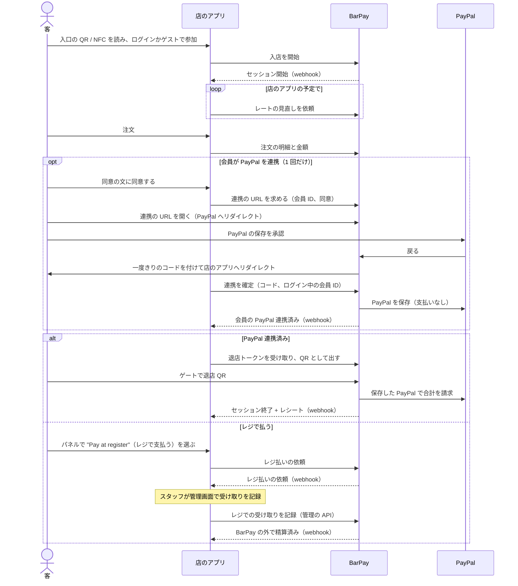
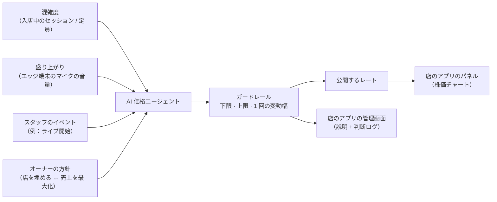
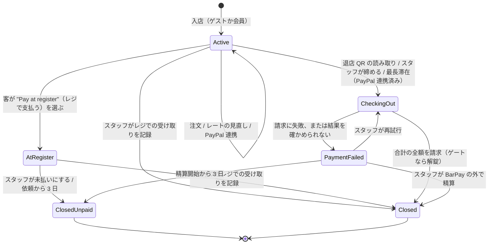
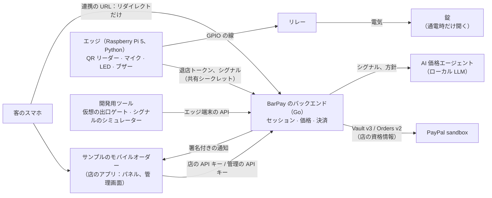

# PRD — BarPay

> `PRD.md` の日本語訳。内容が食い違う場合は `PRD.md` が正。

## 1. 目的

BarPay は、バーが自店のモバイルオーダーシステムに組み込む決済・価格モジュールである。店の混雑と盛り上がりに応じて株価のように動くチャージ料を加え、PayPal を連携した会員は、店を出るだけで来店全体の精算を済ませられる。

- **客**は、店が閑散としていても満席でも同じ固定のチャージ料（席料・お通し）を払い、会計で初めて知ることも多い。特に海外からの客は驚く。滞在中に自分が何に払っているのかが見えず、帰るときにはレジに並ぶ。
- **バーのオーナー**は、暇な夜に値下げして客を呼ぶことも、満席の夜に価値を取り込むこともできない。モバイルオーダーは注文を受けるが、需要に応じてチャージ料を決めたり、客がそのまま出て行けるようにしたりするものは無い。
- **モバイルオーダーの開発者**は、需要に応じた価格と、退店時の精算を自分で作ることになる。

BarPay はこれをモジュールとして解決する。店は自分のアプリ、メニュー、会員、画面をそのまま使い、BarPay が、動くチャージ料、来店のたびに退店 QR をそのまま精算に変える、会員向けの任意の PayPal 連携、それ以外の客のためのレジでの支払いを加える。お金は店自身の PayPal アカウントに入る。BarPay は自分の画面を持たない。API と署名付きの通知を提供し、何を見せるか、いつ BarPay を呼ぶかは店のアプリが決める。

## 2. 利用者

| 利用者 | 目的 |
|---|---|
| 客 | 入店し、飲んで食べ、払っている額を見て、店を出るだけで（PayPal を連携した会員）、またはレジで払って帰る |
| 店のアプリ | 店のモバイルオーダー（ここではサンプルアプリ）。来店を始め、注文を伝え、レートの見直しを依頼し、すべての画面（客のパネルとスタッフの管理画面）を描き、各来店がどう精算されたかを受け取る |
| スタッフ / オーナー | 店のアプリの管理画面で店の状態を見て、例外に対応する。オーナーは価格、上下限、チャージ料のルールをそこで決める |

## 3. 責務の分担

チャージ料とお金に関することは BarPay が持ち、メニュー、客との関係、画面に関することはすべて店のアプリが持つ。

| BarPay | 店のアプリ |
|---|---|
| 来店（セッション）：入店、滞在、精算、レジでの精算 | 店の QR / NFC タグから開く入口の画面、ログインかゲストでの参加 |
| チャージ料と、店のアプリが依頼したときに行う AI による値付け | メニュー、注文画面、厨房。商品の価格と注文の中身。いつレートの見直しを依頼するか |
| PayPal：会員の PayPal の保存（任意）、退店時の請求、会員が求めたときの削除 | 会員とログイン。会員が PayPal を連携したり削除したりする設定画面と、連携の前に見せる同意 |
| 会員を PayPal の承認へ送り出し、戻りを処理すること。ページは出さない | PayPal の前後で客がどこへ行くか |
| 退店トークンと、出口ゲートを開けるかの判断 | パネル：レートの株価チャート、現在の合計、PayPal（退店 QR）かレジかを選ぶ "Pay"（お会計）ボタン |
| 店を回すためのデータと操作（管理の API） | 管理画面と、そのスタッフの認証 |
| すべての結果の署名付きの通知 | 自分の画面でのレシートと履歴（BarPay の結果から作る） |



読み取ること：入店に PayPal は要らない。会員が PayPal を承認するのは 1 回だけで、その後の来店では確認なしに使う。店のアプリと BarPay はサーバー同士でやり取りし、客のブラウザが BarPay を通るのは PayPal へ行くときと戻るときだけ。

境界のルール：

- **入店**：店のアプリが自分のサーバーから入店を開始する。セッションはその場で始まり、その ID が返る。
- **PayPal 連携**：連携は来店ではなく会員に付き、ゲストは連携できない。連携の前に、店のアプリは会員に「来店の合計を、退店時に確認なしで請求する」ことを見せ、見せた同意の文の版を添えて、ログイン中の会員の連携の URL を BarPay に求める。会員はその URL を全画面で開き、フレームの中では開かない。埋め込みのフレームの中では PayPal の承認が動かないと考えられるため（推測、未確認）。連携の URL は作ってから 30 分間、その時刻の直前まで使え、新しい要求があると、まだ使われていない前の URL は使えなくなる。BarPay はページを出さない。ブラウザを PayPal へリダイレクトし、PayPal から戻ったら承認を確かめ、一度きりのコードを付けてブラウザを店のアプリへリダイレクトする。戻りが運ぶのは、結果、一度きりのコード、店のアプリ自身の `state` の値だけで、PayPal のトークンは付けない。BarPay のリダイレクトはリファラーを送らない。店のアプリは `state` を連携を求めたブラウザのセッションに結び付けるので、会員はログインしているのと同じブラウザで承認する必要がある。連携が保存されるのは、店のアプリのサーバーが `state` がそのブラウザのセッションのものだと確かめた上で、コードとログイン中の会員の ID で確定を依頼し、それが連携の URL を作った会員と同じときだけ。保存した PayPal を持つ会員が入店すると、BarPay がセッションを自動で連携済みにする。
- **レートの見直し**：店のアプリが、自分の予定で BarPay にレートの見直しを依頼する（サンプルアプリは 5 分ごと）。BarPay は自分からは見直さず、店の営業時間を知らない。
- **照会**：店のアプリは、セッションの状態、合計、来店中のレートの履歴、レシートをセッションの ID で、会員が保存した PayPal を持っているかを会員 ID で、公開中のレートを今の設定の来店ごとの上限と合わせて、いつでも読める。店のアプリは、上限を入店の前から見せられる。パネルを描くこと、客が戻ってきたときの結果の確認、設定画面に連携と削除のどちらを出すかの判断、取りこぼした通知の回復はこれで行う。
- **管理**：店のアプリの管理画面は、管理の API で、セッションの一覧、説明付きのレートの履歴、判断ログ、警告、通知の記録を読み、設定を変え、スタッフのイベントを送り、セッションを操作する（レジでの受け取りの記録、未払いにする、締める、請求の再試行、BarPay の外で精算、手でゲートを開ける）。管理の要求はそれぞれ、操作したスタッフを示し、BarPay はそれを記録する。スタッフの認証は店のアプリが行う。一覧（セッション、判断、警告、通知）はどれも新しい順で、1 ページずつ読み、どのページも同じやり方で次のページのカーソルを渡す。形が違う、別の一覧のもの、一覧に無いものを指すカーソルは拒み、ページを送るあいだに足されたものでページはずれない。並びは BarPay が保存した順で、同じ時刻のものどうしも含めて、読むたびに同じになる。一覧のセッションは、同じ瞬間の照会と同じものを示す。
- **退店トークン**：滞在中の連携済みのセッション、または終わってから再解錠の受付時間内のセッション（請求した、またはスタッフが記録した）について、店のアプリのサーバーが BarPay から現在の退店トークンを受け取り、そのセッションの客にだけ QR として見せる。トークンはセッションが終わるまで決まった間隔で変わり、出口ゲートでしか使えない。
- **通知**：イベントは `session.started`、`session.paypal_linked`、`session.register_requested`、`session.closed`、`session.payment_failed`、`session.settled_outside`、`session.closed_unpaid`、`gate.unlock_failed`、会員向けの `member.paypal_linked` と `member.saved_paypal_deleted`。それぞれイベント ID とセッションごと（`member.*` は会員ごと）の通し番号を持ち、署名される。通知は設定ファイルの通知先 URL に送り、その URL は、ループバックの IP アドレスへの http を除いて https を使う（[UC8](#uc8--店が-barpay-とつながる)）。受け取りが確認されない通知は、最初の送信の 1 分後、5 分後、30 分後、2 時間後、6 時間後、12 時間後、24 時間後に再送する。それを過ぎると、通知の記録に断念として残し、警告を出す。受け取りの確認になるのは 2xx の応答だけで、リダイレクトは追わない。再送の時刻は保存した最初の送信の時刻から数えるので、再起動しても変わらない。そのうち 1 つ以上の時刻を、BarPay が止まっていた、またはほかの通知を送っていたために送れないまま過ぎたら、送れるようになりしだい、過ぎた時刻の数にかかわらず 1 回だけ送り、まだ来ていない次の再送の時刻から続ける。最後の時刻（24 時間後）をそのようにして過ぎたら、その 1 回が最後で、受け取りが確認されなければ断念する。BarPay が止まる直前に保存した通知は、次に起動したときに初めて送る。セッションは `session.closed`（BarPay を通して精算した。請求した、または合計が 0）、`session.settled_outside`（スタッフがレジまたは BarPay の外での支払いを記録した）、`session.closed_unpaid` のどれか 1 つだけで終わり、そのイベントがレシートを運ぶ。
- **パネル**：店のアプリ自身の画面。BarPay は照会で、現在のレート、その変化と履歴、チャージ料が停止中（といつまでか）か上限到達か、滞在時間、ここまでのチャージ料、注文、支払い方法（PayPal かレジ）、現在の合計、精算後は結果を渡す。"Pay"（お会計）を押すと選択肢が出る。PayPal（連携済みのときだけ出る）は退店 QR を出し、"Pay at register"（レジで支払う）は、スタッフが受け取れるよう合計の確定を BarPay に依頼する。
- **API キー**：店のアプリは自分のサーバーからだけ BarPay を呼ぶ。客に関わる呼び出しには店の API キーを、管理の呼び出しには別の管理の API キーを使う。サンプルアプリには両方を持つバックエンドがある。

## 4. 価格モデル

チャージ料は時間とともに変わる **1 時間あたりのレート**で、**枠**ごとに計上する。入店から 1 枠（設定、初期値 10 分）が終わるたびに、終わった枠を、その時点で公開中のレートで計上する。



レートは AI がオーナーの方針に沿って決め、実際に請求できる範囲はオーナーが決めたガードレールが決める。

- **シグナル**：混雑度と盛り上がり（作者が考える中心の入力）と、スタッフのイベント。混雑度は、入店中（Active）のセッションの数を定員（設定ファイル）で割ったもので、最大で 1（満席）とする。人数ではなく入店中のスマホの数を数え、カメラで人数を数えることはしない。数えるのは入店中のセッションだけで、精算中、レジ待ち、支払い失敗、閉じた、未払いで閉じたセッションは数えない。レジ待ちと支払い失敗は、客が出ていったかもしれない後も最大 3 日その状態に残りうるし、精算中は客が出ていくところだから。盛り上がりはエッジ端末上でマイクの音量だけから算出し、音の分類はしない。端末から出るのは数値だけ。エッジ端末が無いときは盛り上がりのシグナルは無く、開発ではシグナルのシミュレーターが入力する。盛り上がりは 0（静か）から 1（いちばん賑やか）の 1 つの数値で、約 10 秒ごとに送られる。BarPay は最後に受け取った値を、受け取ってから 1 分のあいだ使う。ちょうど 1 分からは、エッジ端末が無いときと同じく盛り上がりのシグナルは無いとみなすので、止まったエッジ端末の古い値が使われ続けることは無い。エッジ端末は、送る 10 秒の間隔ごとに盛り上がりを測る。その間隔の音量は、すべてのサンプルの二乗平均平方根（RMS）を dBFS で表したもの（フルスケールを 1 とするので、無音は −∞）で、店の静かな音量（盛り上がり 0）からいちばん賑やかな音量（盛り上がり 1）までを直線で写す。静かな音量以下は 0、いちばん賑やかな音量以上は 1 とする。平均を送る間隔でとるのは、送る値がその直前の 10 秒を表すようにするためで、dBFS を使うのは、振幅よりも部屋の賑やかさの聞こえ方に近いから。2 つの音量は店ごとの調整値で、秘密でない設定（環境変数）としてエッジ端末に渡す。静かな音量はいちばん賑やかな音量より小さく、いちばん賑やかな音量は 0 dBFS 以下とする。店が自分の値を決めるまでは −50 dBFS と −20 dBFS から始める。マイクを読めなかった間隔の値は送らないので、BarPay は誤った値ではなく、まもなく盛り上がりのシグナルが無い状態になる。BarPay に届かなかった値は送り直さない。遅れて届いた値は変わった後の部屋を表すことになるので、代わりに次の間隔の値を送る。スタッフのイベントは、店のアプリの管理画面から管理の API で、ラベルと段階（starts か ends）を持って届く。見直しが使うのは続いているイベント、つまり BarPay が記録した順で最後のイベントが starts のラベルである。同じラベル（完全に一致するもの）の ends で外れるので、終わったライブがレートを上げ続けることは無い。ends を送り忘れたイベントは判断ログの入力に残り、スタッフが気づける。
- **方針**：オーナーは、店を "fill the room"（店を埋める）と "maximize revenue"（売上を最大化）のあいだのどこに置くかを決める。エージェントは、判断ごとにその方針にどう沿うかを述べる。
- **依頼による見直し**：レートは、店のアプリが依頼したときだけ見直す。BarPay が同時に行う見直しは 1 つまでで、最短の間隔（設定ファイル）に 1 回まで。見直しの最中に届いた依頼にはその見直しの結果を返し、前の見直しから最短の間隔が経つ前に届いた依頼には、新しく見直さずに現在のレートを返す。間隔は、BarPay が保存した前の見直しの開始から数えるので、再起動をまたいでも守られる。代替動作で終わった見直しも数えるので、遅いローカル LLM に依頼のたびに問い合わせることは無い。前の見直しの開始からちょうど最短の間隔が経った依頼は見直す。
- **最初のレート**：店の通貨で公開したレートが無いとき（初めての起動と、通貨の変更を反映する起動）、BarPay は起動時に設定ファイルの開始のレートを、変化 0 で公開する。最初の見直しの前でも入店できるようにするため。それ以外の起動では、最後に公開したレートを引き継ぐ。開始のレートに戻すと、見直しを経ずに変動幅を超えてレートが動くため。レートの履歴は店の今の通貨のレートだけを持ち、通貨の変更より前のレートは含めない。
- **ガードレール**（設定）：下限、上限、1 回の見直しあたりの最大変動幅（1 回の変動幅。1 時間あたりのレートの金額で、設定ファイルに書く）。提案は、下限と上限の内側と、公開中のレートから 1 回の変動幅の内側に切り詰め、それから通貨ごとのレートの刻み（固定：10 JPY、0.05 USD）のいちばん近い倍数に丸める。ちょうど中間なら公開中のレートに近い側に丸める。下限、上限、開始のレート、1 回の変動幅はレートの刻みの倍数なので、丸めても範囲から出ず、変動幅も超えない。公開中のレートが範囲から変動幅より遠く外れていることがあれば、範囲を優先する。オーナーが下限か上限を変えて、公開中のレートが新しい範囲の外になったときは、レートを、変動幅を超えてでもすぐ近いほうの端に合わせ、スタッフと、BarPay が変化から書く説明（AI は関わらない）とともに判断ログに記録する。公開中のレートが新しい範囲の内側に残る変更では、レートを公開せず、何も記録しない。
- **説明**：公開するレートには、切り詰めた後の実際の変化を述べる、短く平易な英語の理由を付ける（例："Room is half empty — rate down $0.50 to $11.50/h."）。AI から受け取るのは理由の文だけで、変化の向き、幅、新しいレートは、BarPay が公開したレートから書く。AI が書いた数値は切り詰めで外れうるため。ガードレールでレートが動かなかったときは、説明もそう述べる（例："Steady room — rate unchanged at $12.00/h."）。代替動作の説明は、レートを据え置いた理由を述べる。説明は管理の API でだけ読める。客に見えるのは、レート、その変化、チャートである。
- **判断ログ**：見直しごとの入力、エージェントの提案と推論、公開したレートと、レートを動かした下限か上限の変更を残し、管理の API で読めるようにする。
- **代替動作**：AI が時間内に答えない、またはその答えをレートとして読めないときは、レートを直前の値のまま据え置き、ログにそう残す。「時間内」は、BarPay が問い合わせを送ってから 20 秒以内のことで、送ってから 20 秒経っても答えが届いていなければ時間切れとする。固定とするのは、`requestRateEvaluation` 自身の 30 秒の上限で店のアプリの呼び出しが切れるより先に、代替動作になるようにするため。AI に接続できないときは答えなかったものとし、HTTP のエラーやチャットの補完でないものが返ったときは、レートとして読めない答えが返ったものとする。
- **プロンプト**：BarPay は、ローカル LLM に OpenAI 互換のチャットの API（`/chat/completions`。llama.cpp のサーバー、Ollama、vLLM、LM Studio が提供する）で、temperature 0 で問い合わせる。設定ファイルに書かれているときだけ、モデルが答える前にどれだけ考えてよいかを `reasoning_effort` として（サーバーの綴りのまま）送る。答える前に考えるモデルは、AI の制限時間の内側で答えるには考えることを止める必要がありうるし、この項目を知らないサーバーやモデルには送らない。固定のシステムメッセージで、役割、各入力の意味、答えの形を伝える。ユーザーメッセージは JSON で、通貨とその最小単位、公開中のレート、下限、上限、1 回の変動幅、レートの刻み、方針、混雑度、盛り上がり（無いときは `null`）、続いているスタッフのイベントを渡す。イベントのラベルは JSON の文字列として渡し、従う指示ではなく考慮する材料として扱わせる。レートとその範囲は目安にすぎず、AI が何を答えてもガードレールは効く。答えは、ちょうど 3 つの項目を持つ 1 つの JSON オブジェクトで、前後の空白と、それを囲む 1 つの Markdown のコードブロック（```` ``` ```` か ```` ```json ````）のほかには何も含めない。`rate_per_hour` は通貨の最小単位での 1 時間あたりの整数で 0 から 100,000,000、`reason` は説明に使うもので 1 から 120 文字（前後の空白を除いて数える）、空白とピリオドだけではなく、改行やほかの制御文字、行区切りや段落区切り、双方向の上書きのような書式文字を含まない。`reasoning` は判断ログに残す、そのレートが方針にどう沿うかで、1 から 4,000 文字、空白だけではない。文字数は Unicode のコードポイントで数える。プロンプトは `reason` を、数値や変化の向きを含まない、店の様子を述べる平易な英語の 1 文にするよう求めるが、それは AI への指示であり、答えを読めるかどうかは上の制限だけで決める。それ以外はレートとして読めない答えとする：文章、項目の不足、余分や重複、小数点・指数・符号付きで書いたレート、文字列のレート、その範囲の外のレート。その範囲の内側でガードレールの外にあるレートはレートとして読み、ガードレールで切り詰める。
- **枠**：1 枠の額は、レート × 枠の長さを通貨の最小単位（1 JPY、0.01 USD）に切り捨てたもので、枠が終わった時点で決まり、その後は変わらない。枠が終わるちょうどその時点に公開されたレートは、その枠のレートになる。入店そのものは 0 円で、精算が始まった（またはレジ払いを依頼した）時点で終わっていない枠は請求しない。その時点ちょうどに終わる枠は終わっているので請求する。
- **追加注文での停止**：来店の 1 件目の注文は対象外（ワンドリンク制）。それ以降の注文は、件数で数え、フードも含め、その注文から決まった時間（設定、初期値 30 分、0 で無効）チャージ料を止める。新しい注文は停止を数え直し、足し合わせない。停止中に終わる枠は 0 円。停止は注文の時点を含み、停止時間が経つ直前までで、注文ちょうどに終わる枠は 0 円、停止の終わりちょうどに終わる枠は請求する。セッションが停止中のあいだ、照会は停止が終わる時刻を渡し、その時刻からは停止中でない。時刻は、1 件目より後の最後の注文に、進行中の枠の設定の停止時間を足したもの。変えた停止時間は次の枠から効く（設定の変更を参照）ので、この時刻は、新しい注文が無くても枠が始まるときに動くことがある。
- **来店ごとの上限**（設定、初期値 ¥3,000 / $30、0 で上限なし）：チャージ料だけの上限で、注文の金額は含めない。上限に達する枠は上限までしか計上せず、その後の枠は 0 円。
- **設定の変更**：設定は管理の API で変える。枠の長さ、停止時間、上限は、入店中のセッションにも次の枠から反映する。各枠は、その枠が始まった時点の設定を使うので、枠の終わりちょうどの変更は、そこで始まる枠に効き、そこで終わる枠には効かない。上限を、セッションがすでに計上した額より低くすると、それ以降の枠は計上しない。すでに計上した額は減らさない。
- **時間**：この文書の時間と期間はすべて実時間。

## 5. 決済モデル

PayPal の連携は任意で、お金は動かない。会員の PayPal をこの店用に保存するだけで、来店全体は退店時に 1 回で請求する。

| 時点 | PayPal で起きること |
|---|---|
| 入店 | 保存した PayPal を持つ会員なら、PayPal にまだあるかを BarPay が確かめる。ほかは何もしない |
| PayPal 連携（会員のみ、任意） | 会員が、merchant-initiated の請求のために PayPal を保存することを承認し、店のアプリが連携を確定すると、BarPay がそれを会員 ID のもとに持つ。支払いは無い |
| 滞在 | 何もしない。注文とチャージ料は BarPay が記録する |
| 精算、合計 = 0 | 何も請求しない |
| 精算、合計 > 0 | 保存した PayPal で合計を 1 回、客の承認なしに請求する。ゲートはそれが成功した後にだけ開く |
| 精算後 | 何もしない。会員の保存した PayPal は、会員が削除するまで次の来店のために残す（UC9） |

- **現在の合計** = 注文 + ここまでのチャージ料。
- ゲスト、保存した PayPal を持たない会員、レジを選んだ客はレジで払う。BarPay が合計を確定し、スタッフが BarPay の外でお金を受け取って店のアプリの管理画面で記録すると、セッションは BarPay の外で精算済みとして終わる。

## 6. 保証すること

| 観点 | BarPay が保証すること |
|---|---|
| 同意 | 保存した PayPal を持つのは、店のアプリが見せた同意の文の版を示した連携の要求に対してだけで、BarPay はその版を保存した PayPal とともに記録する。その文は「来店の合計を、退店時に追加の承認なしで請求する」と述べる。請求するのは退店時だけ。現在の合計は滞在中ずっと読める |
| 透明性 | セッションが終わるまで、BarPay は照会で、現在のレート、その変化と履歴、ここまでのチャージ料、停止中か上限到達か、現在の合計を渡す。それを見せるのは店のアプリの仕事。入店前の料金のルールは店が掲示する（[扱わないこと](#7-扱わないこと) を参照） |
| この来店のためだけの請求 | BarPay が会員の保存した PayPal に請求するのは、その会員のセッションの精算中か、スタッフによるその再試行のときだけ。スタッフが再試行できるのは、精算開始から最大 3 日。保存した PayPal は 1 人の会員のもので、1 つの PayPal アカウントを連携できる会員は 1 人まで。PayPal にもう無いとき（UC1、UC5）と、会員が求めたときに削除し、会員が求めても、それを使うセッションが終わるまでは削除しない |
| 正確さ | BarPay の精算でセッションが終わったとき、請求した額は精算の瞬間にサーバーが確定した最終金額に等しく、レシートはその合計と PayPal の capture ID を示す。レジまたは BarPay の外で精算したときは、レシートは合計とスタッフが記録した額を示す。BarPay では何も請求していない。ただし BarPay が結果を確かめられなかった請求は例外で、その額はスタッフが PayPal のダッシュボードから記録する（UC7） |
| 価格の範囲 | レートは常に店の下限と上限のあいだにある。1 回の見直しで変動幅を超えて動くことは無く、見直しのあいだは最短の間隔以上あく。ただし、オーナーが下限か上限を変えたときは例外で、判断ログに記録する |
| 支払いは 1 回 | 各セッションの精算は 1 回だけ。読み取りの繰り返し、ネットワークエラーやタイムアウト後の再試行、管理の要求の繰り返し、スタッフの再試行で、同じ額を二重に請求することは無い。請求を起こしうる管理の要求には冪等キーを付け、PayPal を呼ぶ前にセッションを精算中にするので、同時に来たもう一方は拒否する。BarPay は、結果の分からない請求を自分で新しい試行にせず、同じ `PayPal-Request-Id` と `invoice_id` で送り直す（[動かせない前提](#8-動かせない前提) の冪等性）。各セッションの請求が PayPal で成功するのは 1 回だけ |
| 支払ってから解錠 | BarPay が出口ゲートを開けるのは、全額を請求したか、スタッフがレジまたは BarPay の外での受け取りを記録して終わったセッションに対してだけで、終わってから再解錠の受付時間内に限る。セッションが終わると、その退店トークンは変わらなくなる。スタッフは管理の API で手でゲートを開けることもできる |
| 店への通知 | 店のアプリには、すべてのセッションの開始、PayPal 連携、レジ払いの依頼、結果を通知する。通知は署名され、イベント ID と通し番号を持ち、最大 24 時間再送されるので、店のアプリは同じ通知を複数回、または順不同で受け取ることがある。現在の状態はいつでも照会で読める |
| アクセス | 入店の開始、注文の報告、ID によるセッションの照会、会員・レートの照会、レートの見直しの依頼、レジ払いの依頼、退店トークンの受け取り、PayPal 連携の要求と確定、会員の保存した PayPal の削除ができるのは、店の API キーだけ。セッションの一覧、判断ログ・警告・通知の記録・設定の読み取り、設定の変更、スタッフのイベントの送信、記録・締める・再試行・精算・未払いにする・手でゲートを開ける操作ができるのは、管理の API キーだけで、管理の要求はそれぞれ操作したスタッフを示す。連携が保存されるのは、要求した会員についてだけで、店のアプリのサーバーが確定したときだけ。精算を起こせるのは、現在の退店トークンを示した認証済みのエッジ端末、管理の要求、最長滞在に達したときの BarPay 自身だけ。退店トークンは店の API キーにだけ発行し、出口ゲートでしか使えず、ログに残さない。2 つのキーが管理の操作を守れるのは、店のアプリが管理の API キーを分けて持つ範囲までで、両方を持つ店のバックエンドは何でもできる。示されたスタッフは記録のためのもので、認証ではない |
| 永続性 | セッション、注文、設定、判断ログ、capture ID、保存した PayPal への参照、警告、通知の記録（届いていない通知を含む）、店のアプリの `Idempotency-Key` の記録、PayPal の呼び出しごとの `PayPal-Request-Id` と `invoice_id` とその試行を最初に送った時刻、公開したレートの履歴、管理の要求ごとに記録したスタッフは、バックエンドを再起動しても残る |
| プライバシー | 生の音声は保存せず、エッジ端末の外に出さない |
| 可観測性 | 失敗した請求、結果を確かめられなかった請求、失敗した解錠、レジ払いの依頼、拒否した遅れた注文、最長滞在を超えたセッション、断念した通知、失敗した削除は、管理の API で読める警告として出す。失敗した請求と、読み取りの後の失敗した解錠（支払い済みか精算済みのセッション）は、店のアプリにも送る |

## 7. 扱わないこと

| 扱わないこと | 理由 |
|---|---|
| 実際のお金での決済 | 本番で保存した PayPal に請求するには PayPal の reference transactions の承認が要る（[動かせない前提](#8-動かせない前提) を参照）。作るのも動かすのも PayPal の sandbox で行う |
| 画面 | すべての画面は店のアプリが描く：パネル、管理画面、連携の前の同意。BarPay はデータと操作を提供する |
| スタッフの認証 | 店のアプリの仕事。BarPay は管理の API キーを確かめ、店のアプリが示したスタッフを記録する |
| いつレートを見直すかの判断 | 店のアプリの予定。BarPay は、依頼されたときに、最短の間隔の範囲で見直す |
| 店の登録画面、1 つのデプロイで複数の店 | 1 つの店を設定ファイルで用意する。価格とチャージ料のルールは管理の API で変える |
| 決済の仲介者としての BarPay（プラットフォーム手数料、マルチパーティ） | 各店は自分の PayPal アカウントで受け取る |
| チェーンの店舗をまたいだ保存した PayPal の利用 | 将来。店舗が 1 つの PayPal アカウントを共有すれば動くかもしれないが、未確認 |
| 会員とログイン | 店のアプリの仕事。BarPay は、店のアプリが渡す ID のもとに会員の保存した PayPal を持つだけ（UC2、UC9） |
| ゲストの PayPal | 保存した PayPal には来店をまたぐ持ち主が要るので、連携には店のアカウントが要る。ゲストはレジで払う |
| メニュー、注文画面、厨房の流れ | 店のアプリの仕事。BarPay は注文の明細と金額だけを記録する |
| 入店前に料金のルールを見せること | 店が、自分のサイトか店内に掲示する（変動制のレート、枠の長さ、来店ごとの上限） |
| レジでのお金の受け取り | 店の仕事。BarPay は合計を確定し、スタッフが受け取ったと言う額を記録する |
| 注文の明細の取り消しや訂正 | 一度伝えた注文は合計に残る。店は PayPal のダッシュボードから返金する |
| 店のアプリが伝える内容の正しさ | BarPay は店のアプリが伝えた注文の金額を請求し、送られた会員 ID とスタッフを信じる。それを確かめること、1 回の来店で注文できる額を制限すること、各退店トークンをそのセッションの客にだけ見せることは店のアプリの仕事 |
| 入店の制限 | 誰が入店できるかは店のアプリが決める。ゲストの参加の回数の制限も含む |
| 読み込んだ設定ファイルの表示 | オーナーはファイルを読む。効いている設定は管理の API で読める |
| 24 時間の再送の後の通知 | 店のアプリは照会で回復する |
| 店を出た客からの、拒否された請求の回収 | 管理の API で読める未払いの額として残る。回収は BarPay の外での店の仕事 |
| グループ内での割り勘 | スマホ 1 台が 1 セッション。割り勘は別のプロダクト |
| 入店時の価格の固定 | 株価のような仕組みが成り立たなくなる。客は、来店ごとの上限と現在の合計の表示で守る |
| 入店時のデポジットやお金の確保 | ゲートは支払いの後にだけ開くので、請求が失敗した客はまだ店内にいて、レジで払える。確保すると、請求が 2 件になり、客の明細に保留中の額が残る |
| 返金と異議申し立て | PayPal のダッシュボードで扱う |
| 税の計算 | すべての価格は税込み |
| BarPay が返す日本語の文 | 説明とエラーの文は英語。画面の言語は店のアプリが決める。通貨（JPY/USD）は選べる |
| 客を閉じ込めること | 扉は内側から常に開けられなければならない。鍵は、出ていく体験の一部として出口ゲートを開けるもので、客が出ていくのを止めるためのものではない |

## 8. 動かせない前提

- **sandbox で確認済み（2026-10-28、USD）**：`payment_source.paypal.vault_id` だけを付けた `CAPTURE` の注文は、買い手の承認なしに、作成時の応答で `COMPLETED` になった。このとき使った保存した PayPal は、注文の承認から作ったもので、BarPay が今使う setup token の流れから作ったものではない。その流れは次の項目で確かめた。
- **sandbox で確認済み（2026-10-31、USD）**：`usage_type` を `MERCHANT` にした setup token を使い、どの呼び出しにも `PayPal-Request-Id` を付けた。一部の行は、保存で返った 2026-10-28 の保存した PayPal を使った（3 行目）。

  | 呼び出し | 観測した結果 |
  |---|---|
  | 保存して請求 | 買い手が承認した setup token から PayPal を保存でき（201）、その `vault_id` での `CAPTURE` の注文は、買い手の承認なしに、1 件のキャプチャで `COMPLETED`（201）になった |
  | setup token の作成から 40 分後の保存（連携の URL の 30 分 + コードの 10 分） | 保存できた |
  | 買い手がこの店の保存した PayPal をすでに持っているときに承認した setup token の保存 | 新しいものではなく、その保存した PayPal の `vault_id` が返った（200）。別に承認した setup token でも同じだった。その保存した PayPal を削除した後は、そうした setup token の保存は 422 `INTERNAL_ERROR` で失敗し、新しい `PayPal-Request-Id` でも同じだった。保存した PayPal が無いときに承認した setup token からは、別々の `vault_id` ができた |
  | ID での照会 | 保存している間は 200 で、拒否された請求の後も 200。BarPay が削除した後と、買い手が自分の PayPal アカウントで取り消した後は 404 `TOKEN_NOT_FOUND` で、それでの請求は 403 `PERMISSION_DENIED` |
  | 削除 | 204。同じ `PayPal-Request-Id` でも新しいものでも、もう一度削除すると 204。買い手が自分の PayPal アカウントですでに取り消したものの削除も 204 |
  | 同じ `PayPal-Request-Id` での再送 | 保存：200 で同じ `vault_id`。新しい `vault_id` を作った保存でも、約 91 分後に同じだった。保存済みの setup token を新しい `PayPal-Request-Id` で保存しても同じ `vault_id` だった。請求：同じ注文とキャプチャで、2 回目の請求は無い（直後は 200、約 39 分後は 201。約 39 分は試した中で最長で、PayPal が覚えている期間は分からない）。削除：204。拒否された請求は覚えられておらず、再送はもう一度処理される |
  | 拒否される請求 | 422 `TRANSACTION_REFUSED` で、注文の ID は返らない。sandbox の買い手に紐付いた銀行口座とカードを外して（残高 0）起こした。sandbox の擬似応答のヘッダーでは代わりに 422 `INSTRUMENT_DECLINED` になり、その `invoice_id` は使われない |
  | 同じ `invoice_id` で新しい `PayPal-Request-Id` | 成功した請求の後：422 `DUPLICATE_INVOICE_ID`。拒否された請求の後：買い手に資金が無い間はまた拒否され、資金ができたら `COMPLETED`（スタッフの再試行） |
- **信じる前に確かめる**：BarPay の return と cancel の URL には、推測できない連携の ID を付ける。客が PayPal から戻ってきたら、バックエンドはその連携とともに保存した setup token だけを使い、URL に付いたトークンの ID は無視し、戻りは連携ごとに 1 回だけ受け付け、setup token が承認されたことを確かめる。その setup token から保存した PayPal を作るのは店のアプリが連携を確定したときだけで、それが成功してから会員に保存する。
- **冪等性**：PayPal を保存する、お金を動かす、保存した PayPal を削除する PayPal の呼び出しにはすべて、セッション・手順・試行回数から作った `PayPal-Request-Id` を付け、呼び出す前に保存しておく。連携と削除にはセッションが無いので、セッションの代わりに、連携の呼び出しは連携の ID から、削除の呼び出しは削除の ID から作る。ネットワークの再試行では同じものを使い、スタッフの再試行では新しい試行にする。PayPal が削除を拒んだ後の次の試みも新しい試行にする。退店時の請求にはセッションごとの `invoice_id` を付け、これも呼び出す前に保存しておく。PayPal は、すでに請求した `invoice_id` の請求を `DUPLICATE_INVOICE_ID` で拒否し、拒否された請求ではその `invoice_id` は使われないので、スタッフの再試行も同じものを使う（上で確認済み）。`invoice_id` は店の PayPal アカウント全体で一意にする。アカウントのほかの請求がすでに使ったものだと、スタッフの再試行では解消できない `DUPLICATE_INVOICE_ID` になるため。呼び出しの結果が分からないのは、呼び出しの制限時間内に PayPal が答えない、接続が切れる、答えを保存する前に BarPay が再起動する、または答えが結果を言わないとき。答えが結果を言わないのは、5xx、408、429、読めない 2xx、請求では完了も拒否もしていない capture（保留など）。請求の成功は、完了した capture を持つ完了した注文だけで、ほかの 4xx と、拒否されたか失敗した capture は拒否にあたる。呼び出しの結果が分からないときは、BarPay は照会せず、同じ `PayPal-Request-Id` で同じ呼び出しを送り直す。答えを失った請求では照会する注文の ID が BarPay に無く、拒否された請求にはそもそも無いため。保存と削除の送り直しは最初の結果を返す。請求の送り直しは、最初の請求が成功していれば同じ注文と capture を返し、二重には請求しない。拒否されていたか PayPal に届いていなければ、ここで請求する。これはまだ払われていない同じ請求で、`invoice_id` によって成功は 1 回だけになる。PayPal が請求の `PayPal-Request-Id` を覚えていたのは約 39 分まで確かめた（それより長いかは分からない）ので、BarPay が請求を送り直すのは、その試行を最初に送ってから 30 分より前に限り、ちょうど 30 分からは送り直さない。それを過ぎても結果が分からないとき、または送り直しが `DUPLICATE_INVOICE_ID` で拒まれたのに BarPay がそのセッションの capture を記録していないときは、もう請求しない。セッションは PaymentFailed になって `charge_unconfirmed` の警告を出し、スタッフが PayPal のダッシュボードを見て片づける（UC7）。このときの請求は、レシートに要る capture ID を BarPay が持たないまま通っているかもしれず、後の送り直しでも返らないと推測される（確かめていない）ので、客が払ったかは PayPal の記録を見るスタッフにしか分からない。
- **店自身の PayPal**：BarPay は店の REST の資格情報で PayPal を呼び、それを秘密情報として持つ。その資格情報の REST アプリには、BarPay の外で使う保存した PayPal を持たせない。保存は、買い手のアカウントがこの店にすでに持つ保存した PayPal を返すことがあり、BarPay はどの会員も持たないものを連携した会員に保存し（UC2）、その会員の削除（UC9）が PayPal でそれを削除するため。
- **保存した PayPal の承認**：本番では、merchant-initiated の請求のために PayPal を保存するには、PayPal から reference transactions の承認を得る必要がある。sandbox の妨げにはならない。
- **通貨**：店ごとに JPY か USD を選び、その店の金額はすべてその通貨にする。JPY には小数点以下が無い。sandbox での JPY は [未決事項 3](#12-未決事項) 次第。
- **時計**：BarPay は、サーバーの時計が戻らないことを前提にする。時計は同期させ、戻すのではなく少しずつ合わせる。金額と時間の制限はすべて BarPay が保存した時刻（入店、注文、公開したレート、設定の変更）から計算するので、時計が戻ると、レートや注文に終わった枠より前の時刻が付き、その枠の金額が変わりうる。これは [価格モデル](#4-価格モデル) の枠で禁じている。
- **ハードウェア**：Raspberry Pi 5、USB の QR リーダー、リレーを通して GPIO の線で動かす通電時解錠型の錠、マイク、ゲートの LED とブザー。
  - **QR リーダー**：QR コードを、スマホの画面に出たものも含めて読める。読んだものを USB HID のキーボードとして、1 文字ずつ US 配列のキーか Alt コード（Alt を押したまま、文字コードを 10 進でテンキーから打つもの）で送る。1 回の読み取りの終わりに Enter か Alt コードの 13 を送り、その後には何も送らない（CR と LF にしない）。機種は置き換わるので、機種の名前は書かない。エッジ端末はこれらに依存する。退店トークンは中身を決めていない文字列（`openapi.yaml` の `ExitToken`）なので、エッジ端末はどの文字が来るかに依存できず、ほかの配列など、これと違う打ち方をするリーダーの文字は読み違える。
  - **ロック**：錠は通電時解錠型で、電気が来ていない間は閉まり、来ている間だけ開く。電気はリレーの接点を通して送る。錠は、電気が無くても内側からは常に開けられるものにする（[客を閉じ込めること](#7-扱わないこと)）。エッジ端末は 1 本の GPIO の線でリレーを動かすので、錠はその線が high の間だけ開く。エッジ端末が普通に止まっても、Raspberry Pi 5 の電源が落ちても、線が切れてもゲートは閉まる。エッジ端末が落ちたときや強制終了されたときは、サービスが止まるたびに動かす後の処理が線を low にするまで、または次に起動するまで、線が high のまま残りうる。起動のときも線を low にする。解錠は、線を解錠の秒数だけ high にしてから low に戻すこと。解錠の秒数は秘密でない設定として環境変数で渡し、既定は 5 秒、0 より大きく 60 秒以下で、1 回の解錠でゲートが開いている時間の上限になる。エッジ端末は解錠だけをする。施錠の命令は無く、ゲートが閉まるのは線が low に戻ることだけによるので、閉め忘れが起きない。開いている間に解錠すると、線を high のままにし、解錠の秒数をその解錠から数え直す。解錠の秒数のちょうど終わりからは、前の解錠は線を high に保たない。その瞬間に解錠できなかった解錠は線を low にし、解錠できた解錠はそこから秒数を数える。解錠できたとは、エッジ端末が線を high にし、読み返した値が high だったことをいう。リレーと錠には状態を返す線が無く、エッジ端末が確かめられるのはそこまでで、エッジ端末はそれを `reportUnlockResult` で報告する。解錠できなかったときは、線をすぐ low に戻す。ただし、前に解錠できた解錠の秒数の途中なら、その秒数の終わりに low に戻し、秒数は数え直さない。エッジ端末は、起動のときと止まるときに線を low にする。どの線を使うかは、秘密でない設定として環境変数で渡し、知らせ方の線のどれかと同じならエッジ端末は起動しない。
  - **エッジ端末は 1 台**：1 つの BarPay につなぐエッジ端末は 1 台にする。`waitForUnlock` は、待っている呼び出しのどれか 1 つに手での解錠を渡し、二度は送らないので、2 台あると別のゲートが開きうる。また、2 台のマイクは互いの盛り上がりを上書きする。
  - **知らせ方**：エッジ端末が LED とブザーで、下の表のとおりにゲートの状態を客に示すこと。この文書とエッジ端末の API で「リーダーに出す」「リーダーが示す」とあるのは、エッジ端末が知らせ方でその状態を示すことをいう。QR リーダー本体の読み取り音は「読めた」の合図にすぎず、結果は知らせ方だけで示す。ブザーの音はどれも 0.5 秒以上で、音と音の間は 0.3 秒空けるので、リーダーの短い読み取り音と取り違えない。

    | 状態 | いつ | LED の色 | LED の点き方 | ブザー | その後 |
    |---|---|---|---|---|---|
    | 読み取り待ち | ほかに何も示していないとき | 白 | 点灯 | 鳴らさない | 次の状態まで続く |
    | 処理中（BarPay の答えかロックを待つ間） | 読み取りから BarPay が答えるまでと、ロックが解錠している間（`unlock` が `true` の後と手での解錠） | 青 | 0.2 秒点いて 0.2 秒消える点滅 | 鳴らさない | 答えの状態、または解錠の結果の状態 |
    | Thank you（ありがとうございました） | `reader_message` が `Thank you` で、ロックが解錠できたとき | 緑 | 3 秒点灯 | 0.5 秒を 1 回 | 読み取り待ち |
    | Please pay at the register（お会計はレジでお願いします） | `reader_message` が `Please pay at the register` | 琥珀色 | 5 秒点灯 | 0.5 秒を 3 回 | 読み取り待ち |
    | Please see staff（スタッフにお声がけください） | `reader_message` が `Please see staff` | 赤 | 10 秒点灯 | 1.5 秒を 1 回 | 読み取り待ち |
    | Please show a new QR code（新しい QR コードを見せてください） | `reader_message` が `Please show a new QR code` | 琥珀色 | 0.5 秒点いて 0.5 秒消える点滅を 5 秒 | 0.5 秒を 2 回 | 読み取り待ち |
    | BarPay に届かない | 読み取りの BarPay への呼び出しに答えが無いか、答えが `ScanResult` でない | 赤 | 0.5 秒点いて 0.5 秒消える点滅を 10 秒 | 1.5 秒を 2 回 | 読み取り待ち |
    | 解錠の失敗 | 解錠（読み取りの後でも手ででも）が、上のロックの判定で解錠できなかった | Please see staff と同じ | Please see staff と同じ | Please see staff と同じ | 読み取り待ち |
    | 手での解錠 | `waitForUnlock` からの解錠で、ロックが解錠できたとき | 緑 | 0.5 秒点いて 0.5 秒消える点滅を 3 秒 | 0.5 秒を 1 回 | 読み取り待ち |

    わざと Please see staff と同じにした解錠の失敗を除き、どの 2 つの状態も、色だけでなく LED の点き方かブザーで異なるので、色の見分けにくい客にも区別がつく。また、手での解錠を除くどの結果も、音だけで区別がつく。手での解錠は、Thank you と同じくゲートが開いたことを表すので、同じ音にする。そのときスタッフはゲートにいる。

    新しい状態を受け取ったら、示している状態の光と音を、音の途中でもすぐ止めて新しい状態に移るので、客が前の状態を遅れて受け取ることはない。エッジ端末が止まるときは LED とブザーを消すので、動いているかのように状態が残ることはない。LED は 3 本の GPIO の線につなぐ 1 つの RGB LED で、アンバーは赤と緑を同時に点けて出す。ブザーは 1 本の線につなぐアクティブブザーなので、エッジ端末は各線を点けるか消すかだけをし、鳴り方は音の数と長さで区別して高さは変えない。LED の各色とブザーは、線が high の間だけ点く・鳴るので、LED はカソード共通のもの、ブザーは線が high の間に鳴るものを使う。どの線を使うかは、秘密でない設定として環境変数で渡す。
- **AI**：価格エージェントは、BarPay のバックエンドがネットワーク越しに呼ぶローカル LLM で動く。呼び出しごとの費用は無い。
- **秘密情報**：PayPal の資格情報、店の API キー、管理の API キー、通知の署名用シークレット、エッジ端末の共有シークレットは公開リポジトリに入れない。エッジ端末は共有シークレットを、`https` か、IP アドレスとして書いたループバックのアドレス（IPv4 の `127.0.0.0/8` か `::1`）への `http` の BarPay の URL（`BARPAY_URL`）にだけ送り（UC8 と同じ）、それ以外では起動しない。ネットワーク越しの平文の `http` では、そのネットワーク上の誰でも共有シークレットを読め、BarPay の答え（解錠を含む）を読むことも偽ることもできるため。`localhost` のような名前は `http` では受け付けない。設定を読むときに、どこに解決されるかが分からないため。
- **ハードウェア無しでの開発**：ハードウェアを使う手順にはすべて、その代わりをする開発用ツールがあり（仮想の出口ゲート、シグナルのシミュレーター）、エッジ端末の API を使う。ツールは店の API キーも管理の API キーも持たず、本番のビルドには入らない。ツールが持つ資格情報はエッジ端末の共有シークレットだけで、環境変数から受け取り、ほかの鍵がある BarPay の設定ファイルは読まない。仮想の出口ゲートは、人が渡した退店 QR の中身を、リーダーが読んだものとして送るだけで、退店トークンを自分では取りに行かない。退店トークンは店の API キーにだけ発行される。
- **言語**：BarPay が返す文、サンプルアプリの UI、README は英語。リポジトリ内の対象外でない `.md` にはすべて `.ja.md` の訳がある（`.claude/skills/bilingual-docs` を参照）。

## 9. ユースケース



読み取ること：セッションが終わるのは、請求が成功したとき、スタッフがレジでの受け取りや精算を記録したとき、スタッフか 3 日の期限で未払いとして閉じたときだけ。決済の失敗でも、客のレジ払いの依頼でも、セッションは終わらない。セッションを消すことは無い。

スタッフは店のアプリの管理画面で操作し、管理画面が BarPay の管理の API を呼ぶ。

### UC1 — 客が入店する

- **事前条件**：BarPay のバックエンドが動いている（レートは起動時から公開されている）。
- **主フロー**：客が店の入口の QR コードを読むか NFC タグにかざすと、店のアプリが開く。ログインするかゲストとして参加すると、店のアプリが BarPay に入店を求め、セッションが始まる。店のアプリに通知が届き、メニューとパネルを出す。
- **代替フロー**：保存した PayPal を持つ会員が入店する → セッションはその場で始まる。BarPay はその後、保存した PayPal がまだあることを PayPal で確かめ、セッションを連携済みにする。会員は何もしない。この確認では、請求が通るかは分からない。払う手段が無くなった買い手の保存した PayPal も、PayPal にはまだある。退店時に拒否された請求は UC5 のとおりに扱い、スタッフの再試行がそれを使う（UC7）ので、保存した PayPal は残す。
- **例外**：会員の保存した PayPal が PayPal にもう無い（客が PayPal のアカウントで取り消した）→ セッションは未連携のまま。BarPay は保存した PayPal を削除して店のアプリに通知する（`member.saved_paypal_deleted`）。会員はもう一度連携する（UC2）か、レジで払える。BarPay が保存した PayPal を無くなったとみなすのは、PayPal がそう答えたとき、つまり確認で見つからない、または請求で権限が無いと答えたとき（UC5）だけ。
- **例外**：確認がタイムアウトするか、答えが読めない → PayPal は無くなったと答えていないので、保存した PayPal は残す。BarPay は、前の確認が終わってから 1 分後にもう一度確かめ、再起動をまたいでも、PayPal が答えるまで続ける。PayPal がまだあると答えたときにセッションが滞在中なら、そこで連携済みにする。それまでセッションは未連携で、もう滞在中でないセッションは連携しない。
- **例外**：店の API キーが無いか間違っている → 拒否し、何も作らない。
- **例外**：店のアプリが同じ入店を 2 回始める（同じ冪等キー）→ 同じセッションを返す。終わっていないセッションを持つ会員 → 拒否する。
- **事後条件**：セッションは滞在中で、会員の保存した PayPal が PayPal にまだあるときだけ連携済み。チャージ料はまだ 0 円。最初の枠は入店から枠 1 つ分の時間で終わる。店の混雑度にこのセッションが含まれる。

### UC2 — 会員が PayPal を連携する

- **事前条件**：客が店のアプリに会員としてログインしていて、保存した PayPal が無い。
- **主フロー**：店のアプリの設定で、会員が PayPal の連携を選び、「来店の合計を、退店時に確認なしで請求する」という同意の文に同意する。店のアプリは同意の版を添えて、その会員の連携の URL を BarPay に求め、全画面で開く。BarPay は会員を PayPal へリダイレクトし、会員はこの店のために PayPal を保存することを承認する。PayPal は会員を BarPay へ戻し、BarPay は承認を確かめて、一度きりのコードを付けて会員を店のアプリへリダイレクトする。店のアプリのサーバーは、そのコードとログイン中の会員の ID で連携を確定し、BarPay はその会員 ID のもとに PayPal を保存する。会員が滞在中のセッションを持っていれば、それはすぐ連携済みになる。持っていなければ、次の入店から使う（UC1）。店のアプリに通知が届く。
- **例外**：客がゲスト → 店のアプリは連携を出さず、アカウントが必要だと伝える。会員 ID の無い連携の要求は BarPay が拒否する。
- **例外**：会員がすでに保存した PayPal を持っている、またはその削除がまだ終わっていない → 拒否する。
- **例外**：店のアプリが、自分のオリジン（設定ファイル）の外の URL へ会員を戻すよう求める → 拒否し、連携の URL を作らない。
- **例外**：会員が、使えなくなった連携の URL を開く → 何も保存しない。会員を店のアプリへ戻し、最初からやり直せる。
- **例外**：会員が PayPal でキャンセルする → 何も保存しない。会員を店のアプリへ戻し、後からやり直すか、レジで払える。
- **例外**：setup token が承認されていない → 何も保存しない。失敗を添えて会員を店のアプリへ戻し、やり直せる。
- **例外**：店のアプリが、知らない・使用済み・期限切れのコードで、または連携の URL を作った会員とは別の会員 ID で確定する → 拒否し、何も保存しない。そのコードはもう使えない。
- **例外**：戻りが、連携を求めたのとは別のブラウザのセッションに届く（`state` が合わない）→ 店のアプリは確定しない。何も保存しない。
- **例外**：会員が承認した後にタブを閉じる、または店のアプリが確定しない → 何も保存しない。もう一度連携すると最初からやり直しになる。
- **例外**：確定のときに PayPal の保存に失敗する → 何も保存しない。店のアプリはエラーを出し、会員はやり直せる。会員が承認したときに PayPal アカウントがこの店に保存した PayPal をすでに持っていて、店のアプリが確定する前にそれが削除された場合もこれにあたる。PayPal は保存を拒み、最初から連携し直すと新しく保存される。確定の中での BarPay の送り直しの後も PayPal の答えが分からないときも、この失敗として扱う。そのとき PayPal が作ったかもしれない保存した PayPal はどの会員のものでもなく、同じ PayPal アカウントでもう一度連携すると、その会員に保存される（[動かせない前提](#8-動かせない前提)の店自身の PayPal を参照）。同じ会員の 2 つの連携が、別々の PayPal アカウントで同時に確定されるまれな場合も同じで、残った保存した PayPal はどの会員のものでもないので請求されることはなく、その PayPal アカウントの後の連携がそれを引き取る。
- **例外**：保存が、BarPay が別の会員のものとして持つ保存した PayPal を返す（PayPal アカウントがこの店に保存した PayPal をすでに持つと、PayPal はそれを返す）→ 拒否する。この会員には何も保存せず、別の会員の保存した PayPal は PayPal でもそのまま残す。会員は別の PayPal アカウントを連携するか、レジで払える。1 つの PayPal アカウントを連携できる会員は 1 人まで。共有すると、一方の会員の来店がもう一方の PayPal に請求され、一方の削除（UC9）がもう一方の保存した PayPal も消すため。結果の分からない保存を BarPay が送り直し、この会員のために保存している保存した PayPal が返るのは成功。BarPay がどの会員のものとしても持たない保存した PayPal は、この会員に保存する（[動かせない前提](#8-動かせない前提) の店自身の PayPal を参照）。
- **例外**：会員のセッションがもう滞在中ではない（レジ待ち、精算中、終了）→ 保存した PayPal は次の来店のために持つ。そのセッションは連携しない。
- **事後条件**：会員は、同意の版を記録した保存した PayPal を持つ。その会員の滞在中のセッションは連携済み。お金は動いていない。

### UC3 — 客が滞在し、価格を見る

- **事前条件**：セッションが滞在中である。
- **主フロー**：店のアプリのパネルに、BarPay の照会から、来店のあいだのレートを階段状の株価チャートで、その直近の変化、滞在時間、ここまでのチャージ料、注文の合計、支払い方法、現在の合計を出す。停止や上限が効いているあいだは、パネルにそう出し、停止ならいつまでかも出す。
- **例外**：セッションが最長滞在（設定ファイル、初期値 12 時間）に達する → PayPal 連携済みなら、UC5 と同じようにゲートなしで精算し、客はもう一度入店できる。未連携なら滞在中のままで、BarPay がセッションごとに 1 回だけ警告を出し、スタッフが客に声をかけられるようにする。連携済みのセッションの合計は、最長滞在に達した瞬間で確定する。そのとき BarPay が止まっていて、次に起動してから精算する場合も同じで、額は BarPay が止まっていた長さによらない。
- **事後条件**：チャージ料は、入店から終わった枠の額の合計に等しい。停止中の枠と上限後の枠は 0 円として数える。

### UC4 — 店のアプリが注文を伝える

- **事前条件**：セッションが滞在中である。
- **主フロー**：客が店のアプリで注文し、店のアプリが注文の明細と金額を BarPay に送る。BarPay はそれをセッションに加える。来店の 2 件目の注文からは、[価格モデル](#4-価格モデル) のとおりチャージ料を止める。
- **例外**：セッションが滞在中ではない（レジ待ち、精算中、決済失敗、終了、未払いで終了）→ 拒否し、警告を出す。提供済みのものは、店が BarPay の外で回収する。
- **例外**：その ID のセッションが無い → 拒否する。警告は出さない。スタッフが対応する客がおらず、作った ID の要求で警告が埋まることもない。
- **例外**：同じ注文が 2 回伝えられる（同じ注文 ID）→ 1 回だけ記録し、停止も数え直さない。セッションがもう滞在中でなくても同じ。
- **例外**：記録済みの注文 ID が、違う明細で伝えられる → 拒否し、記録済みの注文はそのまま。
- **例外**：金額が負、または別の通貨 → 拒否する。
- **例外**：その注文を加えると、現在の合計が通貨の最小単位で 9,000,000,000,000,000 を超える → 拒否し、何も記録しない。この値は、BarPay の持てる合計の上限（API 仕様書の `Total`）までに、その後に加わるチャージ料の余地を残す。
- **事後条件**：現在の合計にその注文が含まれる。

### UC5 — 客が出口ゲートで精算する

- **事前条件**：セッションが滞在中で、PayPal が連携されている。
- **主フロー**：客が店のアプリのパネルの "Pay"（お会計）を押して PayPal を選ぶ。店のアプリはセッションの退店トークンを BarPay から受け取って QR として出し、トークンが変わるたび（設定ファイル、初期値 30 秒ごと）に新しいものを受け取るため、古いスクリーンショットは使えない。客は QR を出口のリーダーに見せる。サーバーはその瞬間に最終金額を確定してチャージ料を止め、[決済モデル](#5-決済モデル) のとおり保存した PayPal で合計を 1 回請求し、ゲートを開ける。ロックが解錠できたら、リーダーには "Thank you"（ありがとうございました）と出す。店のアプリにはレシート付きで通知し、店のアプリが結果を出す。このユースケースで「リーダーに出す」とは、エッジ端末が知らせ方でその状態を示すことで、「ゲートが開いた」とは、ロックの判定で解錠できたことをいう（[動かせない前提](#8-動かせない前提) のハードウェア）。
- **代替フロー**：成功の後、再解錠の受付時間（設定ファイル、初期値 2 分）内に同じ退店 QR をもう一度読ませる → ゲートをもう一度開ける。何も請求しない。
- **例外**：セッションに PayPal が連携されていない → 退店トークンを発行せず、読み取ったトークンも拒否する。リーダーには "Please pay at the register"（お会計はレジでお願いします）と出す。何も請求しない。
- **例外**：請求が失敗するか拒否される → ゲートは閉じたまま、リーダーには "Please see staff"（スタッフにお声がけください）と出し、セッションは PaymentFailed になって未払いの額を持ち、警告を出して店のアプリに通知する（`session.payment_failed`、理由は `refused`）。保存した PayPal はスタッフの再試行（UC7）のために残す。ただし PayPal がそれはもう無いと答えた（権限が無い）ときは、UC1 の例外のとおり BarPay が削除し、スタッフは BarPay の外で精算する。
- **例外**：請求の結果が分からない（タイムアウト、読める答えが無い、再起動）→ ゲートは閉じたまま。最初のタイムアウトからリーダーには "Please see staff" と出し、何分かかるか分からない答えを客がゲートで待たないようにする。BarPay は [動かせない前提](#8-動かせない前提) の冪等性のとおり、PayPal が答えるまで、前の送信が終わってから 1 分後ごとに同じ請求を送り直す。送り直しは PayPal が遅いか届かないときにだけ始まるので、それより頻繁に送っても PayPal の負荷が増えるだけで得るものが少なく、客はすでにスタッフのところにいる。1 分空けても、送り直せる 30 分の間に約 30 回まで試せる。請求を始めた管理の要求（UC7 の締める・再試行）は、精算中のセッションをすぐに受け取り、結果は後から通知で届く（`session.closed` か `session.payment_failed`）。同じ冪等キーの再送は同じ応答を受け取り、待つことも、もう一度請求することもない。成功すれば主フローのとおりセッションを閉じるが、客がゲートを離れているかもしれないのでゲートは開けない。再解錠の受付時間内に、店のアプリが新しい退店トークンを受け取って QR として出し、客がそれをゲートで見せるか、スタッフが手でゲートを開ける。拒否なら上のとおりに扱う。最初に送ってから 30 分たっても答えが無いとき、またはこのセッションの請求はすでに成功していると PayPal が答えたのに BarPay が capture を記録していないときは、もう請求しない。セッションは PaymentFailed になって `charge_unconfirmed` の警告を出し、店のアプリに通知する（`session.payment_failed`、理由は `unconfirmed`）。スタッフは PayPal のダッシュボードを確かめる（UC7）。
- **例外**：請求は成功したが解錠に失敗する → 支払いは有効のままで、リーダーには "Please see staff" と出す。警告を出して店のアプリに通知し、スタッフが手でゲートを開けられるようにする。エッジ端末は解錠のたびに、うまくいったかを伝える。手での解錠（UC7）の失敗は、スタッフがゲートにいるので、警告だけを出す。
- **例外**：退店トークンが不明か期限切れ、終わってから再解錠の受付時間を過ぎたセッションのもの、または PaymentFailed のセッションのもの → 拒否し、何も請求せず、ゲートは閉じたまま。リーダーには、不明か今のものでないトークンなら "Please show a new QR code"（新しい QR コードを見せてください）、それ以外なら "Please see staff" と出す。
- **例外**：同じ QR の読み取りが同時に 2 回届く → 精算は 1 回だけ走り、両方が同じ結果を受け取る。
- **事後条件（成功時）**：請求した額 = レシートの最終金額。セッションは終わっている。チャージ料は止まっている。会員の保存した PayPal は残っている。

### UC6 — 客がレジで払う

- **事前条件**：セッションが滞在中である（PayPal の連携の有無は問わない）。
- **主フロー**：客が店のアプリのパネルの "Pay"（お会計）を押して "Pay at register"（レジで支払う）を選び、店のアプリがそれを BarPay に依頼する。BarPay は最終金額を確定してチャージ料を止め、セッションの支払い方法をレジにして、セッションをレジ待ちにし、警告を出して店のアプリに通知する。レジでスタッフがお金を受け取り、店のアプリの管理画面で記録する。セッションは BarPay の外で精算済みとして終わり、店のアプリに通知する（レシート付きの `session.settled_outside`）。再解錠の受付時間内なら、店のアプリはゲートを開けられる退店トークンを受け取れる。
- **代替フロー**：客がそのままレジに来る → スタッフがセッションの一覧から受け取りを記録する。合計はその時点で確定する。
- **代替フロー**：スタッフが合計と違う額を記録する → レシートは両方を示す。差額を BarPay で請求することは無い。
- **例外**：客がレジを選んだ後、払わずに出ていく → スタッフがセッションを未払いにするか、依頼から 3 日で未払いとして閉じる。どちらの場合も未払いの合計を記録し、PayPal には何も請求しない。期限は依頼からちょうど 3 日の瞬間に来る。その瞬間からスタッフは受け取りの記録も未払いにする操作もできず、セッションは未払いとして閉じる。その直前まではできる。
- **例外**：客がレジを選んだ後に PayPal で払いたくなる → 依頼は取り消せない。レジで払う。チャージ料は止まっているので、最長滞在はもう効かない。
- **事後条件**：セッションは終わっている。レシートは合計とレジで記録した額を示す。BarPay では何も請求していない。

### UC7 — スタッフが店を回す

- **事前条件**：店のアプリが管理画面でスタッフを認証していて、管理の API キーを持っている。
- **主フロー**：店のアプリが作る管理画面は、管理の API で次を出す：すべてのセッションと、入店時刻、滞在時間、注文の件数、現在の合計、支払い方法（PayPal かレジ）、状態、停止や上限。説明付きのレートの履歴と判断ログ。警告と通知の記録。設定：下限と上限、枠の長さ、追加注文での停止時間、来店ごとの上限、価格の方針。スタッフはスタッフのイベント（例：ライブ）を送れる。店のアプリは今すぐの見直しを依頼できる（店の API キー）。
- **代替フロー**：連携済みの客が別の扉から出た、または電池が切れた → スタッフがセッションを締め、UC5 と同じようにゲートなしで精算する。
- **代替フロー**：スタッフが UC6 のとおりレジでの受け取りを記録する。客が払わずに出ていったときは、レジ待ちのセッションを未払いにする。
- **代替フロー**：解錠に失敗した後、スタッフが手でゲートを開ける。エッジ端末は、この解錠を待つ要求を BarPay に開いたままにし、その間はつながっているとみなす。BarPay はそのときに解錠をエッジ端末に渡し、つながっているエッジ端末が無ければ要求を拒否して、後から送ることもしない。スタッフが求めてからずっと後にゲートが開くことは無い。
- **代替フロー**：スタッフが設定を変える → [価格モデル](#4-価格モデル) のとおりに反映する。下限と上限が 0 より大きく通貨のレートの刻み（[ガードレール](#4-価格モデル)を参照）の倍数で、下限が上限より小さいこと、枠が 1 分以上であること、停止時間と上限が 0 以上であることが必要で、満たさない変更は拒否する。
- **例外**：セッションが PaymentFailed → スタッフが再試行すると、新しい試行として、保存した PayPal で合計をもう一度請求する。結果が分からない間は、UC5 のとおり、要求は精算中のセッションをすぐに受け取り、結果は通知で届く。または、精算した額を入れて BarPay の外で精算済みにすると、セッションを閉じる。会員の保存した PayPal がもう無ければ（UC5）再試行は拒否し、スタッフは BarPay の外で精算する。
- **例外**：セッションが PaymentFailed で `charge_unconfirmed` の警告がある（UC5）→ 請求は通っているかもしれない。スタッフは PayPal のダッシュボードを確かめ、通っていれば請求された額で BarPay の外で精算済みにし、通っていなければ再試行する。再試行で二重に請求することは無い。最初の請求が成功していれば PayPal は `DUPLICATE_INVOICE_ID` で拒み、セッションは PaymentFailed のままで、新しい `charge_unconfirmed` の警告を出し、店のアプリにもう一度通知する（`session.payment_failed`、理由は `unconfirmed`）。
- **例外**：PaymentFailed のセッションが精算開始から 3 日に達する → 再試行をやめ、未払いの額を記録して未払いとして閉じる。レジ（UC6）と同じく、期限は精算開始からちょうど 3 日の瞬間に来て、その瞬間からスタッフは再試行も BarPay の外での精算もできず、セッションは未払いとして閉じる。その直前まではできる。その瞬間からの再試行は、再試行の期限を過ぎたとして拒否する。セッションがすでに未払いとして閉じていても同じ。再試行が精算中の間は、その請求がまだ成功しうるので、期限は効かない。期限が来たときにまだ送り直している再試行は続け、成功すれば請求済みとしてセッションを閉じ、失敗するか確かめられなければすぐに未払いとして閉じる。
- **例外**：同じ締める・再試行の要求が 2 回届く（同じ冪等キー）→ 1 回だけ実行する。終わった後の再送は同じ結果を受け取る。結果が分からないまま（UC5）セッションが精算中になった後の再送も、保存した `checking_out` の応答を受け取る。それより前に届いた再送は拒否され、もう一度送れる。
- **事後条件**：管理の操作はすべて、店のアプリが示したスタッフとともに記録されている。

### UC8 — 店が BarPay とつながる

- **主フロー**：オーナーは、起動時に読む設定ファイルに、店の PayPal の REST の資格情報、店の API キー、管理の API キー、店のアプリの通知先 URL と署名用シークレット、店のアプリのオリジン（連携の後に会員を戻す唯一の先）、BarPay 自身の公開 URL（会員のブラウザが連携の URL を開き、PayPal が戻す先）、エッジ端末の共有シークレット、通貨（JPY/USD）、開始のレート、1 回の変動幅、見直しの最短の間隔、ローカル LLM の接続先とモデルと、必要なら答える前にどれだけ考えてよいか、定員、最長滞在、再解錠の受付時間、退店トークンの更新間隔、設定の初期値を書く。
- **設定ファイル**：TOML で、作業ディレクトリの `barpay.toml` から読む。`-config <path>` を付けて起動したときはそのパスから読む。git はこの名前を無視し、リポジトリの `barpay.example.toml` が、秘密の値を入れずにそのキーを示す。BarPay が待ち受けるアドレスと保存先のファイルも書く。金額は通貨の最小単位の整数（USD ならセント）で、期間は、分で書く設定の枠と停止を除き、`30s` や `12h` のように書く。1 回の変動幅は、開始のレートと同じく 1 時間あたりのレートの金額で（`max_step = 300` は 1 時間あたり $3.00）、今のレートに対する割合ではない。この文書が初期値を示す値は省いてよく、ほかの値はすべて必須。
- **例外**：初期値の下限が初期値の上限より小さくない、開始のレートがその範囲の外かレートの刻みの倍数でない、1 回の変動幅がレートの刻みより小さい、その倍数でない、または最大の金額より大きい、最長滞在が 3 日以上、設定の初期値が管理の API での変更なら拒まれる値（UC7）、資格情報（PayPal、店の API キー、管理の API キー、エッジ端末の共有シークレット、署名用シークレット）が無い、店の API キー・管理の API キー・エッジ端末の共有シークレットのどれか 2 つが同じ、またはファイルに未知のキーがある、必須の値が無い、値の形が違う → BarPay は起動せず、秘密の値を出さずに理由を示す。
- **例外**：通知先 URL か BarPay の公開 URL が https でない（ループバックの IP アドレスそのもの（`127.0.0.0/8` か `::1`）への http を除く）→ BarPay は起動せず、理由を示す。`localhost` などの名前への http は拒む。通知はレシートを運び、公開 URL への要求は、ブラウザが連携中の会員であることを示す唯一のものである連携の ID を運ぶ。署名は偽造と改ざんを防ぐが、途中での盗み見は防がない。ループバックの通信は手元から出ず、BarPay と店のアプリを手元で動かすのに要る。名前は名前解決しだいで手元の外を指しうるが、IP アドレスそのものならファイルを読んだ時点で判定できる。
- **例外**：通貨が JPY → BarPay は起動せず、JPY にはまだ対応していないと示す。JPY は P1 で計画する（[優先度](#11-優先度)を参照）。
- **例外**：終わっていないセッションがあるときに通貨を変えた → BarPay は前の通貨で、公開中のレートとそれまで使っていた 1 回の変動幅を保ったまま起動し、警告を出し、終わっていないセッションが無い状態での最初の再起動で反映する。
- **事後条件**：BarPay は設定ファイルの値で動き、レートを公開している。初めての起動と通貨の変更を反映する起動では開始のレート、それ以外では最後に公開したレート（[最初のレート](#4-価格モデル)を参照）。設定は、管理の API で最後に保存した値を持つ。初めての起動と、通貨の変更を反映する起動では初期値を持つ（前の通貨の下限・上限・来店ごとの上限は、新しい通貨では意味を持たない）。

### UC9 — 会員が保存した PayPal を削除する

- **事前条件**：会員が保存した PayPal を持っている。
- **主フロー**：会員が店のアプリの設定で削除すると、店のアプリが BarPay に求め、BarPay が PayPal で削除する。店のアプリに通知が届く。
- **例外**：それを使うセッションがまだ終わっていない → 拒否する。店のアプリは、支払いの後なら削除できると伝える。セッションが保存した PayPal を使うのは、それで連携済みになってから、`closed` か `closed_unpaid` になるまでで、レジ待ちの間も含む。
- **代替フロー**：PayPal がすぐには削除を確認しない → BarPay は要求を受け付け、PayPal が確認するまで、前の試みが終わってから 1 分後ごとに、再起動をまたいでも再試行する。それまで保存した PayPal は削除中として示し、会員はもう一度連携できず、入店は未連携で始まる。削除が確認されたら店のアプリに通知する。会員が求めてから 1 時間たっても PayPal が確認しない削除は、警告として 1 回出す。
- **事後条件**：会員は保存した PayPal を持たない。次の入店は未連携で始まり、もう一度連携するには PayPal の承認を通る（UC2）。

## 10. システム概要



読み取ること：PayPal と AI と話すのは BarPay のバックエンドだけ。店のアプリは注文を伝え、すべての画面を自分のサーバーからの呼び出しで描く。客のスマホが送る金額を BarPay が信じることは無い。

実装の注記：

- 連携では `POST /v3/vault/setup-tokens`（`payment_source.paypal` に `usage_type: MERCHANT` と、BarPay へ戻る return と cancel の URL を持つ `experience_context`）で setup token を作り、店のアプリが連携を確定したときに、その setup token から `POST /v3/vault/payment-tokens` で保存した PayPal を作る。
- 入店時、会員の保存した PayPal を `GET /v3/vault/payment-tokens/{id}` で確かめる。
- 退店時の請求は、intent が `CAPTURE` で、`payment_source.paypal.vault_id` と `invoice_id` を持つ注文にする。
- 会員の保存した PayPal は、求めに応じて `DELETE /v3/vault/payment-tokens/{id}` で削除する。
- エッジ端末は、USB の QR リーダーを `stdin` ではなく入力デバイス（`evdev`）から読む。バックグラウンドのサービスとして動かせるようにするため。
- エッジ端末は、QR リーダーの入力デバイスを秘密でない設定として環境変数から受け取り、専有して読む。リーダーが打った文字は、コンソールなど他のどこにも届かない。リーダーが抜かれたときなど、入力デバイスを開けない・専有できない・読めないときは、エッジ端末の起動のときも含め、1 秒ごとに開き直し、その間も動き続ける。手での解錠と盛り上がりは続き、リーダーは「Waiting for a scan」を示す。入力デバイスを使えないことは使えなくなるたびに 1 回、開けたことは開けるたびに 1 回だけログに出し、開き直しの失敗のたびには出さない。QR リーダーのことでエッジ端末が起動しないのは、設定がパスの形でないときと、`evdev` のパッケージが入っていないときだけで、どちらも待っても直らないため。キーコードを US 配列と Shift で、または Alt コードから文字に戻し、印字できる ASCII の文字をすべて扱い、Enter か Alt コードの 13 までを 1 回の読み取りとする。Alt コードは、左右どちらかの Alt を押している間にテンキーで打った 8 桁までの数字で、Windows の文字コード表を通さずにそのまま 10 進の数として読み、すべての Alt が離されたときに 1 文字になる。Shift はその文字を変えず、Alt は Shift と同じく、押したまま繰り返しになったキーとしない。13 でも印字できる ASCII の文字でもない Alt コード、8 桁を超える Alt コード、数字を打たずに離した Alt、Alt を押している間に打ったほかのキーは、印字できる ASCII の文字を打たないキーとし、まだ離されていない Alt コードは途中の文字とする。印字できる ASCII の文字を打たないキーを含む読み取り、押したまま繰り返しになったキーや、読む前に失われたキーのイベントを含む読み取り、128 文字（`scanExitToken` が受け付ける最も長いトークン）を超える読み取り、Enter の前に 0.5 秒途切れた読み取り（最後のキーからちょうど 0.5 秒の時点から）は BarPay に送らず、リーダーは「Please show a new QR code」（新しい QR コードを見せてください）を示す。壊れた読み取りがトークンとして BarPay に届かず、客は QR を見せ直す。Enter だけの読み取りは無視する。リーダーは 1 回の読み取りを 1 キー数ミリ秒で打つので、0.5 秒は読み取りの途中の間よりずっと長い。
- スキャンは BarPay の答えを最大 1 分待つ。答えは、BarPay が PayPal を呼んだ後（1 回の呼び出しは最大 10 秒）にしか来ないことがある。この時間制限と、下のエッジ端末の呼び出しの時間制限（報告の 10 秒、`waitForUnlock` の 35 秒）は、BarPay へつなぐことと、答えの続きを待つ 1 回ごとにかかり、呼び出しの全体にはかからない。BarPay に届かない、その 1 分の内に答えが無い、`5xx` や `ScanResult` でない答えが返る、スキャンを断られる（`400` か `401`。正しく動くエッジ端末には返らない）ときは、ゲートは閉じたままで、リーダーは「BarPay unreachable」（BarPay に届かない）を示す。スキャンが BarPay の答えを待っている間に読んだ QR は、後から送らずに捨てる。ゲートは答えのたびに多くても 1 回だけ開く。最後のスキャンと同じ退店トークンを、その結果を示してから 3 秒の内に読んだときは送らない。リーダーは、前にかざされた QR を何度も読むため。ちょうど 3 秒の時点からは送るので、もう一度開けてもらうための読み直し（UC5 の代替フロー）は、最も短い結果（Thank you）を示し終えればすぐ通る。
- エッジ端末は、解錠のそれぞれを `reportUnlockResult` で 1 回報告する。結果が分からないとき（BarPay に届かない、10 秒の内に答えが無い、`5xx` や `edge.yaml` に無い答え）だけ、前の送信が失敗してから 2 秒後に送り直し、合わせて最大 3 回送る。BarPay が断った報告は送り直さない。BarPay は何も残しておらず、同じ答えを返すため。
- エッジ端末は、スタッフが手でゲートを開けられるよう、`waitForUnlock` の呼び出しを常に 1 つ待たせておく。1 回の呼び出しは BarPay の答えを最大 35 秒待つ。BarPay が呼び出しを保つ時間より 10 秒長い。`204` か手での解錠が返ったらすぐ呼び直し、呼び出しが失敗したら 2 秒後に呼び直すので、BarPay が戻るとすぐまた待てる。
- エッジ端末は、`scanExitToken` の各 `reader_message` と、文言の無い状態（読み取り待ち、処理中、BarPay に届かない、解錠の失敗、手での解錠）を、知らせ方の表（[動かせない前提](#8-動かせない前提) のハードウェア）のとおりに LED とブザーで示す。
- エッジ端末は、ロックの線を high にし、読み返した値が high だったときに解錠できた（`reportUnlockResult` の `unlocked` が `true`）と報告し（[動かせない前提](#8-動かせない前提) のハードウェアのロック）、それ以外は失敗と報告する。

## 11. 優先度

| 優先度 | 範囲 |
|---|---|
| P0 — 必ず出す | BarPay：再試行と "settled outside BarPay"（BarPay の外で精算）を含む UC1〜UC7 と UC9。設定ファイルとしての UC8。セッション・会員・レートの照会を含む店向けの API。リダイレクトと確定による PayPal 連携。管理の API。簡単な再送付きの署名した通知。方針、ガードレール、説明、判断ログを持つ、依頼による AI の値付け。停止と上限を含む枠ごとのチャージ料。USD。開発用ツール（仮想の出口ゲート、シグナルのシミュレーター）。自分のバックエンドを持つサンプルアプリ：入口の画面、会員登録・ログイン・ゲストでの参加、メニュー、注文、同意と PayPal 連携を含む設定、パネル、管理画面、5 分ごとのレートの見直しの依頼、レシート。API の表を含む README |
| P1 | 実物のエッジ端末：QR リーダー → 精算 → ゲートの解錠、マイクでの盛り上がり。JPY（未決事項 3 の後） |
| P2 | 店の登録画面。チェーンの店舗をまたいだ保存した PayPal。価格以外の AI の提案（例：レシートに滞在のまとめ） |

## 12. 未決事項

2 は、`mock/` にモックを作った後に決める。モックは素の HTML、CSS、JavaScript だけの使い捨ての試作で、製品の一部ではなく、git で管理しないので公開リポジトリには入らない。UI は作者のために日本語にしている。訳の対応付けと、製品のテストと CI の対象外。

1. **盛り上がりの測り方**（閉じた）：マイクの音量だけ（[価格モデル](#4-価格モデル) のシグナルを参照）。音量はエッジ端末の中だけで軽く計算でき、[プライバシー](#6-保証すること) を守りやすい。端末上の音声の分類（歓声、音楽、笑い声）は使わず、後から足せる。カメラでの人数も、混雑度の定義を変えるので使わない。
2. **出口ゲートの見せ方**：鍵が物理的に何を守るのか。BarPay が「客を閉じ込める」ものに見えないようにする。
3. **sandbox での JPY**：sandbox のビジネスアカウントが、JPY を保留にせず受け取れるかを確かめる。
