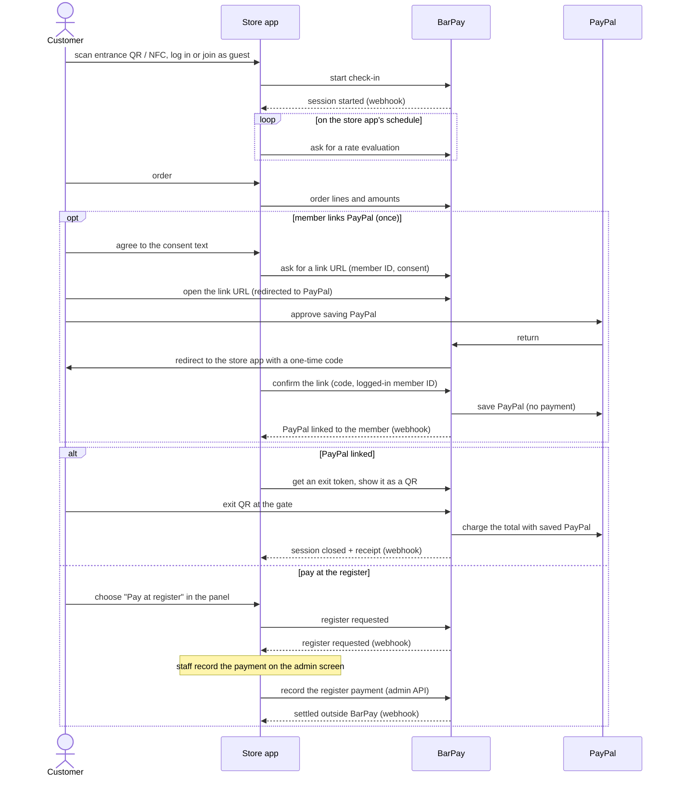
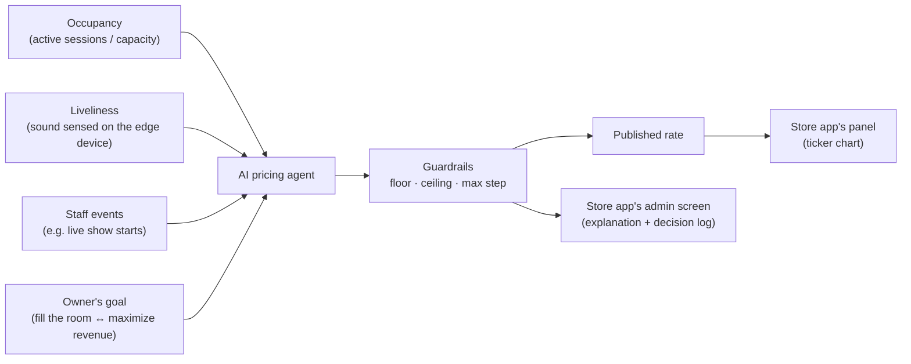
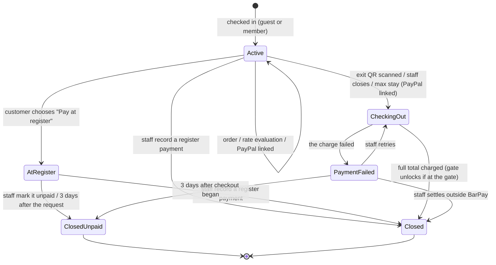
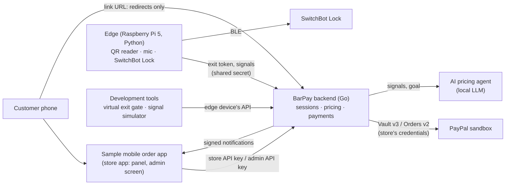

# PRD — BarPay

`PRD.ja.md` is the Japanese translation of this file.

## 1. Purpose

BarPay is a payment and pricing module that a bar plugs into its own mobile order system. It adds a cover charge that moves like a stock price with how crowded and lively the room is, and lets a member who linked PayPal settle the whole visit by walking out.

- **Customers** pay a flat cover charge (table charge / *otoshi* in Japan) whether the bar is dead or packed, and often learn about it only on the bill. Foreign visitors in particular find it surprising. They cannot see what they are paying for while they stay, and they queue at the register to leave.
- **Bar owners** cannot lower prices to fill a slow evening or capture value on a packed one. Mobile order systems take orders, but none of them prices the cover charge by demand or lets the customer simply walk out.
- **Mobile order system developers** would have to build demand pricing and walk-out settlement themselves.

BarPay solves this as a module: the store keeps its own app, menu, members and screens; BarPay adds the live cover charge, an optional PayPal link for members that turns the exit QR into the checkout on every visit, and a register path for everyone else, paid into the store's own PayPal account. BarPay has no screens of its own: it offers an API and signed notifications, and the store app decides what to show and when to call BarPay.

## 2. Users

| User | Goal |
|---|---|
| Customer | Enter, drink and eat, see what they are paying, and leave by walking out (a member with PayPal linked) or by paying at the register |
| Store app | The store's mobile order system (here: the sample app). Starts visits, reports orders, asks for rate evaluations, draws every screen (the customer's panel and the staff's admin screen), and learns how each visit was settled |
| Staff / owner | Watch the room's state and handle the exceptions on the store app's admin screen; the owner sets prices, limits and cover-charge rules there |

## 3. Responsibilities

BarPay owns what is about the cover charge and the money; the store app owns everything about the menu, the customer relationship and the screens.

| BarPay | Store app |
|---|---|
| Visits (sessions): check-in, stay, checkout, register settlement | The entrance landing reached from the store's QR / NFC tag, login or guest join |
| The cover charge and its AI pricing, evaluated when the store app asks | Menu, order screen, kitchen; item prices and order contents; when to ask for a rate evaluation |
| PayPal: saving a member's PayPal (optional), the checkout charge, deleting it when the member asks | Members and login; the settings screen where a member links or deletes their PayPal, with the consent shown before linking |
| Sending the member to PayPal approval and handling the return, without showing a page | Where the customer goes before and after PayPal |
| Exit tokens and the decision to unlock the exit gate | The panel: rate ticker, running total, the Pay button with the choice of PayPal (exit QR) or register |
| The data and operations for running the room, through the admin API | The admin screen and the authentication of its staff |
| Signed notifications of every result | Receipts and history in its own UI (from BarPay's results) |

Read: checking in needs no PayPal; a member approves PayPal once, and every later visit uses it without asking; the store app and BarPay talk server to server, and the customer's browser passes through BarPay only on its way to and from PayPal.

Boundary rules:

- **Check-in**: the store app starts a check-in from its server; the session starts at once and its ID is returned.
- **PayPal link**: linking belongs to a member, not to a visit, and guests cannot link. Before linking, the store app shows the member that the visit's total will be charged at checkout without asking again, and asks BarPay for a link URL for the logged-in member, naming the version of the consent text it showed. The member opens the URL as a full page, never inside a frame, because PayPal approval is not expected to run inside an embedded frame (believed, not verified). A link URL works for 30 minutes, and a new request replaces an earlier unused one. BarPay shows no page: it redirects the browser to PayPal, and when PayPal returns, it checks the approval and redirects the browser to the store app with a one-time code. The return carries only the result, the one-time code and the store app's own `state` value, never a PayPal token, and BarPay's redirects send no referrer. The store app binds `state` to the browser session that asked for the link, so the member must approve in the same browser where they are logged in. The link is saved only when the store app's server, after checking that `state` belongs to that browser session, confirms it with the code and the logged-in member's ID, and only if that is the member the link URL was made for. When a member with a saved PayPal checks in, BarPay links the session by itself.
- **Rate evaluation**: the store app asks BarPay to evaluate the rate on its own schedule (the sample app: every 5 minutes). BarPay does not evaluate on its own and does not know the store's opening hours.
- **Lookup**: the store app can read, at any time, a session's state, totals, rate history over the visit and receipt by its ID; whether a member has a saved PayPal by the member ID; and the published rate. This is how it draws the panel, confirms the result when the customer returns, decides whether its settings screen offers linking or deleting, and recovers missed notifications.
- **Admin**: the store app's admin screen uses the admin API to list sessions, read the rate history with its explanations, the decision log, alerts and the notification log, change settings, send staff events, and act on sessions (record a register payment, mark unpaid, close, retry a charge, settle outside BarPay, open the gate by hand). Each admin request names the staff member acting, and BarPay records it. The store app authenticates its own staff. Every list (sessions, decisions, alerts, notifications) is newest first and read a page at a time, each page handing a cursor for the next one the same way; a cursor that is malformed, comes from another list or names nothing in the list is refused, and items added while paging do not shift the pages.
- **Exit token**: for an active linked session, or a session closed (charged, or recorded by staff) within the re-unlock window, the store app's server asks BarPay for the current exit token and shows it only to that session's customer as a QR. The token changes at a fixed interval until the session closes, and works only at the exit gate.
- **Notifications**: the events are `session.started`, `session.paypal_linked`, `session.register_requested`, `session.closed`, `session.payment_failed`, `session.settled_outside`, `session.closed_unpaid`, `gate.unlock_failed`, and for members `member.paypal_linked` and `member.saved_paypal_deleted`. Each carries an event ID and a sequence number per session (per member for `member.*` events) and is signed. Notifications go to the notification URL in the config file, which uses https except for http to a loopback IP address ([UC8](#uc8--store-connects-to-barpay)). A notification not acknowledged is retried 1 minute, 5 minutes, 30 minutes, 2 hours, 6 hours, 12 hours and 24 hours after the first attempt; after that it is marked as given up in the notification log and raised as an alert. Only a 2xx answer acknowledges a notification; a redirect is not followed. The retry times are counted from the stored time of the first attempt, so a restart keeps them. If one or more of them passed before BarPay could send (it was stopped, or still sending earlier notifications), it sends the notification once as soon as it can, not once per missed time, and goes on with the next retry time still ahead; if the last one (24 hours) passed that way, that attempt is the last, and the notification is given up if it is not acknowledged. A notification stored just before BarPay stopped is first sent when it starts again. A session ends with exactly one of `session.closed` (checked out through BarPay: charged, or a total of 0), `session.settled_outside` (staff recorded a register or outside payment) or `session.closed_unpaid`, and that event carries the receipt.
- **Panel**: the store app's own screen. BarPay gives it, through lookup, the live rate, its change and history, whether the cover charge is paused or capped, time stayed, cover charge so far, orders, payment method (PayPal or register), the running total and, after checkout, the result. Pay opens a choice: PayPal (shown only when linked) shows the exit QR; "Pay at register" asks BarPay to fix the total for staff to collect.
- **API keys**: the store app calls BarPay only from its server, with the store API key for customer-facing calls and a separate admin API key for admin calls; the sample app has a backend that holds both.

## 4. Pricing model

The cover charge is a **rate per hour** that changes over time, charged in **blocks**: every block (settings, default 10 minutes) after check-in, the block that just ended is charged at the rate published at that moment.

The AI decides the rate toward the owner's goal; guardrails set by the owner decide what can actually be charged.

- **Signals**: occupancy and liveliness (the author's core inputs), plus staff events. Occupancy is the number of active sessions divided by capacity (config file), at most 1 (full): it counts checked-in phones, not people (this may change with [Open question 1](#12-open-questions)). Only active sessions are counted, not those checking out, at the register, whose payment failed, closed or closed unpaid: one at the register or whose payment failed can stay so for up to 3 days, after the customer may have left, and one checking out is a customer on the way out. Liveliness is computed on the edge device from the microphone, and only numbers leave the device; without the edge device there is no liveliness signal, and in development the signal simulator supplies it. Liveliness is one number from 0 (quiet) to 1 (loudest), sent about every 10 seconds; BarPay uses the last value it received for 1 minute after receiving it. From exactly 1 minute on there is no liveliness signal, as without the edge device, so a stopped edge device does not leave an old value in use. Staff events come from the store app's admin screen through the admin API, each with a label and a phase (starts or ends). An evaluation uses the events going on: the labels whose last event, in the order BarPay recorded them, is starts. An ends with the same label, compared exactly, takes it out, so a live show that has ended no longer raises the rate; an event whose ends was never sent stays in the decision log's inputs, where staff can see it.
- **Goal**: the owner sets where the store sits between "fill the room" and "maximize revenue". The agent states how each decision serves that goal.
- **Evaluation on request**: the rate is re-evaluated only when the store app asks. BarPay runs at most one evaluation at a time and at most one per minimum interval (config file): a request that arrives while an evaluation is running gets that evaluation's result, and a request sooner than the minimum interval after the last one returns the current rate without a new evaluation.
- **First rate**: when no rate is published in the store's currency (the first start, and the start that applies a currency change), BarPay publishes the starting rate from the config file at start, with a change of 0, so check-in works before the first evaluation. Every other start keeps the rate last published: going back to the starting rate would move the rate without an evaluation, beyond the max step. The rate history holds only the store's current currency; rates from before a currency change are not part of it.
- **Guardrails** (settings): floor, ceiling, and maximum change per evaluation (the max step: an amount of rate per hour, in the config file). A proposal is clamped into the floor and ceiling and to within the max step of the published rate, then rounded to the nearest multiple of the currency's rate step (fixed: 10 JPY, 0.05 USD), a tie going toward the published rate. The floor, ceiling, starting rate and max step are multiples of the rate step, so rounding never leaves the range or goes beyond the max step. Were the published rate ever further outside the range than the max step, the range would win. When the owner changes the floor or ceiling and the published rate falls outside the new range, the rate moves to the nearer bound at once, even beyond the max step, and the decision log records it with the staff member and an explanation BarPay writes from the change (no AI takes part). A change that leaves the published rate inside the new range publishes no rate and records nothing.
- **Explanation**: each published rate carries a short, plain-English reason that states the change actually published, after clamping (e.g. "Room is half empty — rate down $0.50 to $11.50/h."). Only the reason comes from the AI; BarPay writes the direction, the amount and the new rate from the rate it published, because a number the AI writes can be clamped away. When the guardrails leave the rate where it was, the explanation says so (e.g. "Steady room — rate unchanged at $12.00/h."). A fallback's explanation says why the rate was kept. It is readable through the admin API only; the customer sees the rate, its change and its chart.
- **Decision log**: every evaluation's inputs, the agent's proposal and reasoning, and the published rate, and every floor or ceiling change that moved the rate, are kept and readable through the admin API.
- **Fallback**: if the AI does not answer in time, or its answer cannot be read as a rate, the rate stays at its last value and the log says so.
- **Blocks**: a block's amount is the rate × block length, rounded down to the currency's smallest unit (1 JPY, 0.01 USD), and is fixed when the block ends; it never changes afterwards. A rate published exactly when a block ends is that block's rate. Check-in itself costs nothing, and a block that has not ended when checkout begins (or the register is requested) is not charged; a block ending exactly then has ended and is charged.
- **Pause for additional orders**: the first order of a visit does not count (one-drink rule). Each later order, counted by order and including food, pauses the cover charge for a set time (settings, default 30 minutes, 0 turns it off) from that order; a new order restarts the pause rather than adding to it. A block that ends during a pause costs 0. A pause includes the instant of its order and ends just before the pause time has passed: a block ending exactly when an order is placed costs 0, and a block ending exactly when a pause ends is charged.
- **Cap per visit** (settings, default ¥3,000 / $30, 0 for none): a limit on the cover charge only; orders do not count toward it. The block that reaches the cap is charged only up to the cap, and later blocks cost 0.
- **Settings changes**: settings are changed through the admin API. Block length, pause and cap apply to active sessions from their next block: each block uses the settings in effect when it starts, so a change made exactly when a block ends applies to the block starting then, not to the one ending. A cap lowered below what a session has already accrued stops further blocks; nothing already accrued is reduced.
- **Time**: every duration in this document is real time.

## 5. Payment model

Linking PayPal is optional and moves no money: it saves a member's PayPal for this store, and the whole visit is charged once, at checkout.

| Moment | What happens in PayPal |
|---|---|
| Check-in | For a member with a saved PayPal, BarPay checks that it still works; nothing else |
| Link PayPal (members only, optional) | The member approves saving their PayPal for merchant-initiated charges; once the store app confirms the link, BarPay keeps it under the member ID. No payment is made |
| Stay | Nothing. Orders and cover charge are recorded by BarPay |
| Checkout, total = 0 | Nothing is charged |
| Checkout, total > 0 | The total is charged once with the saved PayPal, without the customer's approval; the gate unlocks only after it succeeds |
| After checkout | Nothing. The member's saved PayPal is kept for later visits until they delete it (UC9) |

- The **running total** = orders + cover charge so far.
- A guest, a member without a saved PayPal, or anyone who chooses the register pays at the register. BarPay fixes the total, staff take the money outside BarPay and record it through the store app's admin screen, and the session is closed as settled outside BarPay.

## 6. Guarantees

| Area | BarPay guarantees |
|---|---|
| Consent | A saved PayPal is kept only for a link request that named the version of the consent text the store app showed, which BarPay records with the saved PayPal; that text says the visit's total is charged at checkout without further approval. It is charged only at checkout. The running total is readable throughout |
| Transparency | While a session is open, BarPay provides through lookup the current rate, its change and history, the cover charge so far, whether it is paused or capped, and the running total. Showing them is the store app's job. The pricing rules before check-in are posted by the store (see [Out of scope](#7-out-of-scope)) |
| Charges only for this visit | BarPay charges a member's saved PayPal only during the checkout of that member's session or a staff retry of it, and staff can retry for at most 3 days after checkout began. A saved PayPal is deleted when the member asks, never while a session that uses it is not yet closed |
| Accuracy | When a session is closed through BarPay checkout, the amount charged equals the final total the server fixed at the moment of checkout, and the receipt shows that total with its PayPal capture ID. When it is settled at the register or outside BarPay, the receipt shows the total and the amount staff recorded; nothing was charged through BarPay |
| Price bounds | The rate is always within the store's floor and ceiling. It never moves more than the max step per evaluation, and evaluations are at least the minimum interval apart, except when the owner changes the floor or ceiling, which the decision log records |
| Single payment | Each session is settled once. A repeated scan, a retry after a network error or timeout, a repeated admin request, or a staff retry never charges the same amount twice. Admin requests that can start a charge carry an idempotency key, and move the session to checking out before PayPal is called, so a concurrent one is rejected. Before retrying a call whose outcome is unknown, BarPay checks its status in PayPal |
| Unlock only on payment | BarPay unlocks the exit gate only for a closed session that was fully charged, or whose payment staff recorded at the register or outside BarPay, and only within the re-unlock window after it closed. Once a session is closed its exit token stops changing. Staff can also open the gate by hand through the admin API |
| Store notified | The store app is notified of every session start, PayPal link, register request and result. Notifications are signed, carry an event ID and a sequence number, and are retried for up to 24 hours, so the store app may receive one more than once or out of order; it can always read the current state by lookup |
| Access | Only the store API key can start check-ins, report orders, read a session by its ID, members and the rate, ask for rate evaluations, request the register, get exit tokens, request and confirm PayPal links and delete a member's saved PayPal. Only the admin API key can list sessions, read the decision log, alerts, notification log and settings, change settings, send staff events, and record, close, retry, settle, mark unpaid or open the gate by hand; each admin request names the staff member acting. A link is saved only for the member it was requested for, confirmed by the store app's server. Checkout is triggered only by an authenticated edge device presenting a current exit token, by an admin request, or by BarPay itself at the maximum stay. An exit token is issued only to the store API key, works only at the exit gate, and is never written to logs. The two keys protect admin actions only as far as the store app keeps the admin key apart; a store backend that holds both can do everything, and the staff member it names is attribution, not authentication |
| Durability | Sessions, orders, settings, the decision log, capture IDs, saved-PayPal references, alerts, the notification log (including notifications not yet delivered), the store app's `Idempotency-Key` records, the history of published rates, and the staff member recorded with each admin request survive a backend restart |
| Privacy | Raw audio (and video, if used) is never stored or sent off the edge device |
| Observability | Failed charges, failed unlocks, register requests, rejected late orders, sessions past the maximum stay, notifications given up and failed deletions are raised as alerts readable through the admin API; failed charges and unlocks are also sent to the store app |

## 7. Out of scope

| Not doing | Why |
|---|---|
| Real-money payments | Charging saved PayPal in production needs PayPal's approval for reference transactions (see [Fixed constraints](#8-fixed-constraints)); everything is built and run in the PayPal sandbox |
| Screens | The store app draws every screen: the panel, the admin screen, and the consent before linking. BarPay provides the data and the operations |
| Authenticating staff | The store app's job. BarPay checks the admin API key and records the staff member the store app names |
| Deciding when to evaluate the rate | The store app's schedule. BarPay evaluates when asked, within the minimum interval |
| Store onboarding screens, more than one store per deployment | One store is set up with a config file; prices and cover-charge rules are changed through the admin API |
| BarPay as a payment intermediary (platform fees, multiparty) | Each store is paid into its own PayPal account |
| Using a saved PayPal across a chain's stores | Future: may work when the stores share one PayPal account; not verified |
| Members and login | The store app's job. BarPay only keeps a member's saved PayPal under the ID the store app gives it (UC2, UC9) |
| PayPal for guests | A saved PayPal needs an owner across visits, so linking needs a store account; guests pay at the register |
| Menu, order screen, kitchen workflow | The store app's job; BarPay records order lines and amounts only |
| Showing the pricing rules before check-in | The store posts them (variable rate, block length, cap per visit) on its website or in the store |
| Taking money at the register | The store's job; BarPay fixes the total and records what staff say they received |
| Cancelling or correcting an order line | Once reported, an order stays in the total; the store refunds through the PayPal dashboard |
| Correctness of what the store app reports | BarPay charges the order amounts the store app reports and trusts the member ID and staff member it sends; checking them, limiting how much a visit may order, and showing each exit token only to its session's customer, is the store app's job |
| Limiting check-ins | The store app decides who may check in, including rate-limiting guest joins |
| Showing the loaded config file | The owner reads the file; the settings in effect are readable through the admin API |
| Notifications after 24 hours of retries | The store app recovers through lookup |
| Collecting a declined charge from a customer who has left | It stays as an unpaid amount readable through the admin API; collecting it is the store's job outside BarPay |
| Splitting a bill within a group | Each phone is its own session; splitting is a separate product |
| Locking in a price at entry | Would undo the stock-like model; the customer is protected by the cap per visit and the running total instead |
| A deposit or holding funds at check-in | The gate opens only after payment, so a customer whose charge fails is still inside and pays at the register; a hold would add a second charge and a pending amount on the customer's statement |
| Refunds and disputes | Handled in the PayPal dashboard |
| Tax calculation | All prices are tax-inclusive |
| Japanese text from BarPay | Explanations and error messages are in English; the language of the screens is the store app's choice. Currency (JPY/USD) is selectable |
| Locking customers in | The door must always open from inside; the lock unlocks an exit gate as part of the walk-through experience, not as a way to stop customers from leaving |

## 8. Fixed constraints

- **Verified in the sandbox (2026-10-28, USD)**: a `CAPTURE` order with only `payment_source.paypal.vault_id` was `COMPLETED` in the create response, without buyer approval. The saved PayPal used then came from an order approval, not from the setup-token flow BarPay now uses; see [Open question 4](#12-open-questions).
- **Verify before trusting**: BarPay's return and cancel URLs carry an unguessable link ID. When the customer returns from PayPal, the backend uses only the setup token stored with that link, ignores any token ID added to the URL, accepts a return once per link, and checks that the setup token was approved. It creates the saved PayPal from that setup token only when the store app confirms the link, and saves it to the member only after that succeeds.
- **Idempotency**: every PayPal call that saves PayPal, moves money or deletes a saved PayPal carries a `PayPal-Request-Id` derived from the session, the step and the attempt, stored before the call. A network retry reuses it; a staff retry starts a new attempt. The checkout charge carries an `invoice_id` per session, which PayPal is expected to reject as a duplicate (not verified; see [Open question 4](#12-open-questions)). When a call's outcome is unknown (timeout), BarPay checks its status before any retry.
- **The store's own PayPal**: BarPay calls PayPal with the store's REST credentials and keeps them as secrets.
- **Approval for saved PayPal**: in production, saving PayPal for merchant-initiated charges needs PayPal's approval for reference transactions. It does not block the sandbox.
- **Currency**: each store picks JPY or USD; all amounts in that store use it. JPY has no decimal places. JPY in the sandbox depends on [Open question 3](#12-open-questions).
- **Clock**: BarPay assumes its server's clock never steps back; keep it synchronized by adjusting it gradually (slewing), never by stepping it. Every amount and time limit is computed from the instants BarPay stored (check-in, orders, published rates, settings changes), so a clock set back could give a rate or an order a time before a block that has already ended and change that block's amount, which the [Pricing model](#4-pricing-model), Blocks forbids.
- **Hardware**: Raspberry Pi 5, a USB QR reader that acts as a keyboard, a SwitchBot Lock over BLE. The lock needs its MAC address, key ID and encryption key, read from environment variables.
- **AI**: the pricing agent runs on a local LLM that the BarPay backend reaches over the network; there is no per-call cost.
- **Secrets**: PayPal credentials, the store API key, the admin API key, the notification signing secret, the edge device's shared secret and the SwitchBot keys never enter the public repository.
- **Working without hardware**: every hardware step has a development tool that stands in for it (virtual exit gate, signal simulator) and uses the edge device's API. The tools hold neither the store API key nor the admin API key, and are not part of a production build.
- **Language**: text BarPay returns, the sample app's UI and the README are in English. Every non-exempt `.md` in the repo has a `.ja.md` translation (see `.claude/skills/bilingual-docs`).

## 9. Use cases

Read: a session only ends through a successful charge, a register payment or settlement that staff record, or being closed as unpaid by staff or at a 3-day limit; neither a payment failure nor a customer's register request closes it. Sessions are never removed.

Staff act through the store app's admin screen, which calls BarPay's admin API.

### UC1 — Customer checks in

- **Precondition**: the BarPay backend is running (a rate is published from start).
- **Main flow**: the customer scans the store's entrance QR code or taps its NFC tag, which opens the store app. They log in or join as a guest; the store app asks BarPay for a check-in and the session starts. The store app is notified and shows its menu and its panel.
- **Alternative flow**: a member with a saved PayPal checks in → the session starts at once; BarPay then checks with PayPal that the saved PayPal still works and links the session. The member does nothing.
- **Exception**: the member's saved PayPal no longer works (deleted by the customer in PayPal, declined) → the session stays unlinked; BarPay deletes the saved PayPal and notifies the store app (`member.saved_paypal_deleted`); the member can link again (UC2) or pay at the register.
- **Exception**: the store API key is missing or wrong → rejected; nothing is created.
- **Exception**: the store app starts the same check-in twice (same idempotency key) → the same session is returned. A member who already has an open session → rejected.
- **Postcondition**: the session is active, linked only if the member has a working saved PayPal, with no cover charge yet; its first block ends one block length after check-in; the store's occupancy count includes it.

### UC2 — Member links PayPal

- **Precondition**: the customer is logged in to the store app as a member and has no saved PayPal.
- **Main flow**: in the store app's settings, the member chooses to link PayPal and agrees to the consent text that the visit's total is charged at checkout without asking again. The store app asks BarPay for a link URL for that member, naming the consent version, and opens it as a full page. BarPay redirects the member to PayPal, where they approve saving PayPal for this store. PayPal returns the member to BarPay, which checks the approval and redirects them to the store app with a one-time code. The store app's server confirms the link with the code and the logged-in member's ID; BarPay saves PayPal under that member ID. If the member has an active session, it becomes linked at once; otherwise the next check-in uses it (UC1). The store app is notified.
- **Exception**: the customer is a guest → the store app does not offer linking and says that it needs an account; BarPay rejects a link request without a member ID.
- **Exception**: the member already has a saved PayPal, or its deletion is still pending → rejected.
- **Exception**: the store app asks to return the member to a URL outside its origin (config file) → rejected; no link URL is created.
- **Exception**: the member opens the link URL after it stopped working → nothing is saved; the member is returned to the store app and can start again.
- **Exception**: the member cancels in PayPal → nothing is saved; the member is returned to the store app and can try again later or pay at the register.
- **Exception**: the setup token was not approved → nothing is saved; the member is returned to the store app with the failure and can try again.
- **Exception**: the store app confirms with a code that is unknown, already used or expired, or with a member ID other than the one the link URL was made for → rejected; nothing is saved, and the code cannot be used again.
- **Exception**: the return reaches a browser session other than the one that asked for the link (`state` does not match) → the store app does not confirm; nothing is saved.
- **Exception**: the member closes the tab after approving, or the store app never confirms → nothing is saved; linking again starts over.
- **Exception**: saving PayPal fails at confirmation → nothing is saved; the store app shows an error and the member can try again.
- **Exception**: the member's session is no longer active (at the register, checking out, closed) → the saved PayPal is kept for the next visit; that session is not linked.
- **Postcondition**: the member has a saved PayPal with the consent version recorded; an active session of theirs is linked; no money has moved.

### UC3 — Customer stays and watches the price

- **Precondition**: the session is active.
- **Main flow**: the store app's panel shows, from BarPay's lookup, the rate as a stepped ticker chart over the visit, its latest change, time stayed, the cover charge so far, the orders' total, the payment method and the running total. While a pause or the cap applies, the panel says so.
- **Exception**: the session reaches the maximum stay (config file, default 12 hours) → if PayPal is linked, it is checked out as in UC5 without the gate, and the customer can check in again; if not, it stays active and BarPay raises an alert so staff can speak to the customer.
- **Postcondition**: the cover charge equals the sum of the ended blocks' amounts since check-in, with blocks in a pause or after the cap counted as 0.

### UC4 — Store app reports an order

- **Precondition**: the session is active.
- **Main flow**: the customer orders in the store app; the store app sends BarPay the order lines and amounts. BarPay adds them to the session. From the second order of the visit, the cover charge pauses as in the [Pricing model](#4-pricing-model).
- **Exception**: the session is not active (at the register, checking out, payment failed, closed, closed unpaid) → rejected and raised as an alert; anything already served is collected by the store outside BarPay.
- **Exception**: no session has the ID → rejected; no alert is raised, since there is no customer for staff to see to, and requests with made-up IDs cannot fill the alerts.
- **Exception**: the same order is reported twice (same order ID) → recorded once, and the pause is not restarted; this holds even after the session is no longer active.
- **Exception**: an order ID already recorded comes with different lines → rejected; the recorded order stays as it was.
- **Exception**: an amount is negative or in another currency → rejected.
- **Exception**: with the order, the running total would be above 9,000,000,000,000,000 in the currency's smallest unit, which leaves room under the largest total BarPay holds (the API spec's `Total`) for the cover charge that accrues afterwards → rejected; nothing is recorded.
- **Postcondition**: the running total includes the order.

### UC5 — Customer checks out at the exit gate

- **Precondition**: the session is active and PayPal is linked.
- **Main flow**: the customer taps Pay in the store app's panel and chooses PayPal. The store app gets the session's exit token from BarPay and shows it as a QR, getting a new one each time it changes (config file, default every 30 seconds), so an old screenshot does not work. The customer shows the QR to the reader at the exit. The server fixes the final total at that moment and stops the cover charge, charges the total once with the saved PayPal as in the [Payment model](#5-payment-model), and unlocks the gate. The store app is notified with the receipt and shows the result.
- **Alternative flow**: the same exit QR is scanned again within the re-unlock window (config file, default 2 minutes) after success → the gate unlocks again; nothing is charged.
- **Exception**: the session has no PayPal linked → no exit token is issued, and a scanned token for it is rejected; the reader shows "Please pay at the register"; nothing is charged.
- **Exception**: the charge fails or is declined → the gate stays locked, the customer sees "Please see staff", the session becomes PaymentFailed with the unpaid amount, an alert is raised, and the store app is notified.
- **Exception**: a PayPal call times out → BarPay checks its status in PayPal before doing anything else; the gate stays locked until the outcome is known.
- **Exception**: the charge succeeds but unlocking fails → the payment stands; an alert is raised and the store app is notified so staff can open the gate by hand.
- **Exception**: the exit token is unknown or expired, belongs to a session closed longer ago than the re-unlock window, or belongs to a PaymentFailed session → rejected, nothing charged, the gate stays locked.
- **Exception**: two scans of the same QR arrive at the same time → only one checkout runs; both get the same result.
- **Postcondition (on success)**: total charged = final total on the receipt; the session is closed; the cover charge has stopped; the member's saved PayPal is kept.

### UC6 — Customer pays at the register

- **Precondition**: the session is active, with or without PayPal linked.
- **Main flow**: the customer taps Pay in the store app's panel and chooses "Pay at register"; the store app asks BarPay for it. BarPay fixes the final total, stops the cover charge, sets the session's payment method to register, marks the session as waiting at the register, raises an alert and notifies the store app. At the register, staff take the money and record it on the store app's admin screen. The session is closed as settled outside BarPay, the store app is notified (`session.settled_outside` with the receipt), and within the re-unlock window the store app can get an exit token that opens the gate.
- **Alternative flow**: the customer goes straight to the register → staff record the payment from the session list; the total is fixed at that moment.
- **Alternative flow**: staff record an amount different from the total → the receipt shows both; BarPay charges nothing for the difference.
- **Exception**: the customer leaves after choosing the register without paying → staff mark the session unpaid, or it is closed as unpaid 3 days after the request. Either way the unpaid total is recorded and nothing is charged to PayPal. The limit falls at exactly 3 days after the request: from that instant staff can no longer record a payment or mark the session unpaid, and it is closed as unpaid; until just before it, they can.
- **Exception**: the customer wants to pay with PayPal after choosing the register → the request cannot be withdrawn; they pay at the register. The maximum stay no longer applies, because the cover charge has stopped.
- **Postcondition**: the session is closed; the receipt shows the total and the amount recorded at the register; nothing was charged through BarPay.

### UC7 — Staff run the room

- **Precondition**: the store app has authenticated the staff member on its admin screen and holds the admin API key.
- **Main flow**: the admin screen, designed by the store app, uses the admin API to show every session with check-in time, stay, number of orders, running total, payment method (PayPal or register), state and any pause or cap; the rate history with explanations and the decision log; alerts and the notification log; and the settings: floor and ceiling, block length, pause for additional orders, cap per visit and the pricing goal. Staff can send staff events (e.g. a live show), and the store app can ask for an evaluation at once (store API key).
- **Alternative flow**: a linked customer leaves through another door or has no battery → staff close the session, which checks out as in UC5 without the gate.
- **Alternative flow**: staff record a register payment as in UC6, or mark a session waiting at the register as unpaid when the customer left without paying.
- **Alternative flow**: staff open the gate by hand after a failed unlock.
- **Alternative flow**: staff change a setting → it applies as in the [Pricing model](#4-pricing-model). Floor and ceiling above 0 and multiples of the currency's rate step (see [Guardrails](#4-pricing-model)) with the floor below the ceiling, a block of at least 1 minute, and a pause or cap of 0 or more are required; otherwise the change is rejected.
- **Exception**: a session is PaymentFailed → staff retry, which charges the total again with the saved PayPal as a new attempt; or staff mark it settled outside BarPay with the amount settled, which closes the session.
- **Exception**: a PaymentFailed session reaches 3 days after checkout began → retries stop, it is closed as unpaid with the unpaid amount recorded. As for the register (UC6), the limit falls at exactly 3 days after checkout began: from that instant staff can no longer retry or settle outside BarPay, and the session is closed as unpaid; until just before it, they can.
- **Exception**: the same close or retry request arrives twice (same idempotency key) → it runs once: a repeat after it finished gets the same result, and one that arrives while it is still running is rejected and can be sent again.
- **Postcondition**: every admin action is recorded with the staff member the store app named.

### UC8 — Store connects to BarPay

- **Main flow**: the owner sets, in a config file loaded at start: the store's PayPal REST credentials, the store API key, the admin API key, the store app's notification URL and signing secret, the store app's origin (the only place BarPay returns members to after linking), the edge device's shared secret, currency (JPY/USD), the starting rate, max step, minimum evaluation interval, the local LLM's address and model, capacity, maximum stay, re-unlock window, exit token refresh interval, and the starting values of the settings.
- **Config file**: TOML, read from `barpay.toml` in the working directory unless BarPay is started with `-config <path>`; git ignores that name, and `barpay.example.toml` in the repository lists its keys with no secret values. It also sets the address BarPay listens on and its database file. Amounts are integers in the currency's smallest unit (cents for USD); durations, except the settings' block and pause in minutes, are written like `30s` or `12h`. The max step is an amount of rate per hour, like the starting rate (`max_step = 300` is $3.00 per hour), not a share of the current rate. A value whose default this document states may be left out; every other value is required.
- **Exception**: starting floor not below starting ceiling, starting rate outside them or not a multiple of the rate step, a max step below the rate step, not a multiple of it or above the largest amount, maximum stay of 3 days or more, starting settings that a change through the admin API would reject (UC7), missing credentials (PayPal, the store API key, the admin API key, the edge device's shared secret, the signing secret), two of the store API key, the admin API key and the edge device's shared secret being the same, or an unknown key in the file, a required value missing, or a value of the wrong form → BarPay does not start, and says why without showing any secret value.
- **Exception**: the notification URL does not use https, other than http to a loopback IP address written as one (`127.0.0.0/8` or `::1`) → BarPay does not start, and says why. Plain http to a name such as `localhost` is refused. Notifications carry receipts, and the signature stops forgery and tampering but not reading in transit; loopback traffic never leaves the machine, which running BarPay and the store app on one machine needs, while a name can resolve elsewhere and an IP address can be judged when the file is read.
- **Exception**: the currency is JPY → BarPay does not start, and says JPY is not supported yet. JPY is planned in P1 (see [Priorities](#11-priorities)).
- **Exception**: currency changed while sessions are open → BarPay starts with the previous currency, keeping its published rate and the max step it ran with, raises an alert, and applies the change at the first restart with no open session.
- **Postcondition**: BarPay runs with the config file's values; a rate is published: the starting rate on the first start and on the start that applies a currency change, otherwise the rate last published (see [First rate](#4-pricing-model)); the settings hold the values last saved through the admin API, or the starting values on first start and on the start that applies a currency change (the previous currency's floor, ceiling and cap mean nothing in the new one).

### UC9 — Member deletes their saved PayPal

- **Precondition**: the member has a saved PayPal.
- **Main flow**: the member deletes it in the store app's settings; the store app asks BarPay, which deletes it in PayPal. The store app is notified.
- **Exception**: a session that uses it is not yet closed → rejected; the store app says it can be deleted after paying.
- **Alternative flow**: PayPal does not confirm the deletion at once → BarPay accepts the request and retries until PayPal confirms. Until then the saved PayPal shows as being deleted: the member cannot link again and a check-in starts unlinked. The store app is notified when the deletion is confirmed; a deletion that keeps failing is raised as an alert.
- **Postcondition**: the member has no saved PayPal; their next check-in starts unlinked, and linking again goes through PayPal approval (UC2).

## 10. System overview

Read: only the BarPay backend talks to PayPal and the AI; the store app reports orders and draws every screen from its server's calls, and the customer's phone never sends amounts BarPay trusts.

Implementation notes:

- Linking creates a setup token with `POST /v3/vault/setup-tokens` (`payment_source.paypal` with `usage_type: MERCHANT` and `experience_context` return and cancel URLs back to BarPay), and when the store app confirms the link, creates the saved PayPal with `POST /v3/vault/payment-tokens` from that setup token.
- At check-in, a member's saved PayPal is checked with `GET /v3/vault/payment-tokens/{id}`.
- The checkout charge is an order with intent `CAPTURE`, `payment_source.paypal.vault_id` and an `invoice_id`.
- A member's saved PayPal is deleted, on request, with `DELETE /v3/vault/payment-tokens/{id}`.
- The edge device reads the USB QR reader through the input device (`evdev`), not `stdin`, so it works as a background service.

## 11. Priorities

| Priority | Scope |
|---|---|
| P0 — must ship | BarPay: UC1–UC7 and UC9 with retry and "settled outside BarPay"; UC8 as a config file; the store API with session, member and rate lookup; the PayPal link with redirects and confirmation; the admin API; signed notifications with simple retries; AI pricing on request with goal, guardrails, explanations and decision log; cover charge in blocks with the pause and the cap; USD; development tools (virtual exit gate, signal simulator). Sample app with its own backend: entrance landing, sign-up, login and guest join, menu, ordering, settings with consent and PayPal link, panel, admin screen, rate evaluation requests every 5 minutes, receipt. README with an API table |
| P1 | Real edge device: QR reader → checkout → SwitchBot unlock, microphone liveliness; JPY (after Open question 3) |
| P2 | Store onboarding screens; saved PayPal across a chain's stores; AI suggestions beyond pricing (e.g. a summary of the stay on the receipt) |

## 12. Open questions

Questions 1 and 2 are decided after building a mock in `mock/`. The mock is a throwaway prototype in plain HTML, CSS and JavaScript only, is not part of the product, and is not tracked in git, so it never reaches the public repository. Its UI is Japanese, for the author. It is exempt from translation pairing and from the product's tests and CI.

1. **Liveliness sensing**: microphone loudness only, or an on-device audio classifier (cheering, music, laughter)? Camera people-count as well (which would change how occupancy is counted)? The mock can stand in with browser microphone loudness.
2. **Exit gate framing**: what the lock physically secures, so BarPay does not read as "customers are locked in".
3. **JPY in the sandbox**: confirm a sandbox business account can receive JPY without holding it as pending.
4. **Untested PayPal behavior**: saving PayPal with a setup token and no payment, then charging with that `vault_id` without buyer approval; creating the saved PayPal some minutes after the approval (when the store app confirms); checking a saved PayPal by ID; deleting a saved PayPal; replaying a `PayPal-Request-Id`; a declined charge; and whether a staff retry after a declined charge is rejected as a duplicate `invoice_id`.
5. **Local LLM model and prompt approach**: chosen at implementation time; it must answer within the evaluation's time limit on the hardware BarPay runs with.
